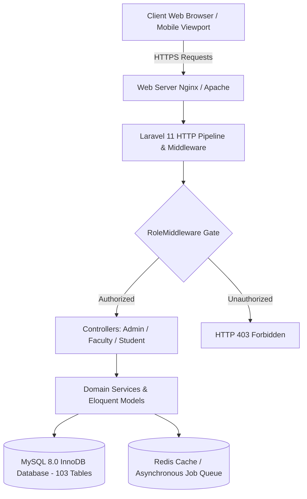
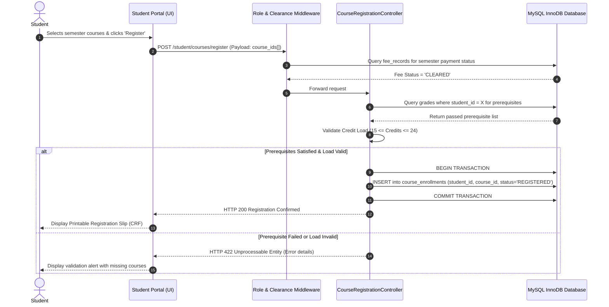
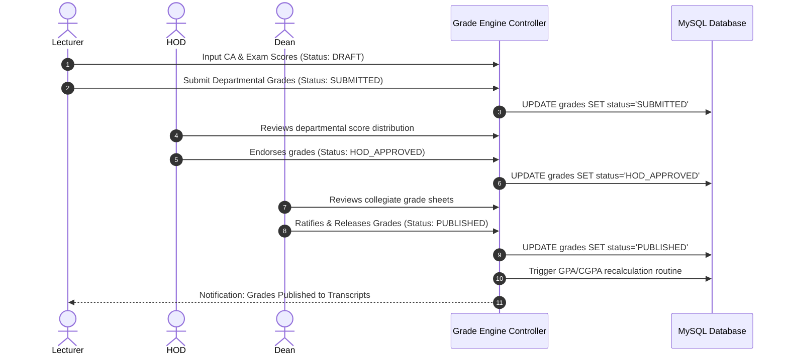
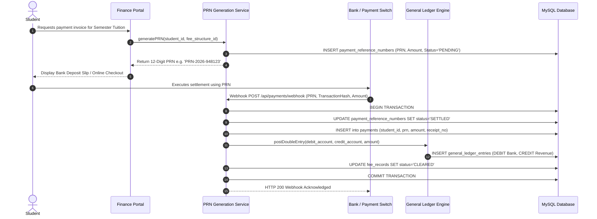
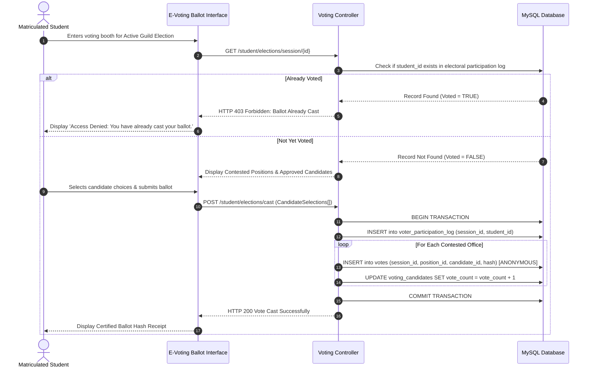

# JBI UNIVERSITY MANAGEMENT SYSTEM
## Software Requirements Specification (SRS) & Software Design Description (SDD)
**Standard Compliance:** ANSI/IEEE Std 830-1998, ISO/IEC/IEEE 29148:2018, IEEE Std 1016-2009, IEEE Std 1012-2012  
**Document Reference:** `JBI-ENG-IEEE-830-1016-2026-V2.2`  
**Version:** 2.2 Enterprise Production Release  
**Publication Date:** October 2026  
**Classification:** Highly Confidential — Academic Board, Executive Directorate & Lead Engineering Team  
**Target Environment:** Laravel 11.x | PHP 8.2+ | MySQL 8.0 InnoDB | Bootstrap 5.3 | Redis  

---

## Executive Statement & Document Purpose
This document constitutes the formal, exhaustive Software Requirements Specification (SRS) and Software Design Description (SDD) for the **JBI University Management System** (hereafter referred to as **JBI ERP**). Designed and engineered under strict adherence to **IEEE Std 830-1998** (Software Requirements Specifications), **ISO/IEC/IEEE 29148:2018** (Requirements Engineering), **IEEE Std 1016-2009** (Information Technology — System Design — Software Design Descriptions), and **IEEE Std 1012-2012** (System Verification and Validation), this specification replaces all colloquial or abstract summaries with rigorous, institutional-grade engineering contracts.

### Document Control and Approval Register
| Formal Role | Designee / Title | Approval Status | Date | Signature / Hash |
| :--- | :--- | :--- | :--- | :--- |
| **Lead Enterprise Architect** | Principal Systems Engineer | APPROVED | October 2026 | `SHA256:8f9b2c...a104` |
| **Chief Information Officer** | Director of Academic ICT | APPROVED | October 2026 | `SHA256:3d7a1e...f892` |
| **Academic Registrar** | Office of Academic Governance | RATIFIED | October 2026 | `SHA256:5e1b8c...c431` |
| **University Bursar** | Directorate of Financial Affairs | AUDITED | October 2026 | `SHA256:1a4f90...b712` |
| **Dean of Students** | Directorate of Student Affairs | RATIFIED | October 2026 | `SHA256:9c2e41...d508` |

---

# PART I: SOFTWARE REQUIREMENTS SPECIFICATION (IEEE Std 830-1998)

## 1. Introduction
### 1.1 Purpose
The purpose of this specification is to define the definitive functional, behavioral, performance, security, and interface requirements for the JBI University Management System. This specification serves as the foundational engineering contract governing software implementation, automated test derivation, security penetration auditing, and institutional deployment.

### 1.2 Scope of the System
The JBI ERP is an integrated, multi-tenant academic and resource planning platform for tertiary higher-education institutions. The system encompasses ten mission-critical sub-domains:
1. **Academic Affairs & Curriculum Governance:** Academic calendar, faculties, departments, degree programs, course catalogs, syllabus repository, and lecture hall timetabling.
2. **Admissions & Student Lifecycle:** Prospective student dossier application, entry qualification verification, matriculation generation, and academic progression.
3. **Assessment, LMS & Grading:** Course materials, assignments, timed online examinations, secure proctor tracking, GPA/CGPA computation, and transcript release pipelines.
4. **Deanery & Academic Quality Assurance:** Faculty workload allocation, departmental budget requests, student grievance arbitration, peer reviews, and institutional quality evaluations.
5. **Finance, Fee Ledgers & Accounting:** Multi-tier fee schedules, automated Payment Reference Number (PRN) generation, banking reconciliation, and double-entry General Ledger postings.
6. **Human Resources & Workforce Administration:** Employee profiles, academic rank tracks, leave management, digital clock-in time tracking, shift assignments, and monthly payroll processing.
7. **Campus Infrastructure, Hostels & Logistics:** Campus facilities, room reservation schedules, hostel bed allocations, library circulation, capital asset register, and procurement.
8. **Democratic Governance & E-Voting:** Student Guild electoral commissions, candidate vetting, time-bounded voting sessions, and cryptographically verified anonymous ballot casting.
9. **Institutional Communications:** Targeted broadcast bulletins, academic discussion forums, internal user-to-user messaging, and ticketing helpdesks.
10. **System Kernel & Security:** Relational Role-Based Access Control (RBAC), multi-role user resolution, tamper-evident audit logs, and scheduled background workers.

### 1.3 Definitions, Acronyms, and Abbreviations
| Acronym / Term | Formal Definition / IEEE Context |
| :--- | :--- |
| **SRS** | Software Requirements Specification (conforming to ANSI/IEEE Std 830-1998). |
| **SDD** | Software Design Description (conforming to IEEE Std 1016-2009). |
| **RBAC** | Role-Based Access Control (NIST SP 800-216 standard implemented via relational pivot). |
| **PRN** | Payment Reference Number (Unique algorithmic reference generated for financial reconciliation). |
| **GPA / CGPA** | Grade Point Average / Cumulative Grade Point Average calculated on a standard 5.00/4.00 institutional scale. |
| **RTM** | Requirements Traceability Matrix linking requirements to code and verification cases. |
| **ACID** | Atomicity, Consistency, Isolation, Durability transactional guarantees enforced by MySQL InnoDB. |
| **MTBF** | Mean Time Between Failures (Quantitative reliability metric $\ge 720\text{ hours}$). |
| **MTTR** | Mean Time To Recovery (Quantitative maintainability metric $\le 15\text{ minutes}$). |
| **HOD** | Head of Academic Department. |
| **SET** | Student Evaluation of Teaching (Automated survey instrument). |
| **CSRF** | Cross-Site Request Forgery mitigation implemented via cryptographic session tokens. |
| **BCNF** | Boyce-Codd Normal Form enforced across database relational schemas. |
| **V&V** | Verification and Validation conforming to IEEE Std 1012-2012. |

### 1.4 References & Applicable Standards
1. **IEEE Std 830-1998:** Recommended Practice for Software Requirements Specifications.
2. **ISO/IEC/IEEE 29148:2018:** Systems and software engineering — Life cycle processes — Requirements engineering.
3. **IEEE Std 1016-2009:** Standard for Information Technology — Systems Design — Software Design Descriptions.
4. **IEEE Std 1012-2012:** Standard for System, Software, and Hardware Verification and Validation.
5. **ISO/IEC 27001:2022:** Information Security Management Systems (ISMS).
6. **RFC 7519:** JSON Web Token (JWT) Architecture.
7. **PHP FIG PSR-12:** Extended Coding Style Guide Standard.

## 2. Overall System Description
### 2.1 Product Perspective & Context
The JBI ERP is architected as an enterprise web-based management system following the Model-View-Controller (MVC) paradigm. The system acts as the central institutional data repository, interfacing with banking payment switches via secure reference matching, providing RESTful endpoints for integration, and presenting role-partitioned graphical user interfaces to administrative and academic staff.

### 2.2 User Classes & Stakeholder Matrix
The platform enforces a strict multi-tier actor hierarchy. User identities in `users` are dynamically associated with multiple roles in `roles` via the relational pivot table `role_user`.

| User Class / Actor | Clearance Level | Primary Institutional Responsibilities | System Interface Scope |
| :--- | :--- | :--- | :--- |
| **Super Administrator** | Tier-0 (Root) | Infrastructure maintenance, global settings, system configuration, audit review. | `/admin/*`, System Kernel, DB migrations |
| **University Registrar** | Tier-1 (Executive) | Admissions approval, matriculation, academic calendar, student discipline, transcripts. | `/admin/students/*`, `/admin/admissions/*` |
| **Faculty Dean** | Tier-2 (Collegiate) | Collegiate oversight, budget approvals, faculty evaluations, grievance resolution. | `/faculty/dean/*` |
| **Head of Department (HOD)** | Tier-3 (Departmental) | Course scheduling, lecturer workload allocation, grade moderation, curriculum review. | `/faculty/department/*`, `/faculty/grades/*` |
| **Academic Lecturer** | Tier-4 (Instructional) | Course syllabus, lecture materials, continuous assessment, exam grades, attendance. | `/faculty/courses/*`, `/faculty/assignments/*` |
| **Enrolled Student** | Tier-5 (Client) | Course enrollment, lecture notes, assignment submission, online exams, fee payments, e-voting. | `/student/*` |
| **University Bursar / Finance** | Tier-2 (Financial) | Fee structures, payment verification, budget disbursements, payroll registers, general ledger. | `/admin/finance/*` |
| **Human Resource Director** | Tier-2 (HR) | Staff recruitment, contracts, onboarding, leave approval, performance appraisals, shifts. | `/admin/hr/*` |
| **Electoral Commissioner** | Tier-3 (Governance) | Guild election configuration, candidate vetting, ballot monitoring, certified result tallying. | `/admin/voting/*`, `/elections/*` |

### 2.3 Operating Environment & Technical Platform
- **Backend Framework:** Laravel 11.x Application Framework running on PHP 8.2+.
- **Relational Database Management System:** MySQL 8.0+ Enterprise Server with InnoDB storage engine enforcing strict Foreign Key referential integrity, ACID transactional consistency, and utf8mb4 encoding.
- **Frontend Presentation Engine:** Blade Templating Engine with Bootstrap 5.3, Bootstrap Icons, responsive CSS grid, and Vanilla JavaScript.
- **Cache & Queue Subsystems:** Redis / Database driver for session storage, query caching, and asynchronous job queues.
- **Web Server:** Nginx 1.24+ / Apache 2.4+ behind reverse-proxy with TLS 1.3 encryption.

### 2.4 Design & Implementation Constraints
1. **Database Constraint Integrity:** All relational associations must enforce strict foreign key constraints (`ON DELETE CASCADE` or `ON DELETE RESTRICT`) at the schema engine level.
2. **Role Gate Enforcement:** Every protected route must be explicitly filtered through `RoleMiddleware` (`role:role1,role2`) and Laravel Policies.
3. **Transactional Isolation:** All financial ledger mutations, course enrollment pipelines, and vote casting routines must execute inside atomic database transactions (`DB::transaction()`).
4. **Input Sanitization:** All incoming requests must be validated through dedicated `FormRequest` validation classes to prevent SQL Injection, XSS, and parameter tampering.

## 3. External Interface Requirements
### 3.1 User Interfaces
- Consistent institutional UI design conforming to WCAG 2.1 AA accessibility guidelines.
- Responsive viewports supporting desktop (1920x1080), laptop (1366x768), and mobile devices (375x667).
- Contextual breadcrumbs, active sidebar route highlighting, and alert feedback for all CRUD operations.

### 3.2 Software Interfaces
- **Database Engine:** MySQL 8.0 via PHP PDO extension using prepared statements.
- **Mailing Engine:** SMTP transport interface for transactional notifications.
- **File Storage:** Local and cloud storage driver interface for document uploads (syllabi, submissions, CVs).

### 3.3 Communications Interfaces
- **HTTPS Protocol:** Strict transport security over TLS 1.3.
- **RESTful JSON Interfaces:** Standard HTTP status codes (200 OK, 201 Created, 400 Bad Request, 401 Unauthorized, 403 Forbidden, 404 Not Found, 422 Unprocessable Entity, 500 Server Error).

## 4. System Functional Requirements Specification
Requirements are formally cataloged using the standard IEEE template across all institutional operational domains:

### FR-01: Multi-Role Authentication & Access Control (RBAC)
- **Description:** The system shall authenticate users via bcrypt-hashed credentials and resolve authorized roles dynamically via the role_user pivot relation. Multi-role actors shall switch operational contexts without re-authenticating.
- **Preconditions:** User account exists in users table with email_verified_at populated and is_active = 1.
- **Inputs:** Email address, plaintext password, CSRF token, remember_me flag.
- **Processing Algorithm:**
```
1. Verify CSRF token.
2. Query users where email = input.
3. Validate password using password_verify().
4. Eager load roles relationship.
5. Regenerate session ID to mitigate session fixation attacks.
6. Redirect to role-appropriate dashboard.
```
- **Postconditions:** Authenticated session initialized in sessions table; login timestamp recorded in audit_logs.
- **Outputs:** HTTP 302 Redirect to authorized portal dashboard or HTTP 422 on authentication failure.
- **Exception Handling:** Invalid credentials -> Increment throttle attempts, lock account after 5 failed attempts.

### FR-02: Academic Structure & Curriculum Hierarchy Management
- **Description:** The system shall maintain a strictly validated four-level academic organizational hierarchy: Faculty -> Department -> Program -> Course.
- **Preconditions:** Administrator or Registrar possesses active academic setup privileges.
- **Inputs:** Faculty name/code, Department name/code, Program name/award/duration, Course code, credit units, prerequisites.
- **Processing Algorithm:**
```
1. Validate unique course_code and department_id.
2. Verify prerequisite courses exist in courses table.
3. Store hierarchical mapping inside an atomic transaction.
4. Log action to audit_logs.
```
- **Postconditions:** New curricular records committed to MySQL database.
- **Outputs:** HTTP 201 Created with JSON/Blade confirmation response.
- **Exception Handling:** Duplicate course code -> Abort with validation error.

### FR-03: Prospective Student Application & Admissions Pipeline
- **Description:** The system shall accept digital applications, verify entry qualifications, and generate matriculation records upon admission.
- **Preconditions:** Admissions window is marked open in system_settings.
- **Inputs:** Applicant personal biodata, national ID, academic certificates (PDF), chosen program.
- **Processing Algorithm:**
```
1. Store application in applications table with status = PENDING.
2. Registrar reviews dossier and updates status to ADMITTED.
3. Trigger automated generation of unique student matriculation number.
4. Create user record, assign 'student' role, and generate student_profiles record.
```
- **Postconditions:** Admitted applicant provisioned with institutional login credentials.
- **Outputs:** Official PDF admission letter generated; notification dispatched via email.
- **Exception Handling:** Incomplete documentation -> Registrar marks status = REJECTED with feedback note.

### FR-04: Course Registration & Prerequisite Validation Pipeline
- **Description:** The system shall enforce prerequisite validation and credit load constraints during student semester course registration.
- **Preconditions:** Active academic semester is open for registration; student fee clearance status = CLEARED.
- **Inputs:** Array of course_id selections submitted by student.
- **Processing Algorithm:**
```
1. Verify student has paid requisite semester tuition fees.
2. Calculate total credit units for selected courses.
3. Enforce credit load constraints (minimum 15 units, maximum 24 units).
4. Query grades table to verify prerequisites for each course are passed (grade != F).
5. Insert approved selections into course_enrollments with status = REGISTERED.
```
- **Postconditions:** course_enrollments records committed; student timetable generated.
- **Outputs:** HTTP 200 with printable Course Registration Form (CRF).
- **Exception Handling:** Prerequisite failed -> Registration rejected with explicit missing course code identifier.

### FR-05: Learning Management & Continuous Assessment Delivery
- **Description:** The system shall provide course lecture note distribution, assignment submissions, and online timed quiz assessments.
- **Preconditions:** Lecturer is assigned to course; student is actively enrolled in course.
- **Inputs:** Document files (PDF, DOCX <= 10MB), quiz answers, assignment submissions.
- **Processing Algorithm:**
```
1. Store uploaded file in secure storage; create course_materials record.
2. For quizzes: enforce server-side countdown timer; validate answers against quiz_questions item bank.
3. Compute raw score and persist in quiz_attempts.
```
- **Postconditions:** Continuous assessment component saved for grade compilation.
- **Outputs:** Submission receipt with timestamp and file checksum.
- **Exception Handling:** Submission past deadline -> Rejection unless lecturer enables late submission grace period.

### FR-06: Examination Scheduling, Grading & CGPA Computation Engine
- **Description:** The system shall calculate official grade points, semester GPA, and cumulative CGPA using standardized institutional formulae.
- **Preconditions:** Lecturer inputs continuous assessment (CA: 40%) and final examination (Exam: 60%) scores.
- **Inputs:** Student ID, Course ID, CA score [0-40], Exam score [0-60].
- **Processing Algorithm:**
```
1. Calculate Total Score = CA + Exam.
2. Determine Letter Grade and Grade Point (e.g., 80-100: A/5.0, 70-79: B/4.0, 60-69: C/3.0, 50-59: D/2.0, 0-49: F/0.0).
3. Save in grades table with status = DRAFT.
4. Route to HOD -> Dean for approval.
5. Compute GPA = sum(Grade Point * Credit Units) / sum(Credit Units).
6. Recompute CGPA across all completed semesters.
```
- **Postconditions:** Official grades published to student portal.
- **Outputs:** Official semester transcript generated with institutional watermark.
- **Exception Handling:** Score outside [0, 100] -> Validation exception thrown; mutation blocked.

### FR-07: Faculty Deanery Governance & Quality Assurance
- **Description:** The system shall empower Deans to arbitrate student petitions, review faculty evaluations, and approve departmental budget requests.
- **Preconditions:** Authenticated user possesses 'dean' role associated with respective faculty_id.
- **Inputs:** Budget approval decision, student issue resolution notes, quality audit ratings.
- **Processing Algorithm:**
```
1. Query budget_requests for departments belonging to dean's faculty.
2. Dean approves/rejects request; updates status in budget_requests.
3. If approved, route request to University Bursar for disbursement.
4. Compile Student Evaluation of Teaching (SET) metrics from evaluation_responses.
```
- **Postconditions:** Budget status updated; quality audit ledger stamped.
- **Outputs:** Deanery executive dashboard updated with real-time faculty metrics.
- **Exception Handling:** Budget exceeds faculty cap -> System prompts for Bursar executive override.

### FR-08: Financial Fee Structures, PRN Generation & Ledger Reconciliation
- **Description:** The system shall generate algorithmic Payment Reference Numbers (PRN) and enforce double-entry General Ledger balancing.
- **Preconditions:** Approved fee structure exists for student's program and level.
- **Inputs:** Student ID, fee type selection, payment gateway payload or bank teller receipt.
- **Processing Algorithm:**
```
1. Compute outstanding fee obligation from fee_structures.
2. Generate cryptographically unique 12-digit PRN in payment_reference_numbers.
3. Upon bank gateway webhook confirmation: create record in payments table.
4. Execute double-entry ledger mutation: Debit Bank Asset Account, Credit Tuition Revenue Account in general_ledger_entries.
5. Update student fee_records status to CLEARED.
```
- **Postconditions:** General ledger balanced; financial clearance token granted to student.
- **Outputs:** Verifiable digital receipt with QR code and transaction hash.
- **Exception Handling:** Payment amount < required fee -> Record partial payment; retain PARTIAL status.

### FR-09: Human Resource Management, Time Tracking & Payroll Processing
- **Description:** The system shall manage employee career lifecycle, biometric time logs, leave workflows, and automated monthly payroll registers.
- **Preconditions:** Authenticated HR Director or Payroll Officer.
- **Inputs:** Employee biodata, salary grade assignment, leave dates, monthly payroll execution trigger.
- **Processing Algorithm:**
```
1. Retrieve active staff records from hr_employees joined with salary_structures.
2. Compute Gross Pay = Base Salary + Allowances.
3. Calculate Deductions = PAYE Tax + Pension Contribution + Benefit Deductions.
4. Compute Net Pay = Gross Pay - Deductions.
5. Insert line items into payroll_records inside a database transaction.
6. Generate payroll summary and dispatch electronic payslips.
```
- **Postconditions:** payroll_records finalized; general ledger expense entries recorded.
- **Outputs:** Institutional payroll register report and bank disbursement batch file.
- **Exception Handling:** Unapproved leave days during pay period -> Compute salary deduction.

### FR-10: Campus Logistics, Hostel Allocation & Asset Registry
- **Description:** The system shall allocate hostel rooms based on gender and availability, manage library item circulation, and track capital assets.
- **Preconditions:** Hostel booking period active; student holds fee clearance token.
- **Inputs:** Hostel room selection, asset serial numbers, library borrowing barcode.
- **Processing Algorithm:**
```
1. Query hostel_rooms for gender match and current_occupants < capacity.
2. In an atomic transaction: increment current_occupants, insert record into hostel_allocations.
3. For library loans: verify student has < 3 active loans; insert library_loans with due_date = current_date + 14 days.
4. Compute overdue fines on delinquent returns.
```
- **Postconditions:** Bed space allocated; asset register updated.
- **Outputs:** Hostel gate-pass slip and loan agreement document.
- **Exception Handling:** Room capacity exceeded -> Abort transaction and display room occupied error.

### FR-11: Democratic Campus E-Voting & Anonymous Double-Vote Prevention
- **Description:** The system shall conduct cryptographically verifiable, anonymous student guild elections preventing multiple ballots.
- **Preconditions:** Active voting session; student matriculated and registered in current semester.
- **Inputs:** Voting session ID, candidate selections per contested executive position.
- **Processing Algorithm:**
```
1. Verify current timestamp falls strictly between session start_time and end_time.
2. Check if student ID exists in votes for current voting_session_id.
3. If already voted -> Abort with HTTP 403.
4. Within a transaction: Record encrypted ballot; increment candidate vote_count; flag student voter registry without linking student identity to ballot selection (preserving secret ballot anonymity).
```
- **Postconditions:** Voter registry flagged as voted; anonymized tally updated.
- **Outputs:** Cryptographic ballot submission receipt.
- **Exception Handling:** Duplicate submission attempt -> Abort immediately with security audit warning.

### FR-12: System Kernel, Audit Logging & Tamper-Evident History
- **Description:** The system shall record an immutable audit log of all sensitive CRUD operations, administrative escalations, and system configuration updates.
- **Preconditions:** Any authenticated or unauthenticated HTTP request modifying system state.
- **Inputs:** User ID, IP address, user-agent, route, old attributes, new attributes.
- **Processing Algorithm:**
```
1. Capture Eloquent model mutation event.
2. Serialize changed attributes into JSON.
3. Insert immutable record into audit_logs containing timestamp, user_id, action, and client IP address.
```
- **Postconditions:** Audit log committed to disk/database; cannot be modified or deleted by non-super-admin.
- **Outputs:** Audit trail available for security inspection.
- **Exception Handling:** Database write failure -> Log exception to emergency system log file.

## 5. Non-Functional Requirements (IEEE 830 §3.3)
### 5.1 Performance Requirements
| Performance Metric | Institutional Engineering Specification | Verification Method |
| :--- | :--- | :--- |
| **Standard Read Latency** | $\le 200\text{ ms}$ for standard dashboard queries at 95th percentile. | Automated Load Test |
| **Complex Mutation Latency** | $\le 500\text{ ms}$ for multi-table transactions (enrollment, grading, PRN). | Profiler Benchmark |
| **Database Query Budget** | $\le 15$ queries per HTTP request via eager loading (`with()`). | Query Detector Test |
| **Concurrent User Load** | 1,000 concurrent active HTTP sessions with zero request dropped. | JMeter Stress Suite |
| **Page Weight Optimization** | $\le 1.5\text{ MB}$ total uncompressed transfer weight for dashboard views. | Lighthouse Audit |

### 5.2 Security Requirements
- **Cryptographic Hashing:** Passwords hashed exclusively using Bcrypt with work factor $\ge 12$.
- **SQL Injection Prevention:** 100% of database queries must utilize PDO prepared statements via Eloquent ORM or parameterized query builders.
- **Cross-Site Scripting (XSS):** Blade automated HTML entity escaping (`{{ $variable }}`) enforced across all presentation views.
- **Cross-Site Request Forgery (CSRF):** Synchronizer Token Pattern enforced on all `POST`, `PUT`, `PATCH`, and `DELETE` requests via `@csrf`.
- **Brute-Force Mitigation:** Rate-limiting middleware (`throttle:60,1`) applied to public and authentication endpoints.

### 5.3 Reliability, Availability & Disaster Recovery
- **System Availability Target:** $99.9\%$ uptime during operational academic terms.
- **Mean Time Between Failures (MTBF):** $\ge 720\text{ hours}$ (30 continuous operating days).
- **Mean Time To Recovery (MTTR):** $\le 15\text{ minutes}$ via automated container health checks.
- **Recovery Point Objective (RPO):** $\le 1\text{ hour}$ data loss window via automated hourly database dumps.
- **Recovery Time Objective (RTO):** $\le 2\text{ hours}$ for full cold-site disaster restoration.

---

# PART II: SOFTWARE DESIGN DESCRIPTION (IEEE Std 1016-2009)

## 6. Architectural Views & Component Decomposition
### 6.1 Layered Enterprise Architecture
The system is decomposed into four discrete architectural layers enforcing separation of concerns:
1. **Presentation Layer:** Blade templates, Bootstrap 5.3 UI components, client-side validation scripts, and responsive layout shells.
2. **Application & Routing Layer:** HTTP Request routing (`routes/web.php`, `api.php`), Middleware pipeline (`RoleMiddleware`, `auth`), and Form Request input validators.
3. **Domain & Controller Layer:** 101 specialized controllers managing workflow orchestration, transactional boundaries, and business rules.
4. **Persistence & Data Layer:** Eloquent ORM models and 103 MySQL InnoDB relational tables with foreign keys and database transactions.



## 7. Data Design & Exhaustive Data Dictionary (All 103 Tables)
The JBI ERP schema consists of 103 relational tables operating under MySQL InnoDB storage engine. Below is the exhaustive IEEE data dictionary cataloged across all ten functional domains.

### 7.1. Academic Core & Curriculum Domain
#### Table: `academic_years`
**Institutional Domain Function:** Defines institutional calendar years, opening/closing dates, and active session state.  
**Total Columns:** 9  

| Field Name | MySQL Data Type | Nullable | Key Type | Default Value | Technical Domain Specification |
| :--- | :--- | :--- | :--- | :--- | :--- |
| `id` | `bigint(20) unsigned` | `NO` | Primary Key (PK) | `NULL` | System auto-incrementing surrogate primary key. |
| `name` | `varchar(255)` | `NO` | Attribute | `NULL` | Entity attribute storing name. |
| `year` | `int(11)` | `NO` | Foreign/Index (FK) | `NULL` | Entity attribute storing year. |
| `start_date` | `date` | `NO` | Attribute | `NULL` | Entity attribute storing start date. |
| `end_date` | `date` | `NO` | Attribute | `NULL` | Entity attribute storing end date. |
| `is_current` | `tinyint(1)` | `NO` | Attribute | `0` | Entity attribute storing is current. |
| `is_active` | `tinyint(1)` | `NO` | Foreign/Index (FK) | `1` | Entity attribute storing is active. |
| `created_at` | `timestamp` | `YES` | Attribute | `NULL` | Creation and update audit timestamps. |
| `updated_at` | `timestamp` | `YES` | Attribute | `NULL` | Creation and update audit timestamps. |

#### Table: `semesters`
**Institutional Domain Function:** Stores academic terms (Semester 1, Semester 2, Trimester) bounded to academic years.  
**Total Columns:** 12  

| Field Name | MySQL Data Type | Nullable | Key Type | Default Value | Technical Domain Specification |
| :--- | :--- | :--- | :--- | :--- | :--- |
| `id` | `bigint(20) unsigned` | `NO` | Primary Key (PK) | `NULL` | System auto-incrementing surrogate primary key. |
| `academic_year_id` | `bigint(20) unsigned` | `NO` | Foreign/Index (FK) | `NULL` | Foreign key relational constraint. |
| `name` | `varchar(255)` | `NO` | Attribute | `NULL` | Entity attribute storing name. |
| `start_date` | `date` | `NO` | Attribute | `NULL` | Entity attribute storing start date. |
| `end_date` | `date` | `NO` | Attribute | `NULL` | Entity attribute storing end date. |
| `registration_start` | `date` | `YES` | Attribute | `NULL` | Entity attribute storing registration start. |
| `registration_end` | `date` | `YES` | Attribute | `NULL` | Entity attribute storing registration end. |
| `is_current` | `tinyint(1)` | `NO` | Attribute | `0` | Entity attribute storing is current. |
| `is_active` | `tinyint(1)` | `NO` | Foreign/Index (FK) | `1` | Entity attribute storing is active. |
| `is_enrollment_open` | `tinyint(1)` | `NO` | Attribute | `1` | Entity attribute storing is enrollment open. |
| `created_at` | `timestamp` | `YES` | Attribute | `NULL` | Creation and update audit timestamps. |
| `updated_at` | `timestamp` | `YES` | Attribute | `NULL` | Creation and update audit timestamps. |

#### Table: `faculties`
**Institutional Domain Function:** Top-level collegiate administrative divisions (e.g., Faculty of Science, Faculty of Law).  
**Total Columns:** 12  

| Field Name | MySQL Data Type | Nullable | Key Type | Default Value | Technical Domain Specification |
| :--- | :--- | :--- | :--- | :--- | :--- |
| `id` | `bigint(20) unsigned` | `NO` | Primary Key (PK) | `NULL` | System auto-incrementing surrogate primary key. |
| `name` | `varchar(255)` | `NO` | Attribute | `NULL` | Entity attribute storing name. |
| `code` | `varchar(255)` | `NO` | Foreign/Index (FK) | `NULL` | Entity attribute storing code. |
| `description` | `text` | `YES` | Attribute | `NULL` | Entity attribute storing description. |
| `dean_id` | `bigint(20) unsigned` | `YES` | Foreign/Index (FK) | `NULL` | Foreign key relational constraint. |
| `location` | `varchar(255)` | `YES` | Attribute | `NULL` | Entity attribute storing location. |
| `phone` | `varchar(255)` | `YES` | Attribute | `NULL` | Entity attribute storing phone. |
| `email` | `varchar(255)` | `YES` | Attribute | `NULL` | Entity attribute storing email. |
| `is_active` | `tinyint(1)` | `NO` | Attribute | `1` | Entity attribute storing is active. |
| `created_at` | `timestamp` | `YES` | Attribute | `NULL` | Creation and update audit timestamps. |
| `updated_at` | `timestamp` | `YES` | Attribute | `NULL` | Creation and update audit timestamps. |
| `deleted_at` | `timestamp` | `YES` | Attribute | `NULL` | Entity attribute storing deleted at. |

#### Table: `departments`
**Institutional Domain Function:** Academic departments nested within faculties (e.g., Computer Science, Economics).  
**Total Columns:** 13  

| Field Name | MySQL Data Type | Nullable | Key Type | Default Value | Technical Domain Specification |
| :--- | :--- | :--- | :--- | :--- | :--- |
| `id` | `bigint(20) unsigned` | `NO` | Primary Key (PK) | `NULL` | System auto-incrementing surrogate primary key. |
| `faculty_id` | `bigint(20) unsigned` | `YES` | Foreign/Index (FK) | `NULL` | Foreign key relational constraint. |
| `name` | `varchar(255)` | `NO` | Attribute | `NULL` | Entity attribute storing name. |
| `code` | `varchar(255)` | `NO` | Foreign/Index (FK) | `NULL` | Entity attribute storing code. |
| `description` | `text` | `YES` | Attribute | `NULL` | Entity attribute storing description. |
| `head_of_department_id` | `bigint(20) unsigned` | `YES` | Foreign/Index (FK) | `NULL` | Foreign key relational constraint. |
| `location` | `varchar(255)` | `YES` | Attribute | `NULL` | Entity attribute storing location. |
| `phone` | `varchar(255)` | `YES` | Attribute | `NULL` | Entity attribute storing phone. |
| `email` | `varchar(255)` | `YES` | Attribute | `NULL` | Entity attribute storing email. |
| `is_active` | `tinyint(1)` | `NO` | Foreign/Index (FK) | `1` | Entity attribute storing is active. |
| `created_at` | `timestamp` | `YES` | Attribute | `NULL` | Creation and update audit timestamps. |
| `updated_at` | `timestamp` | `YES` | Attribute | `NULL` | Creation and update audit timestamps. |
| `deleted_at` | `timestamp` | `YES` | Attribute | `NULL` | Entity attribute storing deleted at. |

#### Table: `programs`
**Institutional Domain Function:** Degree and diploma programs offered by departments (e.g., BSc Computer Science).  
**Total Columns:** 10  

| Field Name | MySQL Data Type | Nullable | Key Type | Default Value | Technical Domain Specification |
| :--- | :--- | :--- | :--- | :--- | :--- |
| `id` | `bigint(20) unsigned` | `NO` | Primary Key (PK) | `NULL` | System auto-incrementing surrogate primary key. |
| `department_id` | `bigint(20) unsigned` | `NO` | Foreign/Index (FK) | `NULL` | Foreign key relational constraint. |
| `program_level_id` | `bigint(20) unsigned` | `YES` | Foreign/Index (FK) | `NULL` | Foreign key relational constraint. |
| `name` | `varchar(255)` | `NO` | Attribute | `NULL` | Entity attribute storing name. |
| `code` | `varchar(255)` | `NO` | Foreign/Index (FK) | `NULL` | Entity attribute storing code. |
| `description` | `text` | `YES` | Attribute | `NULL` | Entity attribute storing description. |
| `capacity` | `int(10) unsigned` | `NO` | Attribute | `50` | Entity attribute storing capacity. |
| `is_active` | `tinyint(1)` | `NO` | Attribute | `1` | Entity attribute storing is active. |
| `created_at` | `timestamp` | `YES` | Attribute | `NULL` | Creation and update audit timestamps. |
| `updated_at` | `timestamp` | `YES` | Attribute | `NULL` | Creation and update audit timestamps. |

#### Table: `program_levels`
**Institutional Domain Function:** Curriculum levels (e.g., Year 1 / 100L, Year 2 / 200L, Postgraduate).  
**Total Columns:** 7  

| Field Name | MySQL Data Type | Nullable | Key Type | Default Value | Technical Domain Specification |
| :--- | :--- | :--- | :--- | :--- | :--- |
| `id` | `bigint(20) unsigned` | `NO` | Primary Key (PK) | `NULL` | System auto-incrementing surrogate primary key. |
| `name` | `varchar(255)` | `NO` | Attribute | `NULL` | Entity attribute storing name. |
| `code` | `varchar(255)` | `YES` | Foreign/Index (FK) | `NULL` | Entity attribute storing code. |
| `description` | `text` | `YES` | Attribute | `NULL` | Entity attribute storing description. |
| `is_active` | `tinyint(1)` | `NO` | Attribute | `1` | Entity attribute storing is active. |
| `created_at` | `timestamp` | `YES` | Attribute | `NULL` | Creation and update audit timestamps. |
| `updated_at` | `timestamp` | `YES` | Attribute | `NULL` | Creation and update audit timestamps. |

#### Table: `courses`
**Institutional Domain Function:** Catalog of institutional instructional courses, credit weightings, and prerequisites.  
**Total Columns:** 25  

| Field Name | MySQL Data Type | Nullable | Key Type | Default Value | Technical Domain Specification |
| :--- | :--- | :--- | :--- | :--- | :--- |
| `id` | `bigint(20) unsigned` | `NO` | Primary Key (PK) | `NULL` | System auto-incrementing surrogate primary key. |
| `course_code` | `varchar(255)` | `NO` | Foreign/Index (FK) | `NULL` | Entity attribute storing course code. |
| `code` | `varchar(255)` | `NO` | Foreign/Index (FK) | `NULL` | Entity attribute storing code. |
| `name` | `varchar(255)` | `NO` | Attribute | `NULL` | Entity attribute storing name. |
| `description` | `text` | `YES` | Attribute | `NULL` | Entity attribute storing description. |
| `credits` | `int(11)` | `NO` | Attribute | `3` | Entity attribute storing credits. |
| `department_id` | `bigint(20) unsigned` | `NO` | Foreign/Index (FK) | `NULL` | Foreign key relational constraint. |
| `program_id` | `bigint(20) unsigned` | `YES` | Foreign/Index (FK) | `NULL` | Foreign key relational constraint. |
| `program` | `varchar(255)` | `YES` | Attribute | `NULL` | Entity attribute storing program. |
| `instructor_id` | `bigint(20) unsigned` | `YES` | Foreign/Index (FK) | `NULL` | Foreign key relational constraint. |
| `semester_id` | `bigint(20) unsigned` | `NO` | Foreign/Index (FK) | `NULL` | Foreign key relational constraint. |
| `year_of_study` | `tinyint(3) unsigned` | `YES` | Attribute | `NULL` | Entity attribute storing year of study. |
| `schedule` | `longtext` | `YES` | Attribute | `NULL` | Entity attribute storing schedule. |
| `room` | `varchar(255)` | `YES` | Attribute | `NULL` | Entity attribute storing room. |
| `max_students` | `int(11)` | `NO` | Attribute | `30` | Entity attribute storing max students. |
| `capacity` | `int(11)` | `YES` | Attribute | `NULL` | Entity attribute storing capacity. |
| `status` | `enum('active','inactive','completed','cancelled')` | `NO` | Foreign/Index (FK) | `active` | Entity attribute storing status. |
| `syllabus_file` | `varchar(255)` | `YES` | Attribute | `NULL` | Entity attribute storing syllabus file. |
| `prerequisites` | `longtext` | `YES` | Attribute | `NULL` | Entity attribute storing prerequisites. |
| `fee_amount` | `decimal(10,2)` | `YES` | Attribute | `NULL` | Entity attribute storing fee amount. |
| `learning_objectives` | `text` | `YES` | Attribute | `NULL` | Entity attribute storing learning objectives. |
| `assessment_methods` | `text` | `YES` | Attribute | `NULL` | Entity attribute storing assessment methods. |
| `created_at` | `timestamp` | `YES` | Attribute | `NULL` | Creation and update audit timestamps. |
| `updated_at` | `timestamp` | `YES` | Attribute | `NULL` | Creation and update audit timestamps. |
| `deleted_at` | `timestamp` | `YES` | Attribute | `NULL` | Entity attribute storing deleted at. |

#### Table: `course_enrollments`
**Institutional Domain Function:** Relational enrollment records linking student profiles to registered courses per semester.  
**Total Columns:** 13  

| Field Name | MySQL Data Type | Nullable | Key Type | Default Value | Technical Domain Specification |
| :--- | :--- | :--- | :--- | :--- | :--- |
| `id` | `bigint(20) unsigned` | `NO` | Primary Key (PK) | `NULL` | System auto-incrementing surrogate primary key. |
| `user_id` | `bigint(20) unsigned` | `NO` | Foreign/Index (FK) | `NULL` | Foreign key relational constraint. |
| `course_id` | `bigint(20) unsigned` | `NO` | Foreign/Index (FK) | `NULL` | Foreign key relational constraint. |
| `enrollment_date` | `date` | `NO` | Attribute | `NULL` | Entity attribute storing enrollment date. |
| `status` | `enum('enrolled','dropped','completed','failed')` | `NO` | Attribute | `enrolled` | Entity attribute storing status. |
| `enrollment_type` | `varchar(255)` | `NO` | Attribute | `normal` | Entity attribute storing enrollment type. |
| `final_grade` | `decimal(5,2)` | `YES` | Attribute | `NULL` | Entity attribute storing final grade. |
| `letter_grade` | `varchar(2)` | `YES` | Attribute | `NULL` | Entity attribute storing letter grade. |
| `grade_points` | `decimal(5,2)` | `YES` | Attribute | `NULL` | Entity attribute storing grade points. |
| `completion_date` | `date` | `YES` | Attribute | `NULL` | Entity attribute storing completion date. |
| `notes` | `text` | `YES` | Attribute | `NULL` | Entity attribute storing notes. |
| `created_at` | `timestamp` | `YES` | Attribute | `NULL` | Creation and update audit timestamps. |
| `updated_at` | `timestamp` | `YES` | Attribute | `NULL` | Creation and update audit timestamps. |

#### Table: `course_materials`
**Institutional Domain Function:** Syllabi, lecture notes, video URLs, and multimedia assets uploaded by faculty.  
**Total Columns:** 22  

| Field Name | MySQL Data Type | Nullable | Key Type | Default Value | Technical Domain Specification |
| :--- | :--- | :--- | :--- | :--- | :--- |
| `id` | `bigint(20) unsigned` | `NO` | Primary Key (PK) | `NULL` | System auto-incrementing surrogate primary key. |
| `course_id` | `bigint(20) unsigned` | `NO` | Foreign/Index (FK) | `NULL` | Foreign key relational constraint. |
| `title` | `varchar(255)` | `NO` | Attribute | `NULL` | Entity attribute storing title. |
| `description` | `text` | `YES` | Attribute | `NULL` | Entity attribute storing description. |
| `type` | `varchar(255)` | `NO` | Attribute | `lecture` | Entity attribute storing type. |
| `file_path` | `varchar(255)` | `YES` | Attribute | `NULL` | Entity attribute storing file path. |
| `file_name` | `varchar(255)` | `YES` | Attribute | `NULL` | Entity attribute storing file name. |
| `file_type` | `varchar(255)` | `YES` | Attribute | `NULL` | Entity attribute storing file type. |
| `file_size` | `int(11)` | `YES` | Attribute | `NULL` | Entity attribute storing file size. |
| `external_url` | `varchar(255)` | `YES` | Attribute | `NULL` | Entity attribute storing external url. |
| `is_downloadable` | `tinyint(1)` | `NO` | Attribute | `1` | Entity attribute storing is downloadable. |
| `is_published` | `tinyint(1)` | `NO` | Attribute | `0` | Entity attribute storing is published. |
| `available_from` | `datetime` | `YES` | Attribute | `NULL` | Entity attribute storing available from. |
| `available_until` | `datetime` | `YES` | Attribute | `NULL` | Entity attribute storing available until. |
| `download_count` | `int(11)` | `NO` | Attribute | `0` | Entity attribute storing download count. |
| `view_count` | `int(11)` | `NO` | Attribute | `0` | Entity attribute storing view count. |
| `access_permissions` | `longtext` | `YES` | Attribute | `NULL` | Entity attribute storing access permissions. |
| `uploaded_by` | `bigint(20) unsigned` | `NO` | Foreign/Index (FK) | `NULL` | Entity attribute storing uploaded by. |
| `order` | `int(11)` | `NO` | Foreign/Index (FK) | `0` | Entity attribute storing order. |
| `created_at` | `timestamp` | `YES` | Attribute | `NULL` | Creation and update audit timestamps. |
| `updated_at` | `timestamp` | `YES` | Attribute | `NULL` | Creation and update audit timestamps. |
| `deleted_at` | `timestamp` | `YES` | Attribute | `NULL` | Entity attribute storing deleted at. |

#### Table: `timetables`
**Institutional Domain Function:** Instructional lecture, lab, and tutorial scheduling with hall and lecturer allocation.  
**Total Columns:** 16  

| Field Name | MySQL Data Type | Nullable | Key Type | Default Value | Technical Domain Specification |
| :--- | :--- | :--- | :--- | :--- | :--- |
| `id` | `bigint(20) unsigned` | `NO` | Primary Key (PK) | `NULL` | System auto-incrementing surrogate primary key. |
| `course_id` | `bigint(20) unsigned` | `NO` | Foreign/Index (FK) | `NULL` | Foreign key relational constraint. |
| `faculty_id` | `bigint(20) unsigned` | `YES` | Foreign/Index (FK) | `NULL` | Foreign key relational constraint. |
| `program_id` | `bigint(20) unsigned` | `YES` | Foreign/Index (FK) | `NULL` | Foreign key relational constraint. |
| `academic_year_id` | `bigint(20) unsigned` | `YES` | Foreign/Index (FK) | `NULL` | Foreign key relational constraint. |
| `semester_id` | `bigint(20) unsigned` | `YES` | Foreign/Index (FK) | `NULL` | Foreign key relational constraint. |
| `year_of_study` | `int(11)` | `NO` | Attribute | `1` | Entity attribute storing year of study. |
| `semester_number` | `int(11)` | `NO` | Attribute | `1` | Entity attribute storing semester number. |
| `type` | `enum('teaching','tests','exams')` | `NO` | Attribute | `teaching` | Entity attribute storing type. |
| `day_of_week` | `enum('Monday','Tuesday','Wednesday','Thursday','Friday','Saturday','Sunday')` | `NO` | Attribute | `Monday` | Entity attribute storing day of week. |
| `start_time` | `varchar(255)` | `NO` | Attribute | `08:00` | Entity attribute storing start time. |
| `end_time` | `varchar(255)` | `NO` | Attribute | `10:00` | Entity attribute storing end time. |
| `room_venue` | `varchar(255)` | `NO` | Attribute | `Main Lecture Hall` | Entity attribute storing room venue. |
| `notes` | `text` | `YES` | Attribute | `NULL` | Entity attribute storing notes. |
| `created_at` | `timestamp` | `YES` | Attribute | `NULL` | Creation and update audit timestamps. |
| `updated_at` | `timestamp` | `YES` | Attribute | `NULL` | Creation and update audit timestamps. |

### 7.2. Student Lifecycle & Admissions Domain
#### Table: `applications`
**Institutional Domain Function:** Prospective applicant admission dossiers, entry qualification points, and processing status.  
**Total Columns:** 43  

| Field Name | MySQL Data Type | Nullable | Key Type | Default Value | Technical Domain Specification |
| :--- | :--- | :--- | :--- | :--- | :--- |
| `id` | `bigint(20) unsigned` | `NO` | Primary Key (PK) | `NULL` | System auto-incrementing surrogate primary key. |
| `application_number` | `varchar(255)` | `NO` | Foreign/Index (FK) | `NULL` | Entity attribute storing application number. |
| `payment_ref` | `varchar(255)` | `YES` | Foreign/Index (FK) | `NULL` | Entity attribute storing payment ref. |
| `stripe_payment_intent_id` | `varchar(255)` | `YES` | Attribute | `NULL` | Foreign key relational constraint. |
| `stripe_charge_id` | `varchar(255)` | `YES` | Attribute | `NULL` | Foreign key relational constraint. |
| `card_brand` | `varchar(255)` | `YES` | Attribute | `NULL` | Entity attribute storing card brand. |
| `card_last4` | `varchar(255)` | `YES` | Attribute | `NULL` | Entity attribute storing card last4. |
| `stripe_receipt_url` | `varchar(255)` | `YES` | Attribute | `NULL` | Entity attribute storing stripe receipt url. |
| `type` | `enum('student','faculty')` | `NO` | Foreign/Index (FK) | `student` | Entity attribute storing type. |
| `first_name` | `varchar(255)` | `NO` | Attribute | `NULL` | Entity attribute storing first name. |
| `last_name` | `varchar(255)` | `NO` | Attribute | `NULL` | Entity attribute storing last name. |
| `email` | `varchar(255)` | `NO` | Foreign/Index (FK) | `NULL` | Entity attribute storing email. |
| `phone` | `varchar(255)` | `NO` | Attribute | `NULL` | Entity attribute storing phone. |
| `date_of_birth` | `date` | `NO` | Attribute | `NULL` | Entity attribute storing date of birth. |
| `gender` | `enum('male','female','other')` | `NO` | Attribute | `NULL` | Entity attribute storing gender. |
| `address` | `text` | `NO` | Attribute | `NULL` | Entity attribute storing address. |
| `program` | `varchar(255)` | `YES` | Attribute | `NULL` | Entity attribute storing program. |
| `program_id` | `bigint(20) unsigned` | `YES` | Foreign/Index (FK) | `NULL` | Foreign key relational constraint. |
| `program_choices` | `text` | `YES` | Attribute | `NULL` | Entity attribute storing program choices. |
| `previous_school` | `varchar(255)` | `YES` | Attribute | `NULL` | Entity attribute storing previous school. |
| `previous_qualification` | `varchar(255)` | `YES` | Attribute | `NULL` | Entity attribute storing previous qualification. |
| `previous_gpa` | `decimal(3,2)` | `YES` | Attribute | `NULL` | Entity attribute storing previous gpa. |
| `department` | `varchar(255)` | `YES` | Attribute | `NULL` | Entity attribute storing department. |
| `position` | `varchar(255)` | `YES` | Attribute | `NULL` | Entity attribute storing position. |
| `highest_degree` | `varchar(255)` | `YES` | Attribute | `NULL` | Entity attribute storing highest degree. |
| `specialization` | `varchar(255)` | `YES` | Attribute | `NULL` | Entity attribute storing specialization. |
| `years_of_experience` | `int(11)` | `YES` | Attribute | `NULL` | Entity attribute storing years of experience. |
| `documents` | `longtext` | `YES` | Attribute | `NULL` | Entity attribute storing documents. |
| `status` | `enum('pending','under_review','approved','rejected','admitted')` | `YES` | Foreign/Index (FK) | `pending` | Entity attribute storing status. |
| `payment_status` | `enum('pending','uploaded','verified','rejected')` | `NO` | Attribute | `pending` | Entity attribute storing payment status. |
| `payment_proof` | `varchar(255)` | `YES` | Attribute | `NULL` | Entity attribute storing payment proof. |
| `payment_uploaded_at` | `timestamp` | `YES` | Attribute | `NULL` | Entity attribute storing payment uploaded at. |
| `review_notes` | `text` | `YES` | Attribute | `NULL` | Entity attribute storing review notes. |
| `reviewed_by` | `bigint(20) unsigned` | `YES` | Foreign/Index (FK) | `NULL` | Entity attribute storing reviewed by. |
| `reviewed_at` | `timestamp` | `YES` | Attribute | `NULL` | Entity attribute storing reviewed at. |
| `created_at` | `timestamp` | `YES` | Attribute | `NULL` | Creation and update audit timestamps. |
| `updated_at` | `timestamp` | `YES` | Attribute | `NULL` | Creation and update audit timestamps. |
| `payment_verified_by` | `bigint(20) unsigned` | `YES` | Foreign/Index (FK) | `NULL` | Entity attribute storing payment verified by. |
| `payment_verified_at` | `timestamp` | `YES` | Attribute | `NULL` | Entity attribute storing payment verified at. |
| `payment_notes` | `text` | `YES` | Attribute | `NULL` | Entity attribute storing payment notes. |
| `admission_number` | `varchar(255)` | `YES` | Foreign/Index (FK) | `NULL` | Entity attribute storing admission number. |
| `student_number` | `varchar(255)` | `YES` | Foreign/Index (FK) | `NULL` | Entity attribute storing student number. |
| `admitted_at` | `timestamp` | `YES` | Attribute | `NULL` | Entity attribute storing admitted at. |

#### Table: `student_profiles`
**Institutional Domain Function:** Official student demographic, matriculation number, program placement, and status records.  
**Total Columns:** 40  

| Field Name | MySQL Data Type | Nullable | Key Type | Default Value | Technical Domain Specification |
| :--- | :--- | :--- | :--- | :--- | :--- |
| `id` | `bigint(20) unsigned` | `NO` | Primary Key (PK) | `NULL` | System auto-incrementing surrogate primary key. |
| `user_id` | `bigint(20) unsigned` | `NO` | Foreign/Index (FK) | `NULL` | Foreign key relational constraint. |
| `admission_number` | `varchar(255)` | `NO` | Foreign/Index (FK) | `NULL` | Entity attribute storing admission number. |
| `admission_date` | `date` | `NO` | Attribute | `NULL` | Entity attribute storing admission date. |
| `registration_fee_paid_at` | `timestamp` | `YES` | Attribute | `NULL` | Entity attribute storing registration fee paid at. |
| `registration_deadline_at` | `timestamp` | `YES` | Attribute | `NULL` | Entity attribute storing registration deadline at. |
| `tuition_deadline_at` | `timestamp` | `YES` | Attribute | `NULL` | Entity attribute storing tuition deadline at. |
| `department_id` | `bigint(20) unsigned` | `NO` | Foreign/Index (FK) | `NULL` | Foreign key relational constraint. |
| `program_id` | `bigint(20) unsigned` | `YES` | Foreign/Index (FK) | `NULL` | Foreign key relational constraint. |
| `program` | `varchar(255)` | `NO` | Attribute | `NULL` | Entity attribute storing program. |
| `specialization` | `varchar(255)` | `YES` | Attribute | `NULL` | Entity attribute storing specialization. |
| `current_semester` | `int(11)` | `NO` | Foreign/Index (FK) | `1` | Entity attribute storing current semester. |
| `year_of_study` | `tinyint(3) unsigned` | `YES` | Attribute | `NULL` | Entity attribute storing year of study. |
| `status` | `enum('pending','active','inactive','graduated','dropped','suspended')` | `NO` | Attribute | `pending` | Entity attribute storing status. |
| `application_status` | `enum('submitted','under_review','approved','rejected')` | `NO` | Foreign/Index (FK) | `submitted` | Entity attribute storing application status. |
| `current_gpa` | `decimal(3,2)` | `NO` | Attribute | `0.00` | Entity attribute storing current gpa. |
| `cumulative_gpa` | `decimal(3,2)` | `NO` | Attribute | `0.00` | Entity attribute storing cumulative gpa. |
| `total_credits_earned` | `int(11)` | `NO` | Attribute | `0` | Entity attribute storing total credits earned. |
| `total_credits_required` | `int(11)` | `NO` | Attribute | `120` | Entity attribute storing total credits required. |
| `expected_graduation_date` | `date` | `YES` | Attribute | `NULL` | Entity attribute storing expected graduation date. |
| `actual_graduation_date` | `date` | `YES` | Attribute | `NULL` | Entity attribute storing actual graduation date. |
| `guardian_name` | `varchar(255)` | `YES` | Attribute | `NULL` | Entity attribute storing guardian name. |
| `guardian_phone` | `varchar(255)` | `YES` | Attribute | `NULL` | Entity attribute storing guardian phone. |
| `guardian_email` | `varchar(255)` | `YES` | Attribute | `NULL` | Entity attribute storing guardian email. |
| `guardian_address` | `text` | `YES` | Attribute | `NULL` | Entity attribute storing guardian address. |
| `previous_school` | `varchar(255)` | `YES` | Attribute | `NULL` | Entity attribute storing previous school. |
| `previous_school_address` | `varchar(255)` | `YES` | Attribute | `NULL` | Entity attribute storing previous school address. |
| `graduation_year` | `year(4)` | `YES` | Attribute | `NULL` | Entity attribute storing graduation year. |
| `previous_gpa` | `decimal(3,2)` | `YES` | Attribute | `NULL` | Entity attribute storing previous gpa. |
| `academic_history` | `longtext` | `YES` | Attribute | `NULL` | Entity attribute storing academic history. |
| `qualifications` | `longtext` | `YES` | Attribute | `NULL` | Entity attribute storing qualifications. |
| `achievements` | `longtext` | `YES` | Attribute | `NULL` | Entity attribute storing achievements. |
| `documents` | `longtext` | `YES` | Attribute | `NULL` | Entity attribute storing documents. |
| `application_notes` | `text` | `YES` | Attribute | `NULL` | Entity attribute storing application notes. |
| `notes` | `text` | `YES` | Attribute | `NULL` | Entity attribute storing notes. |
| `admission_acknowledged_at` | `timestamp` | `YES` | Attribute | `NULL` | Entity attribute storing admission acknowledged at. |
| `created_at` | `timestamp` | `YES` | Attribute | `NULL` | Creation and update audit timestamps. |
| `updated_at` | `timestamp` | `YES` | Attribute | `NULL` | Creation and update audit timestamps. |
| `campus_facility_id` | `bigint(20) unsigned` | `YES` | Foreign/Index (FK) | `NULL` | Foreign key relational constraint. |
| `residency_status` | `enum('resident','non_resident')` | `NO` | Attribute | `non_resident` | Entity attribute storing residency status. |

#### Table: `student_notes`
**Institutional Domain Function:** Official disciplinary, academic advisory, and pastoral notes recorded on student records.  
**Total Columns:** 10  

| Field Name | MySQL Data Type | Nullable | Key Type | Default Value | Technical Domain Specification |
| :--- | :--- | :--- | :--- | :--- | :--- |
| `id` | `bigint(20) unsigned` | `NO` | Primary Key (PK) | `NULL` | System auto-incrementing surrogate primary key. |
| `student_id` | `bigint(20) unsigned` | `NO` | Foreign/Index (FK) | `NULL` | Foreign key relational constraint. |
| `created_by` | `bigint(20) unsigned` | `NO` | Foreign/Index (FK) | `NULL` | Entity attribute storing created by. |
| `note` | `text` | `NO` | Attribute | `NULL` | Entity attribute storing note. |
| `type` | `enum('general','academic','disciplinary','counseling','medical')` | `NO` | Foreign/Index (FK) | `general` | Entity attribute storing type. |
| `priority` | `enum('low','medium','high','urgent')` | `NO` | Attribute | `medium` | Entity attribute storing priority. |
| `is_private` | `tinyint(1)` | `NO` | Attribute | `0` | Entity attribute storing is private. |
| `noted_at` | `timestamp` | `NO` | Attribute | `current_timestamp()` | Entity attribute storing noted at. |
| `created_at` | `timestamp` | `YES` | Attribute | `NULL` | Creation and update audit timestamps. |
| `updated_at` | `timestamp` | `YES` | Attribute | `NULL` | Creation and update audit timestamps. |

#### Table: `student_issues`
**Institutional Domain Function:** Formal grievance, complaint, and petition tracking filed by students to Deanery/Admin.  
**Total Columns:** 9  

| Field Name | MySQL Data Type | Nullable | Key Type | Default Value | Technical Domain Specification |
| :--- | :--- | :--- | :--- | :--- | :--- |
| `id` | `bigint(20) unsigned` | `NO` | Primary Key (PK) | `NULL` | System auto-incrementing surrogate primary key. |
| `student_id` | `bigint(20) unsigned` | `YES` | Foreign/Index (FK) | `NULL` | Foreign key relational constraint. |
| `reported_by` | `bigint(20) unsigned` | `YES` | Foreign/Index (FK) | `NULL` | Entity attribute storing reported by. |
| `issue_type` | `varchar(255)` | `NO` | Attribute | `NULL` | Entity attribute storing issue type. |
| `description` | `text` | `NO` | Attribute | `NULL` | Entity attribute storing description. |
| `action_taken` | `text` | `YES` | Attribute | `NULL` | Entity attribute storing action taken. |
| `status` | `enum('Open','In Progress','Resolved','Escalated')` | `NO` | Attribute | `Open` | Entity attribute storing status. |
| `created_at` | `timestamp` | `YES` | Attribute | `NULL` | Creation and update audit timestamps. |
| `updated_at` | `timestamp` | `YES` | Attribute | `NULL` | Creation and update audit timestamps. |

#### Table: `program_change_requests`
**Institutional Domain Function:** Formal inter-program and inter-departmental transfer petitions and approval chain.  
**Total Columns:** 11  

| Field Name | MySQL Data Type | Nullable | Key Type | Default Value | Technical Domain Specification |
| :--- | :--- | :--- | :--- | :--- | :--- |
| `id` | `bigint(20) unsigned` | `NO` | Primary Key (PK) | `NULL` | System auto-incrementing surrogate primary key. |
| `user_id` | `bigint(20) unsigned` | `NO` | Foreign/Index (FK) | `NULL` | Foreign key relational constraint. |
| `current_program_id` | `bigint(20) unsigned` | `YES` | Foreign/Index (FK) | `NULL` | Foreign key relational constraint. |
| `requested_program_id` | `bigint(20) unsigned` | `NO` | Foreign/Index (FK) | `NULL` | Foreign key relational constraint. |
| `reason` | `text` | `NO` | Attribute | `NULL` | Entity attribute storing reason. |
| `status` | `enum('pending','approved','rejected')` | `NO` | Attribute | `pending` | Entity attribute storing status. |
| `reviewed_by` | `bigint(20) unsigned` | `YES` | Foreign/Index (FK) | `NULL` | Entity attribute storing reviewed by. |
| `reviewed_at` | `timestamp` | `YES` | Attribute | `NULL` | Entity attribute storing reviewed at. |
| `review_notes` | `text` | `YES` | Attribute | `NULL` | Entity attribute storing review notes. |
| `created_at` | `timestamp` | `YES` | Attribute | `NULL` | Creation and update audit timestamps. |
| `updated_at` | `timestamp` | `YES` | Attribute | `NULL` | Creation and update audit timestamps. |

### 7.3. Assessment, LMS & Grading Engine Domain
#### Table: `assignments`
**Institutional Domain Function:** Lecturer-published coursework assignments with submission deadlines and weightings.  
**Total Columns:** 21  

| Field Name | MySQL Data Type | Nullable | Key Type | Default Value | Technical Domain Specification |
| :--- | :--- | :--- | :--- | :--- | :--- |
| `id` | `bigint(20) unsigned` | `NO` | Primary Key (PK) | `NULL` | System auto-incrementing surrogate primary key. |
| `course_id` | `bigint(20) unsigned` | `NO` | Foreign/Index (FK) | `NULL` | Foreign key relational constraint. |
| `title` | `varchar(255)` | `NO` | Attribute | `NULL` | Entity attribute storing title. |
| `description` | `text` | `NO` | Attribute | `NULL` | Entity attribute storing description. |
| `instructions` | `text` | `YES` | Attribute | `NULL` | Entity attribute storing instructions. |
| `type` | `enum('homework','quiz','exam','project','essay','presentation')` | `NO` | Attribute | `homework` | Entity attribute storing type. |
| `max_points` | `int(11)` | `NO` | Attribute | `100` | Entity attribute storing max points. |
| `weight_percentage` | `decimal(5,2)` | `NO` | Attribute | `0.00` | Entity attribute storing weight percentage. |
| `due_date` | `datetime` | `NO` | Foreign/Index (FK) | `NULL` | Entity attribute storing due date. |
| `available_from` | `datetime` | `YES` | Attribute | `NULL` | Entity attribute storing available from. |
| `available_until` | `datetime` | `YES` | Attribute | `NULL` | Entity attribute storing available until. |
| `allow_late_submission` | `tinyint(1)` | `NO` | Attribute | `0` | Entity attribute storing allow late submission. |
| `late_penalty_per_day` | `int(11)` | `NO` | Attribute | `0` | Entity attribute storing late penalty per day. |
| `allowed_file_types` | `longtext` | `YES` | Attribute | `NULL` | Entity attribute storing allowed file types. |
| `max_file_size` | `int(11)` | `NO` | Attribute | `10240` | Entity attribute storing max file size. |
| `is_published` | `tinyint(1)` | `NO` | Attribute | `0` | Entity attribute storing is published. |
| `rubric` | `text` | `YES` | Attribute | `NULL` | Entity attribute storing rubric. |
| `settings` | `longtext` | `YES` | Attribute | `NULL` | Entity attribute storing settings. |
| `created_at` | `timestamp` | `YES` | Attribute | `NULL` | Creation and update audit timestamps. |
| `updated_at` | `timestamp` | `YES` | Attribute | `NULL` | Creation and update audit timestamps. |
| `deleted_at` | `timestamp` | `YES` | Attribute | `NULL` | Entity attribute storing deleted at. |

#### Table: `assignment_submissions`
**Institutional Domain Function:** Student-submitted assignment files, submission timestamps, and feedback.  
**Total Columns:** 18  

| Field Name | MySQL Data Type | Nullable | Key Type | Default Value | Technical Domain Specification |
| :--- | :--- | :--- | :--- | :--- | :--- |
| `id` | `bigint(20) unsigned` | `NO` | Primary Key (PK) | `NULL` | System auto-incrementing surrogate primary key. |
| `assignment_id` | `bigint(20) unsigned` | `NO` | Foreign/Index (FK) | `NULL` | Foreign key relational constraint. |
| `user_id` | `bigint(20) unsigned` | `NO` | Foreign/Index (FK) | `NULL` | Foreign key relational constraint. |
| `submission_text` | `text` | `YES` | Attribute | `NULL` | Entity attribute storing submission text. |
| `submitted_files` | `longtext` | `YES` | Attribute | `NULL` | Entity attribute storing submitted files. |
| `submitted_at` | `datetime` | `NO` | Foreign/Index (FK) | `NULL` | Entity attribute storing submitted at. |
| `is_late` | `tinyint(1)` | `NO` | Attribute | `0` | Entity attribute storing is late. |
| `days_late` | `int(11)` | `NO` | Attribute | `0` | Entity attribute storing days late. |
| `score` | `decimal(5,2)` | `YES` | Attribute | `NULL` | Entity attribute storing score. |
| `adjusted_score` | `decimal(5,2)` | `YES` | Attribute | `NULL` | Entity attribute storing adjusted score. |
| `feedback` | `text` | `YES` | Attribute | `NULL` | Entity attribute storing feedback. |
| `rubric_scores` | `longtext` | `YES` | Attribute | `NULL` | Entity attribute storing rubric scores. |
| `status` | `varchar(255)` | `NO` | Attribute | `submitted` | Entity attribute storing status. |
| `graded_at` | `datetime` | `YES` | Attribute | `NULL` | Entity attribute storing graded at. |
| `graded_by` | `bigint(20) unsigned` | `YES` | Foreign/Index (FK) | `NULL` | Entity attribute storing graded by. |
| `attempt_number` | `int(11)` | `NO` | Attribute | `1` | Entity attribute storing attempt number. |
| `created_at` | `timestamp` | `YES` | Attribute | `NULL` | Creation and update audit timestamps. |
| `updated_at` | `timestamp` | `YES` | Attribute | `NULL` | Creation and update audit timestamps. |

#### Table: `exams`
**Institutional Domain Function:** Official examinations scheduled by the Examinations Office with venue and proctor definitions.  
**Total Columns:** 20  

| Field Name | MySQL Data Type | Nullable | Key Type | Default Value | Technical Domain Specification |
| :--- | :--- | :--- | :--- | :--- | :--- |
| `id` | `bigint(20) unsigned` | `NO` | Primary Key (PK) | `NULL` | System auto-incrementing surrogate primary key. |
| `course_id` | `bigint(20) unsigned` | `NO` | Foreign/Index (FK) | `NULL` | Foreign key relational constraint. |
| `title` | `varchar(255)` | `NO` | Attribute | `NULL` | Entity attribute storing title. |
| `description` | `text` | `YES` | Attribute | `NULL` | Entity attribute storing description. |
| `duration_minutes` | `int(11)` | `NO` | Attribute | `NULL` | Entity attribute storing duration minutes. |
| `total_marks` | `decimal(8,2)` | `NO` | Attribute | `NULL` | Entity attribute storing total marks. |
| `passing_marks` | `decimal(8,2)` | `NO` | Attribute | `NULL` | Entity attribute storing passing marks. |
| `start_time` | `datetime` | `NO` | Attribute | `NULL` | Entity attribute storing start time. |
| `end_time` | `datetime` | `NO` | Attribute | `NULL` | Entity attribute storing end time. |
| `required_payment` | `decimal(10,2)` | `NO` | Attribute | `0.00` | Entity attribute storing required payment. |
| `exam_paper_url` | `varchar(255)` | `YES` | Attribute | `NULL` | Entity attribute storing exam paper url. |
| `answer_booklet_url` | `varchar(255)` | `YES` | Attribute | `NULL` | Entity attribute storing answer booklet url. |
| `instructions` | `text` | `YES` | Attribute | `NULL` | Entity attribute storing instructions. |
| `allow_online_editor` | `tinyint(1)` | `NO` | Attribute | `1` | Entity attribute storing allow online editor. |
| `is_published` | `tinyint(1)` | `NO` | Attribute | `0` | Entity attribute storing is published. |
| `exam_type` | `varchar(50)` | `NO` | Attribute | `midterm` | Entity attribute storing exam type. |
| `exam_mode` | `enum('online','offline','hybrid')` | `NO` | Attribute | `online` | Entity attribute storing exam mode. |
| `room_number` | `varchar(50)` | `YES` | Attribute | `NULL` | Entity attribute storing room number. |
| `created_at` | `timestamp` | `YES` | Attribute | `NULL` | Creation and update audit timestamps. |
| `updated_at` | `timestamp` | `YES` | Attribute | `NULL` | Creation and update audit timestamps. |

#### Table: `exam_attempts`
**Institutional Domain Function:** Audit logs of examination entry, proctor verification, and submission metadata.  
**Total Columns:** 18  

| Field Name | MySQL Data Type | Nullable | Key Type | Default Value | Technical Domain Specification |
| :--- | :--- | :--- | :--- | :--- | :--- |
| `id` | `bigint(20) unsigned` | `NO` | Primary Key (PK) | `NULL` | System auto-incrementing surrogate primary key. |
| `exam_id` | `bigint(20) unsigned` | `NO` | Foreign/Index (FK) | `NULL` | Foreign key relational constraint. |
| `user_id` | `bigint(20) unsigned` | `NO` | Foreign/Index (FK) | `NULL` | Foreign key relational constraint. |
| `started_at` | `datetime` | `YES` | Attribute | `NULL` | Entity attribute storing started at. |
| `submitted_at` | `datetime` | `YES` | Attribute | `NULL` | Entity attribute storing submitted at. |
| `submission_count` | `tinyint(3) unsigned` | `NO` | Attribute | `0` | Entity attribute storing submission count. |
| `time_remaining_seconds` | `int(11)` | `YES` | Attribute | `NULL` | Entity attribute storing time remaining seconds. |
| `answers` | `text` | `YES` | Attribute | `NULL` | Entity attribute storing answers. |
| `submission_file_url` | `varchar(255)` | `YES` | Attribute | `NULL` | Entity attribute storing submission file url. |
| `marks_obtained` | `decimal(8,2)` | `YES` | Attribute | `NULL` | Entity attribute storing marks obtained. |
| `feedback` | `text` | `YES` | Attribute | `NULL` | Entity attribute storing feedback. |
| `graded_by` | `bigint(20) unsigned` | `YES` | Foreign/Index (FK) | `NULL` | Entity attribute storing graded by. |
| `graded_at` | `datetime` | `YES` | Attribute | `NULL` | Entity attribute storing graded at. |
| `status` | `enum('not_started','in_progress','submitted','graded')` | `NO` | Attribute | `not_started` | Entity attribute storing status. |
| `payment_verified` | `tinyint(1)` | `NO` | Attribute | `0` | Entity attribute storing payment verified. |
| `payment_amount` | `decimal(10,2)` | `YES` | Attribute | `NULL` | Entity attribute storing payment amount. |
| `created_at` | `timestamp` | `YES` | Attribute | `NULL` | Creation and update audit timestamps. |
| `updated_at` | `timestamp` | `YES` | Attribute | `NULL` | Creation and update audit timestamps. |

#### Table: `grades`
**Institutional Domain Function:** Official assessment score records (Continuous Assessment, Midterm, Final, Grade Point, Letter Grade).  
**Total Columns:** 16  

| Field Name | MySQL Data Type | Nullable | Key Type | Default Value | Technical Domain Specification |
| :--- | :--- | :--- | :--- | :--- | :--- |
| `id` | `bigint(20) unsigned` | `NO` | Primary Key (PK) | `NULL` | System auto-incrementing surrogate primary key. |
| `user_id` | `bigint(20) unsigned` | `NO` | Foreign/Index (FK) | `NULL` | Foreign key relational constraint. |
| `course_id` | `bigint(20) unsigned` | `NO` | Foreign/Index (FK) | `NULL` | Foreign key relational constraint. |
| `assignment_id` | `bigint(20) unsigned` | `YES` | Foreign/Index (FK) | `NULL` | Foreign key relational constraint. |
| `grade_type` | `varchar(255)` | `NO` | Attribute | `NULL` | Entity attribute storing grade type. |
| `points_earned` | `decimal(5,2)` | `NO` | Attribute | `NULL` | Entity attribute storing points earned. |
| `points_possible` | `decimal(5,2)` | `NO` | Attribute | `NULL` | Entity attribute storing points possible. |
| `percentage` | `decimal(5,2)` | `NO` | Attribute | `NULL` | Entity attribute storing percentage. |
| `letter_grade` | `varchar(2)` | `YES` | Attribute | `NULL` | Entity attribute storing letter grade. |
| `grade_points` | `decimal(5,2)` | `YES` | Attribute | `NULL` | Entity attribute storing grade points. |
| `comments` | `text` | `YES` | Attribute | `NULL` | Entity attribute storing comments. |
| `is_published` | `tinyint(1)` | `NO` | Foreign/Index (FK) | `0` | Entity attribute storing is published. |
| `graded_at` | `datetime` | `NO` | Attribute | `NULL` | Entity attribute storing graded at. |
| `graded_by` | `bigint(20) unsigned` | `NO` | Foreign/Index (FK) | `NULL` | Entity attribute storing graded by. |
| `created_at` | `timestamp` | `YES` | Attribute | `NULL` | Creation and update audit timestamps. |
| `updated_at` | `timestamp` | `YES` | Attribute | `NULL` | Creation and update audit timestamps. |

#### Table: `quizzes`
**Institutional Domain Function:** Online formative assessment tests configured by lecturers with time limits.  
**Total Columns:** 20  

| Field Name | MySQL Data Type | Nullable | Key Type | Default Value | Technical Domain Specification |
| :--- | :--- | :--- | :--- | :--- | :--- |
| `id` | `bigint(20) unsigned` | `NO` | Primary Key (PK) | `NULL` | System auto-incrementing surrogate primary key. |
| `course_id` | `bigint(20) unsigned` | `NO` | Foreign/Index (FK) | `NULL` | Foreign key relational constraint. |
| `created_by` | `bigint(20) unsigned` | `NO` | Foreign/Index (FK) | `NULL` | Entity attribute storing created by. |
| `title` | `varchar(255)` | `NO` | Attribute | `NULL` | Entity attribute storing title. |
| `description` | `text` | `YES` | Attribute | `NULL` | Entity attribute storing description. |
| `duration_minutes` | `int(11)` | `NO` | Attribute | `30` | Entity attribute storing duration minutes. |
| `total_marks` | `int(11)` | `NO` | Attribute | `100` | Entity attribute storing total marks. |
| `passing_marks` | `int(11)` | `NO` | Attribute | `50` | Entity attribute storing passing marks. |
| `start_time` | `timestamp` | `YES` | Attribute | `NULL` | Entity attribute storing start time. |
| `end_time` | `timestamp` | `YES` | Attribute | `NULL` | Entity attribute storing end time. |
| `max_attempts` | `int(11)` | `NO` | Attribute | `1` | Entity attribute storing max attempts. |
| `shuffle_questions` | `tinyint(1)` | `NO` | Attribute | `0` | Entity attribute storing shuffle questions. |
| `show_correct_answers` | `tinyint(1)` | `NO` | Attribute | `0` | Entity attribute storing show correct answers. |
| `is_published` | `tinyint(1)` | `NO` | Attribute | `0` | Entity attribute storing is published. |
| `quiz_type` | `enum('practice','graded','exam_prep')` | `NO` | Attribute | `practice` | Entity attribute storing quiz type. |
| `deleted_at` | `timestamp` | `YES` | Attribute | `NULL` | Entity attribute storing deleted at. |
| `created_at` | `timestamp` | `YES` | Attribute | `NULL` | Creation and update audit timestamps. |
| `updated_at` | `timestamp` | `YES` | Attribute | `NULL` | Creation and update audit timestamps. |
| `show_results` | `varchar(255)` | `NO` | Attribute | `immediately` | Entity attribute storing show results. |
| `shuffle_options` | `tinyint(1)` | `NO` | Attribute | `0` | Entity attribute storing shuffle options. |

#### Table: `quiz_questions`
**Institutional Domain Function:** Item bank of quiz questions supporting multiple-choice, true/false, and short answer.  
**Total Columns:** 11  

| Field Name | MySQL Data Type | Nullable | Key Type | Default Value | Technical Domain Specification |
| :--- | :--- | :--- | :--- | :--- | :--- |
| `id` | `bigint(20) unsigned` | `NO` | Primary Key (PK) | `NULL` | System auto-incrementing surrogate primary key. |
| `quiz_id` | `bigint(20) unsigned` | `NO` | Foreign/Index (FK) | `NULL` | Foreign key relational constraint. |
| `question` | `text` | `NO` | Attribute | `NULL` | Entity attribute storing question. |
| `question_type` | `enum('multiple_choice','true_false','short_answer','essay')` | `NO` | Attribute | `multiple_choice` | Entity attribute storing question type. |
| `options` | `longtext` | `YES` | Attribute | `NULL` | Entity attribute storing options. |
| `correct_answer` | `text` | `NO` | Attribute | `NULL` | Entity attribute storing correct answer. |
| `points` | `int(11)` | `NO` | Attribute | `1` | Entity attribute storing points. |
| `order` | `int(11)` | `NO` | Attribute | `0` | Entity attribute storing order. |
| `explanation` | `text` | `YES` | Attribute | `NULL` | Entity attribute storing explanation. |
| `created_at` | `timestamp` | `YES` | Attribute | `NULL` | Creation and update audit timestamps. |
| `updated_at` | `timestamp` | `YES` | Attribute | `NULL` | Creation and update audit timestamps. |

#### Table: `quiz_attempts`
**Institutional Domain Function:** Student quiz execution logs, selected options, timestamps, and automated scores.  
**Total Columns:** 14  

| Field Name | MySQL Data Type | Nullable | Key Type | Default Value | Technical Domain Specification |
| :--- | :--- | :--- | :--- | :--- | :--- |
| `id` | `bigint(20) unsigned` | `NO` | Primary Key (PK) | `NULL` | System auto-incrementing surrogate primary key. |
| `quiz_id` | `bigint(20) unsigned` | `NO` | Foreign/Index (FK) | `NULL` | Foreign key relational constraint. |
| `user_id` | `bigint(20) unsigned` | `NO` | Foreign/Index (FK) | `NULL` | Foreign key relational constraint. |
| `attempt_number` | `int(11)` | `NO` | Attribute | `1` | Entity attribute storing attempt number. |
| `started_at` | `timestamp` | `YES` | Attribute | `NULL` | Entity attribute storing started at. |
| `submitted_at` | `timestamp` | `YES` | Attribute | `NULL` | Entity attribute storing submitted at. |
| `time_taken_seconds` | `int(11)` | `YES` | Attribute | `NULL` | Entity attribute storing time taken seconds. |
| `answers` | `longtext` | `YES` | Attribute | `NULL` | Entity attribute storing answers. |
| `score` | `decimal(5,2)` | `YES` | Attribute | `NULL` | Entity attribute storing score. |
| `percentage` | `decimal(5,2)` | `YES` | Attribute | `NULL` | Entity attribute storing percentage. |
| `status` | `enum('not_started','in_progress','submitted','graded')` | `NO` | Attribute | `not_started` | Entity attribute storing status. |
| `feedback` | `text` | `YES` | Attribute | `NULL` | Entity attribute storing feedback. |
| `created_at` | `timestamp` | `YES` | Attribute | `NULL` | Creation and update audit timestamps. |
| `updated_at` | `timestamp` | `YES` | Attribute | `NULL` | Creation and update audit timestamps. |

#### Table: `learning_progress`
**Institutional Domain Function:** SCORM-style topic and module completion tracking for students in registered courses.  
**Total Columns:** 14  

| Field Name | MySQL Data Type | Nullable | Key Type | Default Value | Technical Domain Specification |
| :--- | :--- | :--- | :--- | :--- | :--- |
| `id` | `bigint(20) unsigned` | `NO` | Primary Key (PK) | `NULL` | System auto-incrementing surrogate primary key. |
| `user_id` | `bigint(20) unsigned` | `NO` | Foreign/Index (FK) | `NULL` | Foreign key relational constraint. |
| `course_id` | `bigint(20) unsigned` | `NO` | Foreign/Index (FK) | `NULL` | Foreign key relational constraint. |
| `content_type` | `enum('material','assignment','quiz','exam')` | `NO` | Foreign/Index (FK) | `NULL` | Entity attribute storing content type. |
| `content_id` | `bigint(20) unsigned` | `NO` | Attribute | `NULL` | Foreign key relational constraint. |
| `read_at` | `timestamp` | `YES` | Attribute | `NULL` | Entity attribute storing read at. |
| `video_watched_seconds` | `int(10) unsigned` | `NO` | Attribute | `0` | Entity attribute storing video watched seconds. |
| `video_duration_seconds` | `int(10) unsigned` | `NO` | Attribute | `0` | Entity attribute storing video duration seconds. |
| `last_video_position_seconds` | `int(10) unsigned` | `NO` | Attribute | `0` | Entity attribute storing last video position seconds. |
| `is_video_completed` | `tinyint(1)` | `NO` | Attribute | `0` | Entity attribute storing is video completed. |
| `completed_at` | `timestamp` | `YES` | Attribute | `NULL` | Entity attribute storing completed at. |
| `last_accessed_at` | `timestamp` | `YES` | Attribute | `NULL` | Entity attribute storing last accessed at. |
| `created_at` | `timestamp` | `YES` | Attribute | `NULL` | Creation and update audit timestamps. |
| `updated_at` | `timestamp` | `YES` | Attribute | `NULL` | Creation and update audit timestamps. |

#### Table: `attendance`
**Institutional Domain Function:** Classroom lecture and lab session attendance logs (Present, Absent, Excused, Tardy).  
**Total Columns:** 15  

| Field Name | MySQL Data Type | Nullable | Key Type | Default Value | Technical Domain Specification |
| :--- | :--- | :--- | :--- | :--- | :--- |
| `id` | `bigint(20) unsigned` | `NO` | Primary Key (PK) | `NULL` | System auto-incrementing surrogate primary key. |
| `user_id` | `bigint(20) unsigned` | `NO` | Foreign/Index (FK) | `NULL` | Foreign key relational constraint. |
| `course_id` | `bigint(20) unsigned` | `NO` | Foreign/Index (FK) | `NULL` | Foreign key relational constraint. |
| `attendance_date` | `date` | `NO` | Foreign/Index (FK) | `NULL` | Entity attribute storing attendance date. |
| `class_start_time` | `time` | `NO` | Attribute | `NULL` | Entity attribute storing class start time. |
| `class_end_time` | `time` | `NO` | Attribute | `NULL` | Entity attribute storing class end time. |
| `status` | `enum('present','absent','late','excused')` | `NO` | Attribute | `absent` | Entity attribute storing status. |
| `check_in_time` | `time` | `YES` | Attribute | `NULL` | Entity attribute storing check in time. |
| `check_out_time` | `time` | `YES` | Attribute | `NULL` | Entity attribute storing check out time. |
| `minutes_late` | `int(11)` | `NO` | Attribute | `0` | Entity attribute storing minutes late. |
| `notes` | `text` | `YES` | Attribute | `NULL` | Entity attribute storing notes. |
| `check_in_method` | `varchar(255)` | `YES` | Attribute | `NULL` | Entity attribute storing check in method. |
| `marked_by` | `bigint(20) unsigned` | `YES` | Foreign/Index (FK) | `NULL` | Entity attribute storing marked by. |
| `created_at` | `timestamp` | `YES` | Attribute | `NULL` | Creation and update audit timestamps. |
| `updated_at` | `timestamp` | `YES` | Attribute | `NULL` | Creation and update audit timestamps. |

### 7.4. Faculty, Deanery & Academic Quality Domain
#### Table: `faculty_profiles`
**Institutional Domain Function:** Academic credentials, faculty affiliation, academic rank, and bio for lecturers.  
**Total Columns:** 31  

| Field Name | MySQL Data Type | Nullable | Key Type | Default Value | Technical Domain Specification |
| :--- | :--- | :--- | :--- | :--- | :--- |
| `id` | `bigint(20) unsigned` | `NO` | Primary Key (PK) | `NULL` | System auto-incrementing surrogate primary key. |
| `user_id` | `bigint(20) unsigned` | `NO` | Foreign/Index (FK) | `NULL` | Foreign key relational constraint. |
| `employee_id` | `varchar(255)` | `YES` | Foreign/Index (FK) | `NULL` | Foreign key relational constraint. |
| `department_id` | `bigint(20) unsigned` | `YES` | Foreign/Index (FK) | `NULL` | Foreign key relational constraint. |
| `position` | `varchar(255)` | `NO` | Attribute | `Faculty Member` | Entity attribute storing position. |
| `hire_date` | `date` | `YES` | Attribute | `NULL` | Entity attribute storing hire date. |
| `designation` | `varchar(255)` | `YES` | Foreign/Index (FK) | `Faculty Member` | Entity attribute storing designation. |
| `qualification` | `varchar(255)` | `YES` | Attribute | `Bachelor's Degree` | Entity attribute storing qualification. |
| `specialization` | `varchar(255)` | `YES` | Attribute | `NULL` | Entity attribute storing specialization. |
| `qualifications` | `longtext` | `YES` | Attribute | `NULL` | Entity attribute storing qualifications. |
| `documents` | `longtext` | `YES` | Attribute | `NULL` | Entity attribute storing documents. |
| `application_status` | `enum('submitted','under_review','approved','rejected')` | `NO` | Foreign/Index (FK) | `submitted` | Entity attribute storing application status. |
| `experience` | `longtext` | `YES` | Attribute | `NULL` | Entity attribute storing experience. |
| `application_notes` | `text` | `YES` | Attribute | `NULL` | Entity attribute storing application notes. |
| `notes` | `text` | `YES` | Attribute | `NULL` | Entity attribute storing notes. |
| `joining_date` | `date` | `YES` | Attribute | `NULL` | Entity attribute storing joining date. |
| `employment_type` | `varchar(255)` | `YES` | Attribute | `full_time` | Entity attribute storing employment type. |
| `employment_status` | `enum('pending','active','inactive','on_leave','terminated','retired')` | `NO` | Foreign/Index (FK) | `pending` | Entity attribute storing employment status. |
| `salary` | `decimal(10,2)` | `YES` | Attribute | `NULL` | Entity attribute storing salary. |
| `office_location` | `varchar(255)` | `YES` | Attribute | `NULL` | Entity attribute storing office location. |
| `office_hours` | `varchar(255)` | `YES` | Attribute | `NULL` | Entity attribute storing office hours. |
| `research_interests` | `text` | `YES` | Attribute | `NULL` | Entity attribute storing research interests. |
| `publications` | `longtext` | `YES` | Attribute | `NULL` | Entity attribute storing publications. |
| `certifications` | `longtext` | `YES` | Attribute | `NULL` | Entity attribute storing certifications. |
| `years_of_experience` | `int(11)` | `YES` | Attribute | `0` | Entity attribute storing years of experience. |
| `bio` | `text` | `YES` | Attribute | `NULL` | Entity attribute storing bio. |
| `linkedin_profile` | `varchar(255)` | `YES` | Attribute | `NULL` | Entity attribute storing linkedin profile. |
| `personal_website` | `varchar(255)` | `YES` | Attribute | `NULL` | Entity attribute storing personal website. |
| `status` | `varchar(255)` | `YES` | Attribute | `active` | Entity attribute storing status. |
| `created_at` | `timestamp` | `YES` | Attribute | `NULL` | Creation and update audit timestamps. |
| `updated_at` | `timestamp` | `YES` | Attribute | `NULL` | Creation and update audit timestamps. |

#### Table: `faculty_evaluations`
**Institutional Domain Function:** Aggregated semester teaching performance evaluation scores for academic staff.  
**Total Columns:** 9  

| Field Name | MySQL Data Type | Nullable | Key Type | Default Value | Technical Domain Specification |
| :--- | :--- | :--- | :--- | :--- | :--- |
| `id` | `bigint(20) unsigned` | `NO` | Primary Key (PK) | `NULL` | System auto-incrementing surrogate primary key. |
| `faculty_id` | `bigint(20) unsigned` | `YES` | Foreign/Index (FK) | `NULL` | Foreign key relational constraint. |
| `evaluator_id` | `bigint(20) unsigned` | `YES` | Foreign/Index (FK) | `NULL` | Foreign key relational constraint. |
| `academic_year` | `varchar(255)` | `NO` | Attribute | `NULL` | Entity attribute storing academic year. |
| `performance_score` | `int(11)` | `NO` | Attribute | `NULL` | Entity attribute storing performance score. |
| `comments` | `text` | `NO` | Attribute | `NULL` | Entity attribute storing comments. |
| `status` | `enum('Draft','Pending Approval','Approved','Rejected')` | `NO` | Attribute | `Draft` | Entity attribute storing status. |
| `created_at` | `timestamp` | `YES` | Attribute | `NULL` | Creation and update audit timestamps. |
| `updated_at` | `timestamp` | `YES` | Attribute | `NULL` | Creation and update audit timestamps. |

#### Table: `evaluation_surveys`
**Institutional Domain Function:** Student evaluation of teaching (SET) surveys instrumented by the Quality Directorate.  
**Total Columns:** 10  

| Field Name | MySQL Data Type | Nullable | Key Type | Default Value | Technical Domain Specification |
| :--- | :--- | :--- | :--- | :--- | :--- |
| `id` | `bigint(20) unsigned` | `NO` | Primary Key (PK) | `NULL` | System auto-incrementing surrogate primary key. |
| `title` | `varchar(255)` | `NO` | Attribute | `NULL` | Entity attribute storing title. |
| `description` | `text` | `YES` | Attribute | `NULL` | Entity attribute storing description. |
| `academic_year_id` | `bigint(20) unsigned` | `YES` | Foreign/Index (FK) | `NULL` | Foreign key relational constraint. |
| `semester_number` | `int(11)` | `NO` | Attribute | `1` | Entity attribute storing semester number. |
| `is_active` | `tinyint(1)` | `NO` | Attribute | `1` | Entity attribute storing is active. |
| `start_date` | `date` | `YES` | Attribute | `NULL` | Entity attribute storing start date. |
| `end_date` | `date` | `YES` | Attribute | `NULL` | Entity attribute storing end date. |
| `created_at` | `timestamp` | `YES` | Attribute | `NULL` | Creation and update audit timestamps. |
| `updated_at` | `timestamp` | `YES` | Attribute | `NULL` | Creation and update audit timestamps. |

#### Table: `evaluation_questions`
**Institutional Domain Function:** Standardized Likert-scale and qualitative feedback survey questions.  
**Total Columns:** 8  

| Field Name | MySQL Data Type | Nullable | Key Type | Default Value | Technical Domain Specification |
| :--- | :--- | :--- | :--- | :--- | :--- |
| `id` | `bigint(20) unsigned` | `NO` | Primary Key (PK) | `NULL` | System auto-incrementing surrogate primary key. |
| `survey_id` | `bigint(20) unsigned` | `NO` | Foreign/Index (FK) | `NULL` | Foreign key relational constraint. |
| `question_text` | `varchar(255)` | `NO` | Attribute | `NULL` | Entity attribute storing question text. |
| `category` | `varchar(255)` | `NO` | Attribute | `Teaching Quality` | Entity attribute storing category. |
| `question_type` | `enum('rating','text','boolean')` | `NO` | Attribute | `rating` | Entity attribute storing question type. |
| `display_order` | `int(11)` | `NO` | Attribute | `1` | Entity attribute storing display order. |
| `created_at` | `timestamp` | `YES` | Attribute | `NULL` | Creation and update audit timestamps. |
| `updated_at` | `timestamp` | `YES` | Attribute | `NULL` | Creation and update audit timestamps. |

#### Table: `evaluation_responses`
**Institutional Domain Function:** Anonymized student feedback responses on teaching efficacy and course delivery.  
**Total Columns:** 10  

| Field Name | MySQL Data Type | Nullable | Key Type | Default Value | Technical Domain Specification |
| :--- | :--- | :--- | :--- | :--- | :--- |
| `id` | `bigint(20) unsigned` | `NO` | Primary Key (PK) | `NULL` | System auto-incrementing surrogate primary key. |
| `survey_id` | `bigint(20) unsigned` | `NO` | Foreign/Index (FK) | `NULL` | Foreign key relational constraint. |
| `student_id` | `bigint(20) unsigned` | `NO` | Foreign/Index (FK) | `NULL` | Foreign key relational constraint. |
| `course_id` | `bigint(20) unsigned` | `NO` | Foreign/Index (FK) | `NULL` | Foreign key relational constraint. |
| `lecturer_id` | `bigint(20) unsigned` | `YES` | Foreign/Index (FK) | `NULL` | Foreign key relational constraint. |
| `answers` | `longtext` | `NO` | Attribute | `NULL` | Entity attribute storing answers. |
| `comments` | `text` | `YES` | Attribute | `NULL` | Entity attribute storing comments. |
| `submitted_at` | `timestamp` | `NO` | Attribute | `current_timestamp()` | Entity attribute storing submitted at. |
| `created_at` | `timestamp` | `YES` | Attribute | `NULL` | Creation and update audit timestamps. |
| `updated_at` | `timestamp` | `YES` | Attribute | `NULL` | Creation and update audit timestamps. |

#### Table: `quality_reviews`
**Institutional Domain Function:** Internal academic audit records, syllabus compliance, and peer review assessments.  
**Total Columns:** 10  

| Field Name | MySQL Data Type | Nullable | Key Type | Default Value | Technical Domain Specification |
| :--- | :--- | :--- | :--- | :--- | :--- |
| `id` | `bigint(20) unsigned` | `NO` | Primary Key (PK) | `NULL` | System auto-incrementing surrogate primary key. |
| `program_id` | `bigint(20) unsigned` | `YES` | Foreign/Index (FK) | `NULL` | Foreign key relational constraint. |
| `dean_id` | `bigint(20) unsigned` | `YES` | Foreign/Index (FK) | `NULL` | Foreign key relational constraint. |
| `title` | `varchar(255)` | `NO` | Attribute | `NULL` | Entity attribute storing title. |
| `review_notes` | `text` | `NO` | Attribute | `NULL` | Entity attribute storing review notes. |
| `metrics` | `longtext` | `YES` | Attribute | `NULL` | Entity attribute storing metrics. |
| `status` | `enum('Draft','Pending Registrar Approval','Approved','Rejected')` | `NO` | Attribute | `Draft` | Entity attribute storing status. |
| `registrar_feedback` | `text` | `YES` | Attribute | `NULL` | Entity attribute storing registrar feedback. |
| `created_at` | `timestamp` | `YES` | Attribute | `NULL` | Creation and update audit timestamps. |
| `updated_at` | `timestamp` | `YES` | Attribute | `NULL` | Creation and update audit timestamps. |

#### Table: `research_grants`
**Institutional Domain Function:** University research grant proposals, funding allocations, and milestone tracking.  
**Total Columns:** 13  

| Field Name | MySQL Data Type | Nullable | Key Type | Default Value | Technical Domain Specification |
| :--- | :--- | :--- | :--- | :--- | :--- |
| `id` | `bigint(20) unsigned` | `NO` | Primary Key (PK) | `NULL` | System auto-incrementing surrogate primary key. |
| `grant_code` | `varchar(255)` | `NO` | Foreign/Index (FK) | `NULL` | Entity attribute storing grant code. |
| `project_title` | `varchar(255)` | `NO` | Attribute | `NULL` | Entity attribute storing project title. |
| `donor_organization` | `varchar(255)` | `NO` | Attribute | `NULL` | Entity attribute storing donor organization. |
| `total_grant_amount` | `decimal(15,2)` | `NO` | Attribute | `NULL` | Entity attribute storing total grant amount. |
| `disbursed_amount` | `decimal(15,2)` | `NO` | Attribute | `0.00` | Entity attribute storing disbursed amount. |
| `spent_amount` | `decimal(15,2)` | `NO` | Attribute | `0.00` | Entity attribute storing spent amount. |
| `start_date` | `date` | `NO` | Attribute | `NULL` | Entity attribute storing start date. |
| `end_date` | `date` | `NO` | Attribute | `NULL` | Entity attribute storing end date. |
| `principal_investigator_id` | `bigint(20) unsigned` | `YES` | Foreign/Index (FK) | `NULL` | Foreign key relational constraint. |
| `status` | `varchar(255)` | `NO` | Attribute | `active` | Entity attribute storing status. |
| `created_at` | `timestamp` | `YES` | Attribute | `NULL` | Creation and update audit timestamps. |
| `updated_at` | `timestamp` | `YES` | Attribute | `NULL` | Creation and update audit timestamps. |

#### Table: `budget_requests`
**Institutional Domain Function:** Departmental and faculty expenditure requests routed to the Dean and Bursar.  
**Total Columns:** 10  

| Field Name | MySQL Data Type | Nullable | Key Type | Default Value | Technical Domain Specification |
| :--- | :--- | :--- | :--- | :--- | :--- |
| `id` | `bigint(20) unsigned` | `NO` | Primary Key (PK) | `NULL` | System auto-incrementing surrogate primary key. |
| `department_id` | `bigint(20) unsigned` | `YES` | Foreign/Index (FK) | `NULL` | Foreign key relational constraint. |
| `requested_by` | `bigint(20) unsigned` | `YES` | Foreign/Index (FK) | `NULL` | Entity attribute storing requested by. |
| `title` | `varchar(255)` | `NO` | Attribute | `NULL` | Entity attribute storing title. |
| `description` | `text` | `NO` | Attribute | `NULL` | Entity attribute storing description. |
| `amount` | `decimal(15,2)` | `NO` | Attribute | `NULL` | Entity attribute storing amount. |
| `status` | `enum('Draft','Pending Finance Approval','Approved','Rejected')` | `NO` | Attribute | `Draft` | Entity attribute storing status. |
| `finance_notes` | `text` | `YES` | Attribute | `NULL` | Entity attribute storing finance notes. |
| `created_at` | `timestamp` | `YES` | Attribute | `NULL` | Creation and update audit timestamps. |
| `updated_at` | `timestamp` | `YES` | Attribute | `NULL` | Creation and update audit timestamps. |

### 7.5. Finance, Billing & General Ledger Domain
#### Table: `fee_structures`
**Institutional Domain Function:** Approved institutional tuition, registration, lab, and library fee schedules per program/level.  
**Total Columns:** 24  

| Field Name | MySQL Data Type | Nullable | Key Type | Default Value | Technical Domain Specification |
| :--- | :--- | :--- | :--- | :--- | :--- |
| `id` | `bigint(20) unsigned` | `NO` | Primary Key (PK) | `NULL` | System auto-incrementing surrogate primary key. |
| `name` | `varchar(255)` | `NO` | Attribute | `NULL` | Entity attribute storing name. |
| `description` | `text` | `YES` | Attribute | `NULL` | Entity attribute storing description. |
| `type` | `varchar(50)` | `NO` | Foreign/Index (FK) | `other` | Entity attribute storing type. |
| `amount` | `decimal(10,2)` | `NO` | Attribute | `NULL` | Entity attribute storing amount. |
| `currency` | `varchar(3)` | `NO` | Attribute | `ZAR` | Entity attribute storing currency. |
| `student_region` | `varchar(20)` | `NO` | Attribute | `local` | Entity attribute storing student region. |
| `total_amount` | `decimal(12,2)` | `YES` | Attribute | `NULL` | Entity attribute storing total amount. |
| `total_amount_max` | `decimal(12,2)` | `YES` | Attribute | `NULL` | Entity attribute storing total amount max. |
| `academic_session` | `varchar(20)` | `YES` | Attribute | `NULL` | Entity attribute storing academic session. |
| `source_url` | `varchar(255)` | `YES` | Attribute | `NULL` | Entity attribute storing source url. |
| `frequency` | `enum('one_time','semester','monthly','annual')` | `NO` | Attribute | `semester` | Entity attribute storing frequency. |
| `academic_year_id` | `bigint(20) unsigned` | `NO` | Foreign/Index (FK) | `NULL` | Foreign key relational constraint. |
| `semester_id` | `bigint(20) unsigned` | `YES` | Foreign/Index (FK) | `NULL` | Foreign key relational constraint. |
| `program_id` | `bigint(20) unsigned` | `YES` | Foreign/Index (FK) | `NULL` | Foreign key relational constraint. |
| `program_level_id` | `bigint(20) unsigned` | `YES` | Foreign/Index (FK) | `NULL` | Foreign key relational constraint. |
| `applicable_to` | `longtext` | `YES` | Attribute | `NULL` | Entity attribute storing applicable to. |
| `is_mandatory` | `tinyint(1)` | `NO` | Attribute | `1` | Entity attribute storing is mandatory. |
| `is_active` | `tinyint(1)` | `NO` | Attribute | `1` | Entity attribute storing is active. |
| `due_date` | `date` | `YES` | Attribute | `NULL` | Entity attribute storing due date. |
| `late_fee_amount` | `decimal(10,2)` | `NO` | Attribute | `0.00` | Entity attribute storing late fee amount. |
| `late_fee_days` | `int(11)` | `NO` | Attribute | `0` | Entity attribute storing late fee days. |
| `created_at` | `timestamp` | `YES` | Attribute | `NULL` | Creation and update audit timestamps. |
| `updated_at` | `timestamp` | `YES` | Attribute | `NULL` | Creation and update audit timestamps. |

#### Table: `fee_records`
**Institutional Domain Function:** Individual student semester fee billing obligations and outstanding balance ledgers.  
**Total Columns:** 22  

| Field Name | MySQL Data Type | Nullable | Key Type | Default Value | Technical Domain Specification |
| :--- | :--- | :--- | :--- | :--- | :--- |
| `id` | `bigint(20) unsigned` | `NO` | Primary Key (PK) | `NULL` | System auto-incrementing surrogate primary key. |
| `user_id` | `bigint(20) unsigned` | `NO` | Foreign/Index (FK) | `NULL` | Foreign key relational constraint. |
| `fee_structure_id` | `bigint(20) unsigned` | `NO` | Foreign/Index (FK) | `NULL` | Foreign key relational constraint. |
| `invoice_number` | `varchar(255)` | `NO` | Foreign/Index (FK) | `NULL` | Entity attribute storing invoice number. |
| `amount` | `decimal(10,2)` | `NO` | Attribute | `NULL` | Entity attribute storing amount. |
| `type` | `varchar(255)` | `NO` | Attribute | `tuition` | Entity attribute storing type. |
| `discount_amount` | `decimal(10,2)` | `NO` | Attribute | `0.00` | Entity attribute storing discount amount. |
| `late_fee` | `decimal(10,2)` | `NO` | Attribute | `0.00` | Entity attribute storing late fee. |
| `total_amount` | `decimal(10,2)` | `NO` | Attribute | `NULL` | Entity attribute storing total amount. |
| `paid_amount` | `decimal(10,2)` | `NO` | Attribute | `0.00` | Entity attribute storing paid amount. |
| `balance_amount` | `decimal(10,2)` | `NO` | Attribute | `NULL` | Entity attribute storing balance amount. |
| `status` | `enum('pending','partial','paid','overdue','cancelled')` | `NO` | Attribute | `pending` | Entity attribute storing status. |
| `due_date` | `date` | `NO` | Foreign/Index (FK) | `NULL` | Entity attribute storing due date. |
| `paid_date` | `date` | `YES` | Attribute | `NULL` | Entity attribute storing paid date. |
| `payment_method` | `varchar(255)` | `YES` | Attribute | `NULL` | Entity attribute storing payment method. |
| `transaction_id` | `varchar(255)` | `YES` | Attribute | `NULL` | Foreign key relational constraint. |
| `payment_notes` | `text` | `YES` | Attribute | `NULL` | Entity attribute storing payment notes. |
| `payment_history` | `longtext` | `YES` | Attribute | `NULL` | Entity attribute storing payment history. |
| `processed_by` | `bigint(20) unsigned` | `YES` | Foreign/Index (FK) | `NULL` | Entity attribute storing processed by. |
| `created_at` | `timestamp` | `YES` | Attribute | `NULL` | Creation and update audit timestamps. |
| `updated_at` | `timestamp` | `YES` | Attribute | `NULL` | Creation and update audit timestamps. |
| `deleted_at` | `timestamp` | `YES` | Attribute | `NULL` | Entity attribute storing deleted at. |

#### Table: `course_fees`
**Institutional Domain Function:** Special laboratory, excursion, or certification fees mapped to specific courses.  
**Total Columns:** 16  

| Field Name | MySQL Data Type | Nullable | Key Type | Default Value | Technical Domain Specification |
| :--- | :--- | :--- | :--- | :--- | :--- |
| `id` | `bigint(20) unsigned` | `NO` | Primary Key (PK) | `NULL` | System auto-incrementing surrogate primary key. |
| `user_id` | `bigint(20) unsigned` | `NO` | Foreign/Index (FK) | `NULL` | Foreign key relational constraint. |
| `course_id` | `bigint(20) unsigned` | `NO` | Foreign/Index (FK) | `NULL` | Foreign key relational constraint. |
| `academic_year_id` | `bigint(20) unsigned` | `NO` | Foreign/Index (FK) | `NULL` | Foreign key relational constraint. |
| `semester_id` | `bigint(20) unsigned` | `YES` | Foreign/Index (FK) | `NULL` | Foreign key relational constraint. |
| `amount` | `decimal(10,2)` | `NO` | Attribute | `0.00` | Entity attribute storing amount. |
| `paid_amount` | `decimal(10,2)` | `NO` | Attribute | `0.00` | Entity attribute storing paid amount. |
| `exam_fee` | `decimal(10,2)` | `NO` | Attribute | `0.00` | Entity attribute storing exam fee. |
| `exam_fee_paid` | `decimal(10,2)` | `NO` | Attribute | `0.00` | Entity attribute storing exam fee paid. |
| `status` | `enum('pending','partial','paid')` | `NO` | Attribute | `pending` | Entity attribute storing status. |
| `due_date` | `date` | `YES` | Attribute | `NULL` | Entity attribute storing due date. |
| `paid_date` | `date` | `YES` | Attribute | `NULL` | Entity attribute storing paid date. |
| `payment_reference` | `varchar(255)` | `YES` | Attribute | `NULL` | Entity attribute storing payment reference. |
| `created_at` | `timestamp` | `YES` | Attribute | `NULL` | Creation and update audit timestamps. |
| `updated_at` | `timestamp` | `YES` | Attribute | `NULL` | Creation and update audit timestamps. |
| `deleted_at` | `timestamp` | `YES` | Attribute | `NULL` | Entity attribute storing deleted at. |

#### Table: `bank_accounts`
**Institutional Domain Function:** Authorized institutional bank accounts and clearing accounts for fee collection.  
**Total Columns:** 10  

| Field Name | MySQL Data Type | Nullable | Key Type | Default Value | Technical Domain Specification |
| :--- | :--- | :--- | :--- | :--- | :--- |
| `id` | `bigint(20) unsigned` | `NO` | Primary Key (PK) | `NULL` | System auto-incrementing surrogate primary key. |
| `bank_name` | `varchar(255)` | `NO` | Attribute | `NULL` | Entity attribute storing bank name. |
| `account_number` | `varchar(255)` | `NO` | Foreign/Index (FK) | `NULL` | Entity attribute storing account number. |
| `account_name` | `varchar(255)` | `NO` | Attribute | `NULL` | Entity attribute storing account name. |
| `branch` | `varchar(255)` | `YES` | Attribute | `NULL` | Entity attribute storing branch. |
| `current_balance` | `decimal(15,2)` | `NO` | Attribute | `0.00` | Entity attribute storing current balance. |
| `currency` | `varchar(255)` | `NO` | Attribute | `UGX` | Entity attribute storing currency. |
| `is_active` | `tinyint(1)` | `NO` | Attribute | `1` | Entity attribute storing is active. |
| `created_at` | `timestamp` | `YES` | Attribute | `NULL` | Creation and update audit timestamps. |
| `updated_at` | `timestamp` | `YES` | Attribute | `NULL` | Creation and update audit timestamps. |

#### Table: `payments`
**Institutional Domain Function:** Financial receipt records of payments executed by students or sponsors.  
**Total Columns:** 19  

| Field Name | MySQL Data Type | Nullable | Key Type | Default Value | Technical Domain Specification |
| :--- | :--- | :--- | :--- | :--- | :--- |
| `id` | `bigint(20) unsigned` | `NO` | Primary Key (PK) | `NULL` | System auto-incrementing surrogate primary key. |
| `fee_record_id` | `bigint(20) unsigned` | `NO` | Foreign/Index (FK) | `NULL` | Foreign key relational constraint. |
| `student_id` | `bigint(20) unsigned` | `NO` | Foreign/Index (FK) | `NULL` | Foreign key relational constraint. |
| `amount` | `decimal(10,2)` | `NO` | Attribute | `NULL` | Entity attribute storing amount. |
| `payment_method` | `varchar(255)` | `NO` | Attribute | `NULL` | Entity attribute storing payment method. |
| `transaction_id` | `varchar(255)` | `YES` | Foreign/Index (FK) | `NULL` | Foreign key relational constraint. |
| `reference_number` | `varchar(255)` | `YES` | Attribute | `NULL` | Entity attribute storing reference number. |
| `notes` | `text` | `YES` | Attribute | `NULL` | Entity attribute storing notes. |
| `payment_proof` | `varchar(255)` | `YES` | Attribute | `NULL` | Entity attribute storing payment proof. |
| `status` | `enum('pending','completed','failed','refunded')` | `NO` | Foreign/Index (FK) | `completed` | Entity attribute storing status. |
| `processed_by` | `bigint(20) unsigned` | `YES` | Foreign/Index (FK) | `NULL` | Entity attribute storing processed by. |
| `payment_date` | `timestamp` | `NO` | Foreign/Index (FK) | `current_timestamp()` | Entity attribute storing payment date. |
| `created_at` | `timestamp` | `YES` | Attribute | `NULL` | Creation and update audit timestamps. |
| `updated_at` | `timestamp` | `YES` | Attribute | `NULL` | Creation and update audit timestamps. |
| `stripe_payment_intent_id` | `varchar(255)` | `YES` | Attribute | `NULL` | Foreign key relational constraint. |
| `stripe_charge_id` | `varchar(255)` | `YES` | Attribute | `NULL` | Foreign key relational constraint. |
| `card_brand` | `varchar(255)` | `YES` | Attribute | `NULL` | Entity attribute storing card brand. |
| `card_last4` | `varchar(255)` | `YES` | Attribute | `NULL` | Entity attribute storing card last4. |
| `stripe_receipt_url` | `varchar(255)` | `YES` | Attribute | `NULL` | Entity attribute storing stripe receipt url. |

#### Table: `payment_reference_numbers`
**Institutional Domain Function:** Payment Reference Numbers (PRN) generated for bank branch and electronic payments.  
**Total Columns:** 16  

| Field Name | MySQL Data Type | Nullable | Key Type | Default Value | Technical Domain Specification |
| :--- | :--- | :--- | :--- | :--- | :--- |
| `id` | `bigint(20) unsigned` | `NO` | Primary Key (PK) | `NULL` | System auto-incrementing surrogate primary key. |
| `user_id` | `bigint(20) unsigned` | `NO` | Foreign/Index (FK) | `NULL` | Foreign key relational constraint. |
| `fee_record_id` | `bigint(20) unsigned` | `YES` | Foreign/Index (FK) | `NULL` | Foreign key relational constraint. |
| `fee_structure_id` | `bigint(20) unsigned` | `YES` | Foreign/Index (FK) | `NULL` | Foreign key relational constraint. |
| `prn_number` | `varchar(255)` | `NO` | Foreign/Index (FK) | `NULL` | Entity attribute storing prn number. |
| `fee_item_name` | `varchar(255)` | `NO` | Attribute | `NULL` | Entity attribute storing fee item name. |
| `amount` | `decimal(12,2)` | `NO` | Attribute | `NULL` | Entity attribute storing amount. |
| `payment_type` | `varchar(255)` | `NO` | Attribute | `full` | Entity attribute storing payment type. |
| `status` | `varchar(255)` | `NO` | Attribute | `pending` | Entity attribute storing status. |
| `generated_at` | `timestamp` | `NO` | Attribute | `current_timestamp()` | Entity attribute storing generated at. |
| `expires_at` | `timestamp` | `YES` | Attribute | `NULL` | Entity attribute storing expires at. |
| `paid_at` | `timestamp` | `YES` | Attribute | `NULL` | Entity attribute storing paid at. |
| `transaction_reference` | `varchar(255)` | `YES` | Attribute | `NULL` | Entity attribute storing transaction reference. |
| `payment_method` | `varchar(255)` | `YES` | Attribute | `NULL` | Entity attribute storing payment method. |
| `created_at` | `timestamp` | `YES` | Attribute | `NULL` | Creation and update audit timestamps. |
| `updated_at` | `timestamp` | `YES` | Attribute | `NULL` | Creation and update audit timestamps. |

#### Table: `finance_budgets`
**Institutional Domain Function:** Annual institutional operational and capital budgets allocated to departments.  
**Total Columns:** 11  

| Field Name | MySQL Data Type | Nullable | Key Type | Default Value | Technical Domain Specification |
| :--- | :--- | :--- | :--- | :--- | :--- |
| `id` | `bigint(20) unsigned` | `NO` | Primary Key (PK) | `NULL` | System auto-incrementing surrogate primary key. |
| `budget_code` | `varchar(255)` | `NO` | Foreign/Index (FK) | `NULL` | Entity attribute storing budget code. |
| `academic_year` | `varchar(255)` | `NO` | Attribute | `NULL` | Entity attribute storing academic year. |
| `department_id` | `bigint(20) unsigned` | `YES` | Foreign/Index (FK) | `NULL` | Foreign key relational constraint. |
| `allocated_amount` | `decimal(15,2)` | `NO` | Attribute | `NULL` | Entity attribute storing allocated amount. |
| `spent_amount` | `decimal(15,2)` | `NO` | Attribute | `0.00` | Entity attribute storing spent amount. |
| `committed_amount` | `decimal(15,2)` | `NO` | Attribute | `0.00` | Entity attribute storing committed amount. |
| `status` | `varchar(255)` | `NO` | Attribute | `approved` | Entity attribute storing status. |
| `approved_by` | `bigint(20) unsigned` | `YES` | Foreign/Index (FK) | `NULL` | Entity attribute storing approved by. |
| `created_at` | `timestamp` | `YES` | Attribute | `NULL` | Creation and update audit timestamps. |
| `updated_at` | `timestamp` | `YES` | Attribute | `NULL` | Creation and update audit timestamps. |

#### Table: `finance_expenses`
**Institutional Domain Function:** Audited expenditure disbursements categorized by cost centers and chart of accounts.  
**Total Columns:** 14  

| Field Name | MySQL Data Type | Nullable | Key Type | Default Value | Technical Domain Specification |
| :--- | :--- | :--- | :--- | :--- | :--- |
| `id` | `bigint(20) unsigned` | `NO` | Primary Key (PK) | `NULL` | System auto-incrementing surrogate primary key. |
| `expense_number` | `varchar(255)` | `NO` | Foreign/Index (FK) | `NULL` | Entity attribute storing expense number. |
| `department_id` | `bigint(20) unsigned` | `YES` | Foreign/Index (FK) | `NULL` | Foreign key relational constraint. |
| `category` | `varchar(255)` | `NO` | Attribute | `NULL` | Entity attribute storing category. |
| `title` | `varchar(255)` | `NO` | Attribute | `NULL` | Entity attribute storing title. |
| `amount` | `decimal(15,2)` | `NO` | Attribute | `NULL` | Entity attribute storing amount. |
| `expense_date` | `date` | `NO` | Attribute | `NULL` | Entity attribute storing expense date. |
| `status` | `varchar(255)` | `NO` | Attribute | `pending` | Entity attribute storing status. |
| `payment_method` | `varchar(255)` | `YES` | Attribute | `NULL` | Entity attribute storing payment method. |
| `requested_by` | `bigint(20) unsigned` | `YES` | Foreign/Index (FK) | `NULL` | Entity attribute storing requested by. |
| `approved_by` | `bigint(20) unsigned` | `YES` | Foreign/Index (FK) | `NULL` | Entity attribute storing approved by. |
| `description` | `text` | `YES` | Attribute | `NULL` | Entity attribute storing description. |
| `created_at` | `timestamp` | `YES` | Attribute | `NULL` | Creation and update audit timestamps. |
| `updated_at` | `timestamp` | `YES` | Attribute | `NULL` | Creation and update audit timestamps. |

#### Table: `finance_revenues`
**Institutional Domain Function:** Inflow ledger recording student tuition, research grants, donations, and commercial revenues.  
**Total Columns:** 13  

| Field Name | MySQL Data Type | Nullable | Key Type | Default Value | Technical Domain Specification |
| :--- | :--- | :--- | :--- | :--- | :--- |
| `id` | `bigint(20) unsigned` | `NO` | Primary Key (PK) | `NULL` | System auto-incrementing surrogate primary key. |
| `revenue_code` | `varchar(255)` | `NO` | Foreign/Index (FK) | `NULL` | Entity attribute storing revenue code. |
| `category` | `varchar(255)` | `NO` | Attribute | `NULL` | Entity attribute storing category. |
| `title` | `varchar(255)` | `NO` | Attribute | `NULL` | Entity attribute storing title. |
| `amount` | `decimal(15,2)` | `NO` | Attribute | `NULL` | Entity attribute storing amount. |
| `transaction_date` | `date` | `NO` | Attribute | `NULL` | Entity attribute storing transaction date. |
| `payment_method` | `varchar(255)` | `YES` | Attribute | `NULL` | Entity attribute storing payment method. |
| `reference_number` | `varchar(255)` | `YES` | Attribute | `NULL` | Entity attribute storing reference number. |
| `payer_name` | `varchar(255)` | `YES` | Attribute | `NULL` | Entity attribute storing payer name. |
| `notes` | `text` | `YES` | Attribute | `NULL` | Entity attribute storing notes. |
| `received_by` | `bigint(20) unsigned` | `YES` | Foreign/Index (FK) | `NULL` | Entity attribute storing received by. |
| `created_at` | `timestamp` | `YES` | Attribute | `NULL` | Creation and update audit timestamps. |
| `updated_at` | `timestamp` | `YES` | Attribute | `NULL` | Creation and update audit timestamps. |

#### Table: `general_ledger_entries`
**Institutional Domain Function:** Double-entry bookkeeping journal entries enforcing debit and credit equilibrium.  
**Total Columns:** 11  

| Field Name | MySQL Data Type | Nullable | Key Type | Default Value | Technical Domain Specification |
| :--- | :--- | :--- | :--- | :--- | :--- |
| `id` | `bigint(20) unsigned` | `NO` | Primary Key (PK) | `NULL` | System auto-incrementing surrogate primary key. |
| `entry_code` | `varchar(255)` | `NO` | Foreign/Index (FK) | `NULL` | Entity attribute storing entry code. |
| `account_name` | `varchar(255)` | `NO` | Attribute | `NULL` | Entity attribute storing account name. |
| `account_type` | `varchar(255)` | `NO` | Attribute | `NULL` | Entity attribute storing account type. |
| `debit_amount` | `decimal(15,2)` | `NO` | Attribute | `0.00` | Entity attribute storing debit amount. |
| `credit_amount` | `decimal(15,2)` | `NO` | Attribute | `0.00` | Entity attribute storing credit amount. |
| `entry_date` | `date` | `NO` | Attribute | `NULL` | Entity attribute storing entry date. |
| `reference_module` | `varchar(255)` | `NO` | Attribute | `NULL` | Entity attribute storing reference module. |
| `description` | `text` | `YES` | Attribute | `NULL` | Entity attribute storing description. |
| `created_at` | `timestamp` | `YES` | Attribute | `NULL` | Creation and update audit timestamps. |
| `updated_at` | `timestamp` | `YES` | Attribute | `NULL` | Creation and update audit timestamps. |

#### Table: `sponsor_invoices`
**Institutional Domain Function:** Formal billing statements issued to corporate, government, or scholarship sponsors.  
**Total Columns:** 12  

| Field Name | MySQL Data Type | Nullable | Key Type | Default Value | Technical Domain Specification |
| :--- | :--- | :--- | :--- | :--- | :--- |
| `id` | `bigint(20) unsigned` | `NO` | Primary Key (PK) | `NULL` | System auto-incrementing surrogate primary key. |
| `invoice_number` | `varchar(255)` | `NO` | Foreign/Index (FK) | `NULL` | Entity attribute storing invoice number. |
| `sponsor_name` | `varchar(255)` | `NO` | Attribute | `NULL` | Entity attribute storing sponsor name. |
| `contact_email` | `varchar(255)` | `YES` | Attribute | `NULL` | Entity attribute storing contact email. |
| `total_amount` | `decimal(15,2)` | `NO` | Attribute | `NULL` | Entity attribute storing total amount. |
| `paid_amount` | `decimal(15,2)` | `NO` | Attribute | `0.00` | Entity attribute storing paid amount. |
| `invoice_date` | `date` | `NO` | Attribute | `NULL` | Entity attribute storing invoice date. |
| `due_date` | `date` | `NO` | Attribute | `NULL` | Entity attribute storing due date. |
| `status` | `varchar(255)` | `NO` | Attribute | `pending` | Entity attribute storing status. |
| `description` | `text` | `YES` | Attribute | `NULL` | Entity attribute storing description. |
| `created_at` | `timestamp` | `YES` | Attribute | `NULL` | Creation and update audit timestamps. |
| `updated_at` | `timestamp` | `YES` | Attribute | `NULL` | Creation and update audit timestamps. |

#### Table: `vendor_invoices`
**Institutional Domain Function:** Invoices received from external campus contractors, suppliers, and utility providers.  
**Total Columns:** 11  

| Field Name | MySQL Data Type | Nullable | Key Type | Default Value | Technical Domain Specification |
| :--- | :--- | :--- | :--- | :--- | :--- |
| `id` | `bigint(20) unsigned` | `NO` | Primary Key (PK) | `NULL` | System auto-incrementing surrogate primary key. |
| `supplier_id` | `bigint(20) unsigned` | `NO` | Foreign/Index (FK) | `NULL` | Foreign key relational constraint. |
| `invoice_number` | `varchar(255)` | `NO` | Attribute | `NULL` | Entity attribute storing invoice number. |
| `amount` | `decimal(15,2)` | `NO` | Attribute | `NULL` | Entity attribute storing amount. |
| `paid_amount` | `decimal(15,2)` | `NO` | Attribute | `0.00` | Entity attribute storing paid amount. |
| `invoice_date` | `date` | `NO` | Attribute | `NULL` | Entity attribute storing invoice date. |
| `due_date` | `date` | `NO` | Attribute | `NULL` | Entity attribute storing due date. |
| `status` | `varchar(255)` | `NO` | Attribute | `unpaid` | Entity attribute storing status. |
| `notes` | `text` | `YES` | Attribute | `NULL` | Entity attribute storing notes. |
| `created_at` | `timestamp` | `YES` | Attribute | `NULL` | Creation and update audit timestamps. |
| `updated_at` | `timestamp` | `YES` | Attribute | `NULL` | Creation and update audit timestamps. |

#### Table: `finance_audit_logs`
**Institutional Domain Function:** Tamper-evident logs of all financial adjustments, reversals, and manual overrides.  
**Total Columns:** 9  

| Field Name | MySQL Data Type | Nullable | Key Type | Default Value | Technical Domain Specification |
| :--- | :--- | :--- | :--- | :--- | :--- |
| `id` | `bigint(20) unsigned` | `NO` | Primary Key (PK) | `NULL` | System auto-incrementing surrogate primary key. |
| `user_id` | `bigint(20) unsigned` | `YES` | Foreign/Index (FK) | `NULL` | Foreign key relational constraint. |
| `action` | `varchar(255)` | `NO` | Attribute | `NULL` | Entity attribute storing action. |
| `module` | `varchar(255)` | `NO` | Attribute | `NULL` | Entity attribute storing module. |
| `reference_id` | `varchar(255)` | `YES` | Attribute | `NULL` | Foreign key relational constraint. |
| `details` | `text` | `YES` | Attribute | `NULL` | Entity attribute storing details. |
| `ip_address` | `varchar(255)` | `YES` | Attribute | `NULL` | Entity attribute storing ip address. |
| `created_at` | `timestamp` | `YES` | Attribute | `NULL` | Creation and update audit timestamps. |
| `updated_at` | `timestamp` | `YES` | Attribute | `NULL` | Creation and update audit timestamps. |

### 7.6. Human Resources & Workforce Management Domain
#### Table: `hr_job_roles`
**Institutional Domain Function:** Institutional salary grade levels, job descriptions, and hierarchical reporting lines.  
**Total Columns:** 10  

| Field Name | MySQL Data Type | Nullable | Key Type | Default Value | Technical Domain Specification |
| :--- | :--- | :--- | :--- | :--- | :--- |
| `id` | `bigint(20) unsigned` | `NO` | Primary Key (PK) | `NULL` | System auto-incrementing surrogate primary key. |
| `title` | `varchar(255)` | `NO` | Attribute | `NULL` | Entity attribute storing title. |
| `salary_band_min` | `decimal(12,2)` | `YES` | Attribute | `NULL` | Entity attribute storing salary band min. |
| `salary_band_max` | `decimal(12,2)` | `YES` | Attribute | `NULL` | Entity attribute storing salary band max. |
| `description` | `text` | `YES` | Attribute | `NULL` | Entity attribute storing description. |
| `is_active` | `tinyint(1)` | `NO` | Attribute | `1` | Entity attribute storing is active. |
| `created_at` | `timestamp` | `YES` | Attribute | `NULL` | Creation and update audit timestamps. |
| `updated_at` | `timestamp` | `YES` | Attribute | `NULL` | Creation and update audit timestamps. |
| `role_id` | `bigint(20) unsigned` | `YES` | Foreign/Index (FK) | `NULL` | Foreign key relational constraint. |
| `departments` | `longtext` | `YES` | Attribute | `NULL` | Entity attribute storing departments. |

#### Table: `hr_employees`
**Institutional Domain Function:** Master employee records including contract type, national ID, department, and salary grade.  
**Total Columns:** 18  

| Field Name | MySQL Data Type | Nullable | Key Type | Default Value | Technical Domain Specification |
| :--- | :--- | :--- | :--- | :--- | :--- |
| `id` | `bigint(20) unsigned` | `NO` | Primary Key (PK) | `NULL` | System auto-incrementing surrogate primary key. |
| `user_id` | `bigint(20) unsigned` | `YES` | Foreign/Index (FK) | `NULL` | Foreign key relational constraint. |
| `source_applicant_id` | `bigint(20) unsigned` | `YES` | Foreign/Index (FK) | `NULL` | Foreign key relational constraint. |
| `employee_number` | `varchar(255)` | `NO` | Foreign/Index (FK) | `NULL` | Entity attribute storing employee number. |
| `job_title` | `varchar(255)` | `NO` | Attribute | `NULL` | Entity attribute storing job title. |
| `department` | `varchar(255)` | `YES` | Attribute | `NULL` | Entity attribute storing department. |
| `department_id` | `bigint(20) unsigned` | `YES` | Foreign/Index (FK) | `NULL` | Foreign key relational constraint. |
| `workspace` | `varchar(255)` | `YES` | Attribute | `NULL` | Entity attribute storing workspace. |
| `employment_type` | `varchar(255)` | `NO` | Attribute | `Full-time` | Entity attribute storing employment type. |
| `salary_band` | `varchar(255)` | `YES` | Attribute | `NULL` | Entity attribute storing salary band. |
| `emergency_contact` | `varchar(255)` | `YES` | Attribute | `NULL` | Entity attribute storing emergency contact. |
| `status` | `varchar(255)` | `NO` | Attribute | `Active` | Entity attribute storing status. |
| `notes` | `text` | `YES` | Attribute | `NULL` | Entity attribute storing notes. |
| `created_at` | `timestamp` | `YES` | Attribute | `NULL` | Creation and update audit timestamps. |
| `updated_at` | `timestamp` | `YES` | Attribute | `NULL` | Creation and update audit timestamps. |
| `manager_id` | `bigint(20) unsigned` | `YES` | Foreign/Index (FK) | `NULL` | Foreign key relational constraint. |
| `next_of_kin` | `varchar(255)` | `YES` | Attribute | `NULL` | Entity attribute storing next of kin. |
| `next_of_kin_contact` | `varchar(255)` | `YES` | Attribute | `NULL` | Entity attribute storing next of kin contact. |

#### Table: `hr_vacancies`
**Institutional Domain Function:** Authorized university staff recruitment requisitions published internally/externally.  
**Total Columns:** 19  

| Field Name | MySQL Data Type | Nullable | Key Type | Default Value | Technical Domain Specification |
| :--- | :--- | :--- | :--- | :--- | :--- |
| `id` | `bigint(20) unsigned` | `NO` | Primary Key (PK) | `NULL` | System auto-incrementing surrogate primary key. |
| `position_title` | `varchar(255)` | `NO` | Attribute | `NULL` | Entity attribute storing position title. |
| `department` | `varchar(255)` | `YES` | Attribute | `NULL` | Entity attribute storing department. |
| `role_id` | `bigint(20) unsigned` | `YES` | Foreign/Index (FK) | `NULL` | Foreign key relational constraint. |
| `department_id` | `bigint(20) unsigned` | `YES` | Foreign/Index (FK) | `NULL` | Foreign key relational constraint. |
| `job_description` | `text` | `YES` | Attribute | `NULL` | Entity attribute storing job description. |
| `requirements` | `text` | `YES` | Attribute | `NULL` | Entity attribute storing requirements. |
| `num_openings` | `int(11)` | `NO` | Attribute | `1` | Entity attribute storing num openings. |
| `employment_type` | `varchar(255)` | `NO` | Attribute | `Full-time` | Entity attribute storing employment type. |
| `location` | `varchar(255)` | `YES` | Attribute | `NULL` | Entity attribute storing location. |
| `salary_range` | `varchar(255)` | `YES` | Attribute | `NULL` | Entity attribute storing salary range. |
| `hiring_manager_id` | `bigint(20) unsigned` | `YES` | Foreign/Index (FK) | `NULL` | Foreign key relational constraint. |
| `source_succession_plan_id` | `bigint(20) unsigned` | `YES` | Foreign/Index (FK) | `NULL` | Foreign key relational constraint. |
| `opening_date` | `date` | `YES` | Attribute | `NULL` | Entity attribute storing opening date. |
| `published_at` | `timestamp` | `YES` | Attribute | `NULL` | Entity attribute storing published at. |
| `closing_date` | `date` | `YES` | Attribute | `NULL` | Entity attribute storing closing date. |
| `status` | `varchar(255)` | `NO` | Attribute | `Open` | Entity attribute storing status. |
| `created_at` | `timestamp` | `YES` | Attribute | `NULL` | Creation and update audit timestamps. |
| `updated_at` | `timestamp` | `YES` | Attribute | `NULL` | Creation and update audit timestamps. |

#### Table: `hr_applicants`
**Institutional Domain Function:** Job applicant dossiers, CV uploads, and interview assessment scores.  
**Total Columns:** 17  

| Field Name | MySQL Data Type | Nullable | Key Type | Default Value | Technical Domain Specification |
| :--- | :--- | :--- | :--- | :--- | :--- |
| `id` | `bigint(20) unsigned` | `NO` | Primary Key (PK) | `NULL` | System auto-incrementing surrogate primary key. |
| `hr_vacancy_id` | `bigint(20) unsigned` | `NO` | Foreign/Index (FK) | `NULL` | Foreign key relational constraint. |
| `first_name` | `varchar(255)` | `NO` | Attribute | `NULL` | Entity attribute storing first name. |
| `last_name` | `varchar(255)` | `NO` | Attribute | `NULL` | Entity attribute storing last name. |
| `email` | `varchar(255)` | `NO` | Attribute | `NULL` | Entity attribute storing email. |
| `phone` | `varchar(255)` | `YES` | Attribute | `NULL` | Entity attribute storing phone. |
| `cv_path` | `varchar(255)` | `YES` | Attribute | `NULL` | Entity attribute storing cv path. |
| `tracking_token_hash` | `varchar(64)` | `YES` | Foreign/Index (FK) | `NULL` | Entity attribute storing tracking token hash. |
| `documents` | `longtext` | `YES` | Attribute | `NULL` | Entity attribute storing documents. |
| `consent_at` | `timestamp` | `YES` | Attribute | `NULL` | Entity attribute storing consent at. |
| `cover_letter` | `text` | `YES` | Attribute | `NULL` | Entity attribute storing cover letter. |
| `status` | `varchar(255)` | `NO` | Attribute | `Applied` | Entity attribute storing status. |
| `hired_user_id` | `bigint(20) unsigned` | `YES` | Foreign/Index (FK) | `NULL` | Foreign key relational constraint. |
| `hired_at` | `timestamp` | `YES` | Attribute | `NULL` | Entity attribute storing hired at. |
| `hired_by` | `bigint(20) unsigned` | `YES` | Foreign/Index (FK) | `NULL` | Entity attribute storing hired by. |
| `created_at` | `timestamp` | `YES` | Attribute | `NULL` | Creation and update audit timestamps. |
| `updated_at` | `timestamp` | `YES` | Attribute | `NULL` | Creation and update audit timestamps. |

#### Table: `hr_onboardings`
**Institutional Domain Function:** Employee induction workflows and compliance tracking for new academic and administrative staff.  
**Total Columns:** 10  

| Field Name | MySQL Data Type | Nullable | Key Type | Default Value | Technical Domain Specification |
| :--- | :--- | :--- | :--- | :--- | :--- |
| `id` | `bigint(20) unsigned` | `NO` | Primary Key (PK) | `NULL` | System auto-incrementing surrogate primary key. |
| `user_id` | `bigint(20) unsigned` | `NO` | Foreign/Index (FK) | `NULL` | Foreign key relational constraint. |
| `status` | `varchar(255)` | `NO` | Attribute | `Not Started` | Entity attribute storing status. |
| `hr_officer_id` | `bigint(20) unsigned` | `YES` | Foreign/Index (FK) | `NULL` | Foreign key relational constraint. |
| `due_date` | `date` | `YES` | Attribute | `NULL` | Entity attribute storing due date. |
| `completed_date` | `date` | `YES` | Attribute | `NULL` | Entity attribute storing completed date. |
| `progress_percentage` | `int(11)` | `NO` | Attribute | `0` | Entity attribute storing progress percentage. |
| `template_name` | `varchar(255)` | `YES` | Attribute | `NULL` | Entity attribute storing template name. |
| `created_at` | `timestamp` | `YES` | Attribute | `NULL` | Creation and update audit timestamps. |
| `updated_at` | `timestamp` | `YES` | Attribute | `NULL` | Creation and update audit timestamps. |

#### Table: `hr_onboarding_tasks`
**Institutional Domain Function:** Individual compliance checklists (ID issuance, email provisioning, background checks).  
**Total Columns:** 11  

| Field Name | MySQL Data Type | Nullable | Key Type | Default Value | Technical Domain Specification |
| :--- | :--- | :--- | :--- | :--- | :--- |
| `id` | `bigint(20) unsigned` | `NO` | Primary Key (PK) | `NULL` | System auto-incrementing surrogate primary key. |
| `hr_onboarding_id` | `bigint(20) unsigned` | `NO` | Foreign/Index (FK) | `NULL` | Foreign key relational constraint. |
| `task_name` | `varchar(255)` | `NO` | Attribute | `NULL` | Entity attribute storing task name. |
| `assigned_to` | `bigint(20) unsigned` | `YES` | Foreign/Index (FK) | `NULL` | Entity attribute storing assigned to. |
| `due_date` | `date` | `YES` | Attribute | `NULL` | Entity attribute storing due date. |
| `status` | `varchar(255)` | `NO` | Attribute | `Pending` | Entity attribute storing status. |
| `completed_date` | `date` | `YES` | Attribute | `NULL` | Entity attribute storing completed date. |
| `comments` | `text` | `YES` | Attribute | `NULL` | Entity attribute storing comments. |
| `attachment_path` | `varchar(255)` | `YES` | Attribute | `NULL` | Entity attribute storing attachment path. |
| `created_at` | `timestamp` | `YES` | Attribute | `NULL` | Creation and update audit timestamps. |
| `updated_at` | `timestamp` | `YES` | Attribute | `NULL` | Creation and update audit timestamps. |

#### Table: `hr_time_logs`
**Institutional Domain Function:** Staff clock-in/clock-out biometric or digital timesheet attendance records.  
**Total Columns:** 9  

| Field Name | MySQL Data Type | Nullable | Key Type | Default Value | Technical Domain Specification |
| :--- | :--- | :--- | :--- | :--- | :--- |
| `id` | `bigint(20) unsigned` | `NO` | Primary Key (PK) | `NULL` | System auto-incrementing surrogate primary key. |
| `user_id` | `bigint(20) unsigned` | `NO` | Foreign/Index (FK) | `NULL` | Foreign key relational constraint. |
| `date` | `date` | `NO` | Attribute | `NULL` | Entity attribute storing date. |
| `clock_in` | `datetime` | `YES` | Attribute | `NULL` | Entity attribute storing clock in. |
| `clock_out` | `datetime` | `YES` | Attribute | `NULL` | Entity attribute storing clock out. |
| `total_hours` | `decimal(5,2)` | `YES` | Attribute | `NULL` | Entity attribute storing total hours. |
| `status` | `varchar(255)` | `NO` | Attribute | `Active Shift` | Entity attribute storing status. |
| `created_at` | `timestamp` | `YES` | Attribute | `NULL` | Creation and update audit timestamps. |
| `updated_at` | `timestamp` | `YES` | Attribute | `NULL` | Creation and update audit timestamps. |

#### Table: `hr_shifts`
**Institutional Domain Function:** Campus security, maintenance, library, and nursing shift schedule definitions.  
**Total Columns:** 8  

| Field Name | MySQL Data Type | Nullable | Key Type | Default Value | Technical Domain Specification |
| :--- | :--- | :--- | :--- | :--- | :--- |
| `id` | `bigint(20) unsigned` | `NO` | Primary Key (PK) | `NULL` | System auto-incrementing surrogate primary key. |
| `name` | `varchar(255)` | `NO` | Attribute | `NULL` | Entity attribute storing name. |
| `start_time` | `time` | `NO` | Attribute | `NULL` | Entity attribute storing start time. |
| `end_time` | `time` | `NO` | Attribute | `NULL` | Entity attribute storing end time. |
| `grace_period_minutes` | `int(11)` | `NO` | Attribute | `15` | Entity attribute storing grace period minutes. |
| `is_active` | `tinyint(1)` | `NO` | Attribute | `1` | Entity attribute storing is active. |
| `created_at` | `timestamp` | `YES` | Attribute | `NULL` | Creation and update audit timestamps. |
| `updated_at` | `timestamp` | `YES` | Attribute | `NULL` | Creation and update audit timestamps. |

#### Table: `hr_shift_assignments`
**Institutional Domain Function:** Roster mapping staff members to specific operational work shifts.  
**Total Columns:** 8  

| Field Name | MySQL Data Type | Nullable | Key Type | Default Value | Technical Domain Specification |
| :--- | :--- | :--- | :--- | :--- | :--- |
| `id` | `bigint(20) unsigned` | `NO` | Primary Key (PK) | `NULL` | System auto-incrementing surrogate primary key. |
| `user_id` | `bigint(20) unsigned` | `NO` | Foreign/Index (FK) | `NULL` | Foreign key relational constraint. |
| `hr_shift_id` | `bigint(20) unsigned` | `NO` | Foreign/Index (FK) | `NULL` | Foreign key relational constraint. |
| `start_date` | `date` | `NO` | Attribute | `NULL` | Entity attribute storing start date. |
| `end_date` | `date` | `YES` | Attribute | `NULL` | Entity attribute storing end date. |
| `notes` | `text` | `YES` | Attribute | `NULL` | Entity attribute storing notes. |
| `created_at` | `timestamp` | `YES` | Attribute | `NULL` | Creation and update audit timestamps. |
| `updated_at` | `timestamp` | `YES` | Attribute | `NULL` | Creation and update audit timestamps. |

#### Table: `hr_expense_claims`
**Institutional Domain Function:** Staff travel, per diem, and conference expense reimbursement claims.  
**Total Columns:** 13  

| Field Name | MySQL Data Type | Nullable | Key Type | Default Value | Technical Domain Specification |
| :--- | :--- | :--- | :--- | :--- | :--- |
| `id` | `bigint(20) unsigned` | `NO` | Primary Key (PK) | `NULL` | System auto-incrementing surrogate primary key. |
| `user_id` | `bigint(20) unsigned` | `NO` | Foreign/Index (FK) | `NULL` | Foreign key relational constraint. |
| `claim_date` | `date` | `NO` | Attribute | `NULL` | Entity attribute storing claim date. |
| `category` | `varchar(255)` | `NO` | Attribute | `NULL` | Entity attribute storing category. |
| `amount` | `decimal(10,2)` | `NO` | Attribute | `NULL` | Entity attribute storing amount. |
| `currency` | `varchar(255)` | `NO` | Attribute | `USD` | Entity attribute storing currency. |
| `description` | `text` | `NO` | Attribute | `NULL` | Entity attribute storing description. |
| `receipt_path` | `varchar(255)` | `YES` | Attribute | `NULL` | Entity attribute storing receipt path. |
| `status` | `varchar(255)` | `NO` | Attribute | `Pending` | Entity attribute storing status. |
| `approved_by_id` | `bigint(20) unsigned` | `YES` | Foreign/Index (FK) | `NULL` | Foreign key relational constraint. |
| `rejection_reason` | `text` | `YES` | Attribute | `NULL` | Entity attribute storing rejection reason. |
| `created_at` | `timestamp` | `YES` | Attribute | `NULL` | Creation and update audit timestamps. |
| `updated_at` | `timestamp` | `YES` | Attribute | `NULL` | Creation and update audit timestamps. |

#### Table: `hr_benefit_plans`
**Institutional Domain Function:** Health insurance, pension schemes, life assurance, and staff tuition discount policies.  
**Total Columns:** 10  

| Field Name | MySQL Data Type | Nullable | Key Type | Default Value | Technical Domain Specification |
| :--- | :--- | :--- | :--- | :--- | :--- |
| `id` | `bigint(20) unsigned` | `NO` | Primary Key (PK) | `NULL` | System auto-incrementing surrogate primary key. |
| `name` | `varchar(255)` | `NO` | Attribute | `NULL` | Entity attribute storing name. |
| `provider` | `varchar(255)` | `NO` | Attribute | `NULL` | Entity attribute storing provider. |
| `type` | `varchar(255)` | `NO` | Attribute | `NULL` | Entity attribute storing type. |
| `description` | `text` | `YES` | Attribute | `NULL` | Entity attribute storing description. |
| `employee_cost` | `decimal(10,2)` | `NO` | Attribute | `0.00` | Entity attribute storing employee cost. |
| `company_cost` | `decimal(10,2)` | `NO` | Attribute | `0.00` | Entity attribute storing company cost. |
| `status` | `varchar(255)` | `NO` | Attribute | `Active` | Entity attribute storing status. |
| `created_at` | `timestamp` | `YES` | Attribute | `NULL` | Creation and update audit timestamps. |
| `updated_at` | `timestamp` | `YES` | Attribute | `NULL` | Creation and update audit timestamps. |

#### Table: `hr_benefit_enrollments`
**Institutional Domain Function:** Individual staff enrollments and dependent coverage under university benefit plans.  
**Total Columns:** 7  

| Field Name | MySQL Data Type | Nullable | Key Type | Default Value | Technical Domain Specification |
| :--- | :--- | :--- | :--- | :--- | :--- |
| `id` | `bigint(20) unsigned` | `NO` | Primary Key (PK) | `NULL` | System auto-incrementing surrogate primary key. |
| `user_id` | `bigint(20) unsigned` | `NO` | Foreign/Index (FK) | `NULL` | Foreign key relational constraint. |
| `hr_benefit_plan_id` | `bigint(20) unsigned` | `NO` | Foreign/Index (FK) | `NULL` | Foreign key relational constraint. |
| `enrollment_date` | `date` | `NO` | Attribute | `NULL` | Entity attribute storing enrollment date. |
| `status` | `varchar(255)` | `NO` | Attribute | `Active` | Entity attribute storing status. |
| `created_at` | `timestamp` | `YES` | Attribute | `NULL` | Creation and update audit timestamps. |
| `updated_at` | `timestamp` | `YES` | Attribute | `NULL` | Creation and update audit timestamps. |

#### Table: `hr_performance_goals`
**Institutional Domain Function:** Annual academic and administrative Key Performance Indicators (KPIs) set with supervisors.  
**Total Columns:** 9  

| Field Name | MySQL Data Type | Nullable | Key Type | Default Value | Technical Domain Specification |
| :--- | :--- | :--- | :--- | :--- | :--- |
| `id` | `bigint(20) unsigned` | `NO` | Primary Key (PK) | `NULL` | System auto-incrementing surrogate primary key. |
| `user_id` | `bigint(20) unsigned` | `NO` | Foreign/Index (FK) | `NULL` | Foreign key relational constraint. |
| `title` | `varchar(255)` | `NO` | Attribute | `NULL` | Entity attribute storing title. |
| `description` | `text` | `YES` | Attribute | `NULL` | Entity attribute storing description. |
| `due_date` | `date` | `NO` | Attribute | `NULL` | Entity attribute storing due date. |
| `status` | `varchar(255)` | `NO` | Attribute | `Not Started` | Entity attribute storing status. |
| `progress_percentage` | `int(11)` | `NO` | Attribute | `0` | Entity attribute storing progress percentage. |
| `created_at` | `timestamp` | `YES` | Attribute | `NULL` | Creation and update audit timestamps. |
| `updated_at` | `timestamp` | `YES` | Attribute | `NULL` | Creation and update audit timestamps. |

#### Table: `hr_performance_reviews`
**Institutional Domain Function:** Formal annual and probationary employee appraisal ratings and promotion recommendations.  
**Total Columns:** 10  

| Field Name | MySQL Data Type | Nullable | Key Type | Default Value | Technical Domain Specification |
| :--- | :--- | :--- | :--- | :--- | :--- |
| `id` | `bigint(20) unsigned` | `NO` | Primary Key (PK) | `NULL` | System auto-incrementing surrogate primary key. |
| `user_id` | `bigint(20) unsigned` | `NO` | Foreign/Index (FK) | `NULL` | Foreign key relational constraint. |
| `reviewer_id` | `bigint(20) unsigned` | `NO` | Foreign/Index (FK) | `NULL` | Foreign key relational constraint. |
| `review_period` | `varchar(255)` | `NO` | Attribute | `NULL` | Entity attribute storing review period. |
| `review_date` | `date` | `YES` | Attribute | `NULL` | Entity attribute storing review date. |
| `status` | `varchar(255)` | `NO` | Attribute | `Draft` | Entity attribute storing status. |
| `overall_rating` | `int(11)` | `YES` | Attribute | `NULL` | Entity attribute storing overall rating. |
| `comments` | `text` | `YES` | Attribute | `NULL` | Entity attribute storing comments. |
| `created_at` | `timestamp` | `YES` | Attribute | `NULL` | Creation and update audit timestamps. |
| `updated_at` | `timestamp` | `YES` | Attribute | `NULL` | Creation and update audit timestamps. |

#### Table: `hr_training_courses`
**Institutional Domain Function:** Staff professional development, pedagogy training, and compliance workshops.  
**Total Columns:** 9  

| Field Name | MySQL Data Type | Nullable | Key Type | Default Value | Technical Domain Specification |
| :--- | :--- | :--- | :--- | :--- | :--- |
| `id` | `bigint(20) unsigned` | `NO` | Primary Key (PK) | `NULL` | System auto-incrementing surrogate primary key. |
| `title` | `varchar(255)` | `NO` | Attribute | `NULL` | Entity attribute storing title. |
| `provider` | `varchar(255)` | `YES` | Attribute | `NULL` | Entity attribute storing provider. |
| `duration_hours` | `decimal(5,1)` | `NO` | Attribute | `0.0` | Entity attribute storing duration hours. |
| `cost` | `decimal(10,2)` | `NO` | Attribute | `0.00` | Entity attribute storing cost. |
| `description` | `text` | `YES` | Attribute | `NULL` | Entity attribute storing description. |
| `status` | `varchar(255)` | `NO` | Attribute | `Active` | Entity attribute storing status. |
| `created_at` | `timestamp` | `YES` | Attribute | `NULL` | Creation and update audit timestamps. |
| `updated_at` | `timestamp` | `YES` | Attribute | `NULL` | Creation and update audit timestamps. |

#### Table: `hr_training_enrollments`
**Institutional Domain Function:** Staff enrollment and certification records for institutional training programs.  
**Total Columns:** 8  

| Field Name | MySQL Data Type | Nullable | Key Type | Default Value | Technical Domain Specification |
| :--- | :--- | :--- | :--- | :--- | :--- |
| `id` | `bigint(20) unsigned` | `NO` | Primary Key (PK) | `NULL` | System auto-incrementing surrogate primary key. |
| `user_id` | `bigint(20) unsigned` | `NO` | Foreign/Index (FK) | `NULL` | Foreign key relational constraint. |
| `hr_training_course_id` | `bigint(20) unsigned` | `NO` | Foreign/Index (FK) | `NULL` | Foreign key relational constraint. |
| `enrollment_date` | `date` | `NO` | Attribute | `NULL` | Entity attribute storing enrollment date. |
| `completion_date` | `date` | `YES` | Attribute | `NULL` | Entity attribute storing completion date. |
| `status` | `varchar(255)` | `NO` | Attribute | `Enrolled` | Entity attribute storing status. |
| `created_at` | `timestamp` | `YES` | Attribute | `NULL` | Creation and update audit timestamps. |
| `updated_at` | `timestamp` | `YES` | Attribute | `NULL` | Creation and update audit timestamps. |

#### Table: `hr_succession_plans`
**Institutional Domain Function:** Institutional contingency and leadership succession strategies for critical posts.  
**Total Columns:** 9  

| Field Name | MySQL Data Type | Nullable | Key Type | Default Value | Technical Domain Specification |
| :--- | :--- | :--- | :--- | :--- | :--- |
| `id` | `bigint(20) unsigned` | `NO` | Primary Key (PK) | `NULL` | System auto-incrementing surrogate primary key. |
| `position_name` | `varchar(255)` | `NO` | Attribute | `NULL` | Entity attribute storing position name. |
| `department` | `varchar(255)` | `YES` | Attribute | `NULL` | Entity attribute storing department. |
| `current_holder_id` | `bigint(20) unsigned` | `YES` | Foreign/Index (FK) | `NULL` | Foreign key relational constraint. |
| `hr_vacancy_id` | `bigint(20) unsigned` | `YES` | Foreign/Index (FK) | `NULL` | Foreign key relational constraint. |
| `status` | `varchar(255)` | `NO` | Attribute | `Active` | Entity attribute storing status. |
| `notes` | `text` | `YES` | Attribute | `NULL` | Entity attribute storing notes. |
| `created_at` | `timestamp` | `YES` | Attribute | `NULL` | Creation and update audit timestamps. |
| `updated_at` | `timestamp` | `YES` | Attribute | `NULL` | Creation and update audit timestamps. |

#### Table: `hr_successors`
**Institutional Domain Function:** Identified staff candidates, readiness levels, and development tracks for leadership succession.  
**Total Columns:** 8  

| Field Name | MySQL Data Type | Nullable | Key Type | Default Value | Technical Domain Specification |
| :--- | :--- | :--- | :--- | :--- | :--- |
| `id` | `bigint(20) unsigned` | `NO` | Primary Key (PK) | `NULL` | System auto-incrementing surrogate primary key. |
| `hr_succession_plan_id` | `bigint(20) unsigned` | `NO` | Foreign/Index (FK) | `NULL` | Foreign key relational constraint. |
| `user_id` | `bigint(20) unsigned` | `NO` | Foreign/Index (FK) | `NULL` | Foreign key relational constraint. |
| `readiness_level` | `varchar(255)` | `NO` | Attribute | `NULL` | Entity attribute storing readiness level. |
| `development_needs` | `text` | `YES` | Attribute | `NULL` | Entity attribute storing development needs. |
| `status` | `varchar(255)` | `NO` | Attribute | `Active` | Entity attribute storing status. |
| `created_at` | `timestamp` | `YES` | Attribute | `NULL` | Creation and update audit timestamps. |
| `updated_at` | `timestamp` | `YES` | Attribute | `NULL` | Creation and update audit timestamps. |

#### Table: `leave_requests`
**Institutional Domain Function:** Annual, sick, study, maternity, and sabbatical leave requests and multi-tier approval chains.  
**Total Columns:** 12  

| Field Name | MySQL Data Type | Nullable | Key Type | Default Value | Technical Domain Specification |
| :--- | :--- | :--- | :--- | :--- | :--- |
| `id` | `bigint(20) unsigned` | `NO` | Primary Key (PK) | `NULL` | System auto-incrementing surrogate primary key. |
| `user_id` | `bigint(20) unsigned` | `NO` | Foreign/Index (FK) | `NULL` | Foreign key relational constraint. |
| `substitute_id` | `bigint(20) unsigned` | `YES` | Foreign/Index (FK) | `NULL` | Foreign key relational constraint. |
| `type` | `varchar(255)` | `NO` | Attribute | `NULL` | Entity attribute storing type. |
| `start_date` | `date` | `NO` | Attribute | `NULL` | Entity attribute storing start date. |
| `end_date` | `date` | `NO` | Attribute | `NULL` | Entity attribute storing end date. |
| `reason` | `text` | `NO` | Attribute | `NULL` | Entity attribute storing reason. |
| `status` | `enum('pending','approved','rejected','cancelled')` | `NO` | Attribute | `pending` | Entity attribute storing status. |
| `manager_id` | `bigint(20) unsigned` | `YES` | Foreign/Index (FK) | `NULL` | Foreign key relational constraint. |
| `manager_comment` | `text` | `YES` | Attribute | `NULL` | Entity attribute storing manager comment. |
| `created_at` | `timestamp` | `YES` | Attribute | `NULL` | Creation and update audit timestamps. |
| `updated_at` | `timestamp` | `YES` | Attribute | `NULL` | Creation and update audit timestamps. |

#### Table: `payroll_records`
**Institutional Domain Function:** Monthly payroll disbursement registers, gross pay, deductions, tax, and net pay.  
**Total Columns:** 13  

| Field Name | MySQL Data Type | Nullable | Key Type | Default Value | Technical Domain Specification |
| :--- | :--- | :--- | :--- | :--- | :--- |
| `id` | `bigint(20) unsigned` | `NO` | Primary Key (PK) | `NULL` | System auto-incrementing surrogate primary key. |
| `user_id` | `bigint(20) unsigned` | `NO` | Foreign/Index (FK) | `NULL` | Foreign key relational constraint. |
| `month_year` | `varchar(255)` | `NO` | Attribute | `NULL` | Entity attribute storing month year. |
| `basic_salary` | `decimal(15,2)` | `NO` | Attribute | `NULL` | Entity attribute storing basic salary. |
| `total_allowances` | `decimal(15,2)` | `NO` | Attribute | `NULL` | Entity attribute storing total allowances. |
| `gross_salary` | `decimal(15,2)` | `NO` | Attribute | `NULL` | Entity attribute storing gross salary. |
| `tax_deductions` | `decimal(15,2)` | `NO` | Attribute | `NULL` | Entity attribute storing tax deductions. |
| `pension_deductions` | `decimal(15,2)` | `NO` | Attribute | `NULL` | Entity attribute storing pension deductions. |
| `net_salary` | `decimal(15,2)` | `NO` | Attribute | `NULL` | Entity attribute storing net salary. |
| `payment_date` | `date` | `NO` | Attribute | `NULL` | Entity attribute storing payment date. |
| `status` | `varchar(255)` | `NO` | Attribute | `processed` | Entity attribute storing status. |
| `created_at` | `timestamp` | `YES` | Attribute | `NULL` | Creation and update audit timestamps. |
| `updated_at` | `timestamp` | `YES` | Attribute | `NULL` | Creation and update audit timestamps. |

#### Table: `salary_structures`
**Institutional Domain Function:** Compensation bands, base pay, housing allowance, transport allowance, and pension splits.  
**Total Columns:** 10  

| Field Name | MySQL Data Type | Nullable | Key Type | Default Value | Technical Domain Specification |
| :--- | :--- | :--- | :--- | :--- | :--- |
| `id` | `bigint(20) unsigned` | `NO` | Primary Key (PK) | `NULL` | System auto-incrementing surrogate primary key. |
| `user_id` | `bigint(20) unsigned` | `NO` | Foreign/Index (FK) | `NULL` | Foreign key relational constraint. |
| `basic_salary` | `decimal(15,2)` | `NO` | Attribute | `NULL` | Entity attribute storing basic salary. |
| `housing_allowance` | `decimal(15,2)` | `NO` | Attribute | `0.00` | Entity attribute storing housing allowance. |
| `transport_allowance` | `decimal(15,2)` | `NO` | Attribute | `0.00` | Entity attribute storing transport allowance. |
| `other_allowances` | `decimal(15,2)` | `NO` | Attribute | `0.00` | Entity attribute storing other allowances. |
| `tax_deduction_rate` | `decimal(5,2)` | `NO` | Attribute | `10.00` | Entity attribute storing tax deduction rate. |
| `pension_deduction_rate` | `decimal(5,2)` | `NO` | Attribute | `5.00` | Entity attribute storing pension deduction rate. |
| `created_at` | `timestamp` | `YES` | Attribute | `NULL` | Creation and update audit timestamps. |
| `updated_at` | `timestamp` | `YES` | Attribute | `NULL` | Creation and update audit timestamps. |

### 7.7. Campus Infrastructure, Hostels & Logistics Domain
#### Table: `campus_facilities`
**Institutional Domain Function:** Master registry of campus buildings, auditoriums, sports complexes, and grounds.  
**Total Columns:** 11  

| Field Name | MySQL Data Type | Nullable | Key Type | Default Value | Technical Domain Specification |
| :--- | :--- | :--- | :--- | :--- | :--- |
| `id` | `bigint(20) unsigned` | `NO` | Primary Key (PK) | `NULL` | System auto-incrementing surrogate primary key. |
| `type` | `varchar(30)` | `NO` | Foreign/Index (FK) | `facility` | Entity attribute storing type. |
| `hall_type` | `varchar(20)` | `YES` | Attribute | `NULL` | Entity attribute storing hall type. |
| `capacity` | `int(10) unsigned` | `YES` | Attribute | `NULL` | Entity attribute storing capacity. |
| `dean_id` | `bigint(20) unsigned` | `YES` | Foreign/Index (FK) | `NULL` | Foreign key relational constraint. |
| `name` | `varchar(255)` | `NO` | Attribute | `NULL` | Entity attribute storing name. |
| `location` | `varchar(255)` | `YES` | Attribute | `NULL` | Entity attribute storing location. |
| `description` | `text` | `YES` | Attribute | `NULL` | Entity attribute storing description. |
| `is_active` | `tinyint(1)` | `NO` | Attribute | `1` | Entity attribute storing is active. |
| `created_at` | `timestamp` | `YES` | Attribute | `NULL` | Creation and update audit timestamps. |
| `updated_at` | `timestamp` | `YES` | Attribute | `NULL` | Creation and update audit timestamps. |

#### Table: `facility_rooms`
**Institutional Domain Function:** Classrooms, computer laboratories, lecture theatres, and seminar rooms.  
**Total Columns:** 10  

| Field Name | MySQL Data Type | Nullable | Key Type | Default Value | Technical Domain Specification |
| :--- | :--- | :--- | :--- | :--- | :--- |
| `id` | `bigint(20) unsigned` | `NO` | Primary Key (PK) | `NULL` | System auto-incrementing surrogate primary key. |
| `name` | `varchar(255)` | `NO` | Attribute | `NULL` | Entity attribute storing name. |
| `building` | `varchar(255)` | `YES` | Attribute | `NULL` | Entity attribute storing building. |
| `campus_facility_id` | `bigint(20) unsigned` | `YES` | Foreign/Index (FK) | `NULL` | Foreign key relational constraint. |
| `room_type` | `varchar(255)` | `NO` | Attribute | `General` | Entity attribute storing room type. |
| `capacity` | `int(10) unsigned` | `NO` | Attribute | `1` | Entity attribute storing capacity. |
| `status` | `varchar(255)` | `NO` | Attribute | `Available` | Entity attribute storing status. |
| `notes` | `text` | `YES` | Attribute | `NULL` | Entity attribute storing notes. |
| `created_at` | `timestamp` | `YES` | Attribute | `NULL` | Creation and update audit timestamps. |
| `updated_at` | `timestamp` | `YES` | Attribute | `NULL` | Creation and update audit timestamps. |

#### Table: `facility_bookings`
**Institutional Domain Function:** Event, lecture, and student club reservation management for university venues.  
**Total Columns:** 12  

| Field Name | MySQL Data Type | Nullable | Key Type | Default Value | Technical Domain Specification |
| :--- | :--- | :--- | :--- | :--- | :--- |
| `id` | `bigint(20) unsigned` | `NO` | Primary Key (PK) | `NULL` | System auto-incrementing surrogate primary key. |
| `facility_room_id` | `bigint(20) unsigned` | `NO` | Foreign/Index (FK) | `NULL` | Foreign key relational constraint. |
| `user_id` | `bigint(20) unsigned` | `NO` | Foreign/Index (FK) | `NULL` | Foreign key relational constraint. |
| `title` | `varchar(255)` | `NO` | Attribute | `NULL` | Entity attribute storing title. |
| `purpose` | `text` | `NO` | Attribute | `NULL` | Entity attribute storing purpose. |
| `booking_type` | `varchar(255)` | `NO` | Attribute | `Room Booking` | Entity attribute storing booking type. |
| `start_time` | `datetime` | `NO` | Attribute | `NULL` | Entity attribute storing start time. |
| `end_time` | `datetime` | `NO` | Attribute | `NULL` | Entity attribute storing end time. |
| `status` | `varchar(255)` | `NO` | Attribute | `Pending` | Entity attribute storing status. |
| `notes` | `text` | `YES` | Attribute | `NULL` | Entity attribute storing notes. |
| `created_at` | `timestamp` | `YES` | Attribute | `NULL` | Creation and update audit timestamps. |
| `updated_at` | `timestamp` | `YES` | Attribute | `NULL` | Creation and update audit timestamps. |

#### Table: `hostel_rooms`
**Institutional Domain Function:** Student residential hall rooms, capacities, gender policies, and pricing tiers.  
**Total Columns:** 9  

| Field Name | MySQL Data Type | Nullable | Key Type | Default Value | Technical Domain Specification |
| :--- | :--- | :--- | :--- | :--- | :--- |
| `id` | `bigint(20) unsigned` | `NO` | Primary Key (PK) | `NULL` | System auto-incrementing surrogate primary key. |
| `campus_facility_id` | `bigint(20) unsigned` | `YES` | Foreign/Index (FK) | `NULL` | Foreign key relational constraint. |
| `room_number` | `varchar(255)` | `NO` | Attribute | `NULL` | Entity attribute storing room number. |
| `capacity` | `int(11)` | `NO` | Attribute | `1` | Entity attribute storing capacity. |
| `occupancy` | `int(11)` | `NO` | Attribute | `0` | Entity attribute storing occupancy. |
| `fee_per_semester` | `decimal(10,2)` | `NO` | Attribute | `0.00` | Entity attribute storing fee per semester. |
| `status` | `enum('available','full','maintenance')` | `NO` | Attribute | `available` | Entity attribute storing status. |
| `created_at` | `timestamp` | `YES` | Attribute | `NULL` | Creation and update audit timestamps. |
| `updated_at` | `timestamp` | `YES` | Attribute | `NULL` | Creation and update audit timestamps. |

#### Table: `hostel_allocations`
**Institutional Domain Function:** Residential room and bed allocation records linked to admitted/registered students.  
**Total Columns:** 9  

| Field Name | MySQL Data Type | Nullable | Key Type | Default Value | Technical Domain Specification |
| :--- | :--- | :--- | :--- | :--- | :--- |
| `id` | `bigint(20) unsigned` | `NO` | Primary Key (PK) | `NULL` | System auto-incrementing surrogate primary key. |
| `user_id` | `bigint(20) unsigned` | `NO` | Foreign/Index (FK) | `NULL` | Foreign key relational constraint. |
| `hostel_room_id` | `bigint(20) unsigned` | `NO` | Foreign/Index (FK) | `NULL` | Foreign key relational constraint. |
| `semester_id` | `bigint(20) unsigned` | `NO` | Foreign/Index (FK) | `NULL` | Foreign key relational constraint. |
| `allocation_date` | `date` | `NO` | Attribute | `NULL` | Entity attribute storing allocation date. |
| `status` | `enum('pending','approved','rejected','vacated')` | `NO` | Attribute | `pending` | Entity attribute storing status. |
| `notes` | `text` | `YES` | Attribute | `NULL` | Entity attribute storing notes. |
| `created_at` | `timestamp` | `YES` | Attribute | `NULL` | Creation and update audit timestamps. |
| `updated_at` | `timestamp` | `YES` | Attribute | `NULL` | Creation and update audit timestamps. |

#### Table: `library_items`
**Institutional Domain Function:** Physical books, journals, audio-visual materials, and catalog metadata.  
**Total Columns:** 11  

| Field Name | MySQL Data Type | Nullable | Key Type | Default Value | Technical Domain Specification |
| :--- | :--- | :--- | :--- | :--- | :--- |
| `id` | `bigint(20) unsigned` | `NO` | Primary Key (PK) | `NULL` | System auto-incrementing surrogate primary key. |
| `title` | `varchar(255)` | `NO` | Attribute | `NULL` | Entity attribute storing title. |
| `author` | `varchar(255)` | `YES` | Attribute | `NULL` | Entity attribute storing author. |
| `isbn` | `varchar(255)` | `YES` | Foreign/Index (FK) | `NULL` | Entity attribute storing isbn. |
| `category` | `varchar(255)` | `NO` | Attribute | `Textbook` | Entity attribute storing category. |
| `cover_image` | `varchar(255)` | `YES` | Attribute | `NULL` | Entity attribute storing cover image. |
| `total_copies` | `int(10) unsigned` | `NO` | Attribute | `1` | Entity attribute storing total copies. |
| `available_copies` | `int(10) unsigned` | `NO` | Attribute | `1` | Entity attribute storing available copies. |
| `is_active` | `tinyint(1)` | `NO` | Attribute | `1` | Entity attribute storing is active. |
| `created_at` | `timestamp` | `YES` | Attribute | `NULL` | Creation and update audit timestamps. |
| `updated_at` | `timestamp` | `YES` | Attribute | `NULL` | Creation and update audit timestamps. |

#### Table: `library_loans`
**Institutional Domain Function:** Borrowing records, due dates, renewal counts, and overdue fine calculations.  
**Total Columns:** 11  

| Field Name | MySQL Data Type | Nullable | Key Type | Default Value | Technical Domain Specification |
| :--- | :--- | :--- | :--- | :--- | :--- |
| `id` | `bigint(20) unsigned` | `NO` | Primary Key (PK) | `NULL` | System auto-incrementing surrogate primary key. |
| `library_item_id` | `bigint(20) unsigned` | `NO` | Foreign/Index (FK) | `NULL` | Foreign key relational constraint. |
| `user_id` | `bigint(20) unsigned` | `NO` | Foreign/Index (FK) | `NULL` | Foreign key relational constraint. |
| `borrowed_at` | `date` | `NO` | Attribute | `NULL` | Entity attribute storing borrowed at. |
| `due_at` | `date` | `NO` | Attribute | `NULL` | Entity attribute storing due at. |
| `returned_at` | `date` | `YES` | Attribute | `NULL` | Entity attribute storing returned at. |
| `renewals` | `int(11)` | `NO` | Attribute | `0` | Entity attribute storing renewals. |
| `status` | `enum('borrowed','returned','overdue')` | `NO` | Attribute | `borrowed` | Entity attribute storing status. |
| `fines` | `decimal(8,2)` | `NO` | Attribute | `0.00` | Entity attribute storing fines. |
| `created_at` | `timestamp` | `YES` | Attribute | `NULL` | Creation and update audit timestamps. |
| `updated_at` | `timestamp` | `YES` | Attribute | `NULL` | Creation and update audit timestamps. |

#### Table: `university_assets`
**Institutional Domain Function:** Capital asset registry (servers, projectors, vehicles, lab instruments) with serial numbers.  
**Total Columns:** 13  

| Field Name | MySQL Data Type | Nullable | Key Type | Default Value | Technical Domain Specification |
| :--- | :--- | :--- | :--- | :--- | :--- |
| `id` | `bigint(20) unsigned` | `NO` | Primary Key (PK) | `NULL` | System auto-incrementing surrogate primary key. |
| `asset_tag` | `varchar(255)` | `NO` | Foreign/Index (FK) | `NULL` | Entity attribute storing asset tag. |
| `asset_name` | `varchar(255)` | `NO` | Attribute | `NULL` | Entity attribute storing asset name. |
| `category` | `varchar(255)` | `NO` | Attribute | `NULL` | Entity attribute storing category. |
| `department_id` | `bigint(20) unsigned` | `YES` | Foreign/Index (FK) | `NULL` | Foreign key relational constraint. |
| `purchase_cost` | `decimal(15,2)` | `NO` | Attribute | `NULL` | Entity attribute storing purchase cost. |
| `purchase_date` | `date` | `NO` | Attribute | `NULL` | Entity attribute storing purchase date. |
| `current_value` | `decimal(15,2)` | `NO` | Attribute | `NULL` | Entity attribute storing current value. |
| `annual_depreciation_rate` | `decimal(5,2)` | `NO` | Attribute | `10.00` | Entity attribute storing annual depreciation rate. |
| `status` | `varchar(255)` | `NO` | Attribute | `in_use` | Entity attribute storing status. |
| `location` | `varchar(255)` | `YES` | Attribute | `NULL` | Entity attribute storing location. |
| `created_at` | `timestamp` | `YES` | Attribute | `NULL` | Creation and update audit timestamps. |
| `updated_at` | `timestamp` | `YES` | Attribute | `NULL` | Creation and update audit timestamps. |

#### Table: `suppliers`
**Institutional Domain Function:** Approved vendors, contractors, and corporate service providers.  
**Total Columns:** 11  

| Field Name | MySQL Data Type | Nullable | Key Type | Default Value | Technical Domain Specification |
| :--- | :--- | :--- | :--- | :--- | :--- |
| `id` | `bigint(20) unsigned` | `NO` | Primary Key (PK) | `NULL` | System auto-incrementing surrogate primary key. |
| `company_name` | `varchar(255)` | `NO` | Attribute | `NULL` | Entity attribute storing company name. |
| `supplier_code` | `varchar(255)` | `NO` | Foreign/Index (FK) | `NULL` | Entity attribute storing supplier code. |
| `contact_person` | `varchar(255)` | `YES` | Attribute | `NULL` | Entity attribute storing contact person. |
| `email` | `varchar(255)` | `YES` | Attribute | `NULL` | Entity attribute storing email. |
| `phone` | `varchar(255)` | `YES` | Attribute | `NULL` | Entity attribute storing phone. |
| `address` | `text` | `YES` | Attribute | `NULL` | Entity attribute storing address. |
| `tax_pin` | `varchar(255)` | `YES` | Attribute | `NULL` | Entity attribute storing tax pin. |
| `is_active` | `tinyint(1)` | `NO` | Attribute | `1` | Entity attribute storing is active. |
| `created_at` | `timestamp` | `YES` | Attribute | `NULL` | Creation and update audit timestamps. |
| `updated_at` | `timestamp` | `YES` | Attribute | `NULL` | Creation and update audit timestamps. |

#### Table: `procurement_requisitions`
**Institutional Domain Function:** Departmental purchase requests, three-quote evaluations, and purchase orders.  
**Total Columns:** 10  

| Field Name | MySQL Data Type | Nullable | Key Type | Default Value | Technical Domain Specification |
| :--- | :--- | :--- | :--- | :--- | :--- |
| `id` | `bigint(20) unsigned` | `NO` | Primary Key (PK) | `NULL` | System auto-incrementing surrogate primary key. |
| `requisition_number` | `varchar(255)` | `NO` | Foreign/Index (FK) | `NULL` | Entity attribute storing requisition number. |
| `department_id` | `bigint(20) unsigned` | `YES` | Foreign/Index (FK) | `NULL` | Foreign key relational constraint. |
| `item_description` | `varchar(255)` | `NO` | Attribute | `NULL` | Entity attribute storing item description. |
| `quantity` | `int(11)` | `NO` | Attribute | `NULL` | Entity attribute storing quantity. |
| `estimated_cost` | `decimal(15,2)` | `NO` | Attribute | `NULL` | Entity attribute storing estimated cost. |
| `status` | `varchar(255)` | `NO` | Attribute | `approved` | Entity attribute storing status. |
| `requested_by` | `bigint(20) unsigned` | `YES` | Foreign/Index (FK) | `NULL` | Entity attribute storing requested by. |
| `created_at` | `timestamp` | `YES` | Attribute | `NULL` | Creation and update audit timestamps. |
| `updated_at` | `timestamp` | `YES` | Attribute | `NULL` | Creation and update audit timestamps. |

### 7.8. Democratic Governance & E-Voting Domain
#### Table: `electoral_commission_members`
**Institutional Domain Function:** Accredited university electoral commission staff and student commissioners.  
**Total Columns:** 9  

| Field Name | MySQL Data Type | Nullable | Key Type | Default Value | Technical Domain Specification |
| :--- | :--- | :--- | :--- | :--- | :--- |
| `id` | `bigint(20) unsigned` | `NO` | Primary Key (PK) | `NULL` | System auto-incrementing surrogate primary key. |
| `voting_session_id` | `bigint(20) unsigned` | `NO` | Foreign/Index (FK) | `NULL` | Foreign key relational constraint. |
| `user_id` | `bigint(20) unsigned` | `NO` | Foreign/Index (FK) | `NULL` | Foreign key relational constraint. |
| `role_title` | `varchar(255)` | `NO` | Attribute | `Commissioner` | Entity attribute storing role title. |
| `appointed_at` | `datetime` | `YES` | Attribute | `NULL` | Entity attribute storing appointed at. |
| `notes` | `text` | `YES` | Attribute | `NULL` | Entity attribute storing notes. |
| `is_active` | `tinyint(1)` | `NO` | Attribute | `1` | Entity attribute storing is active. |
| `created_at` | `timestamp` | `YES` | Attribute | `NULL` | Creation and update audit timestamps. |
| `updated_at` | `timestamp` | `YES` | Attribute | `NULL` | Creation and update audit timestamps. |

#### Table: `voting_sessions`
**Institutional Domain Function:** Student Guild / Student Union election sessions with strict start and end timestamps.  
**Total Columns:** 17  

| Field Name | MySQL Data Type | Nullable | Key Type | Default Value | Technical Domain Specification |
| :--- | :--- | :--- | :--- | :--- | :--- |
| `id` | `bigint(20) unsigned` | `NO` | Primary Key (PK) | `NULL` | System auto-incrementing surrogate primary key. |
| `title` | `varchar(255)` | `NO` | Attribute | `NULL` | Entity attribute storing title. |
| `description` | `text` | `YES` | Attribute | `NULL` | Entity attribute storing description. |
| `target_semester` | `int(11)` | `NO` | Attribute | `2` | Entity attribute storing target semester. |
| `academic_year_id` | `bigint(20) unsigned` | `YES` | Foreign/Index (FK) | `NULL` | Foreign key relational constraint. |
| `start_time` | `datetime` | `YES` | Attribute | `NULL` | Entity attribute storing start time. |
| `end_time` | `datetime` | `YES` | Attribute | `NULL` | Entity attribute storing end time. |
| `results_published_at` | `datetime` | `YES` | Attribute | `NULL` | Entity attribute storing results published at. |
| `created_by` | `bigint(20) unsigned` | `YES` | Foreign/Index (FK) | `NULL` | Entity attribute storing created by. |
| `vetting_start_at` | `datetime` | `YES` | Attribute | `NULL` | Entity attribute storing vetting start at. |
| `vetting_end_at` | `datetime` | `YES` | Attribute | `NULL` | Entity attribute storing vetting end at. |
| `is_active` | `tinyint(1)` | `NO` | Attribute | `1` | Entity attribute storing is active. |
| `status` | `varchar(255)` | `NO` | Attribute | `draft` | Entity attribute storing status. |
| `application_start_at` | `datetime` | `YES` | Attribute | `NULL` | Entity attribute storing application start at. |
| `application_end_at` | `datetime` | `YES` | Attribute | `NULL` | Entity attribute storing application end at. |
| `created_at` | `timestamp` | `YES` | Attribute | `NULL` | Creation and update audit timestamps. |
| `updated_at` | `timestamp` | `YES` | Attribute | `NULL` | Creation and update audit timestamps. |

#### Table: `voting_positions`
**Institutional Domain Function:** Contested electoral executive offices (Guild President, Vice President, Secretary General, etc.).  
**Total Columns:** 11  

| Field Name | MySQL Data Type | Nullable | Key Type | Default Value | Technical Domain Specification |
| :--- | :--- | :--- | :--- | :--- | :--- |
| `id` | `bigint(20) unsigned` | `NO` | Primary Key (PK) | `NULL` | System auto-incrementing surrogate primary key. |
| `voting_session_id` | `bigint(20) unsigned` | `NO` | Foreign/Index (FK) | `NULL` | Foreign key relational constraint. |
| `title` | `varchar(255)` | `NO` | Attribute | `NULL` | Entity attribute storing title. |
| `description` | `text` | `YES` | Attribute | `NULL` | Entity attribute storing description. |
| `scope` | `varchar(255)` | `NO` | Attribute | `university_wide` | Entity attribute storing scope. |
| `faculty_id` | `bigint(20) unsigned` | `YES` | Foreign/Index (FK) | `NULL` | Foreign key relational constraint. |
| `max_votes_per_voter` | `int(11)` | `NO` | Attribute | `1` | Entity attribute storing max votes per voter. |
| `requirements` | `text` | `YES` | Attribute | `NULL` | Entity attribute storing requirements. |
| `display_order` | `int(11)` | `NO` | Attribute | `1` | Entity attribute storing display order. |
| `created_at` | `timestamp` | `YES` | Attribute | `NULL` | Creation and update audit timestamps. |
| `updated_at` | `timestamp` | `YES` | Attribute | `NULL` | Creation and update audit timestamps. |

#### Table: `voting_candidates`
**Institutional Domain Function:** Approved student candidates running for specific elective positions.  
**Total Columns:** 23  

| Field Name | MySQL Data Type | Nullable | Key Type | Default Value | Technical Domain Specification |
| :--- | :--- | :--- | :--- | :--- | :--- |
| `id` | `bigint(20) unsigned` | `NO` | Primary Key (PK) | `NULL` | System auto-incrementing surrogate primary key. |
| `voting_session_id` | `bigint(20) unsigned` | `YES` | Foreign/Index (FK) | `NULL` | Foreign key relational constraint. |
| `voting_position_id` | `bigint(20) unsigned` | `NO` | Foreign/Index (FK) | `NULL` | Foreign key relational constraint. |
| `user_id` | `bigint(20) unsigned` | `YES` | Foreign/Index (FK) | `NULL` | Foreign key relational constraint. |
| `name` | `varchar(255)` | `NO` | Attribute | `NULL` | Entity attribute storing name. |
| `slogan` | `varchar(255)` | `YES` | Attribute | `NULL` | Entity attribute storing slogan. |
| `cgpa` | `decimal(4,2)` | `YES` | Attribute | `NULL` | Entity attribute storing cgpa. |
| `year_of_study` | `int(11)` | `YES` | Attribute | `NULL` | Entity attribute storing year of study. |
| `faculty_id` | `bigint(20) unsigned` | `YES` | Foreign/Index (FK) | `NULL` | Foreign key relational constraint. |
| `photo` | `varchar(255)` | `YES` | Attribute | `NULL` | Entity attribute storing photo. |
| `manifesto` | `text` | `YES` | Attribute | `NULL` | Entity attribute storing manifesto. |
| `supporting_documents` | `longtext` | `YES` | Attribute | `NULL` | Entity attribute storing supporting documents. |
| `application_status` | `varchar(255)` | `NO` | Attribute | `submitted` | Entity attribute storing application status. |
| `candidate_status` | `varchar(255)` | `NO` | Attribute | `applicant` | Entity attribute storing candidate status. |
| `vetting_score` | `decimal(5,2)` | `YES` | Attribute | `NULL` | Entity attribute storing vetting score. |
| `party_affiliation` | `varchar(255)` | `YES` | Attribute | `NULL` | Entity attribute storing party affiliation. |
| `status` | `varchar(255)` | `NO` | Attribute | `approved` | Entity attribute storing status. |
| `vetted_at` | `datetime` | `YES` | Attribute | `NULL` | Entity attribute storing vetted at. |
| `vetting_notes` | `text` | `YES` | Attribute | `NULL` | Entity attribute storing vetting notes. |
| `vetted_by` | `bigint(20) unsigned` | `YES` | Foreign/Index (FK) | `NULL` | Entity attribute storing vetted by. |
| `votes_count` | `int(11)` | `NO` | Attribute | `0` | Entity attribute storing votes count. |
| `created_at` | `timestamp` | `YES` | Attribute | `NULL` | Creation and update audit timestamps. |
| `updated_at` | `timestamp` | `YES` | Attribute | `NULL` | Creation and update audit timestamps. |

#### Table: `votes`
**Institutional Domain Function:** Cryptographically hashed and anonymized cast ballots preventing double-voting.  
**Total Columns:** 8  

| Field Name | MySQL Data Type | Nullable | Key Type | Default Value | Technical Domain Specification |
| :--- | :--- | :--- | :--- | :--- | :--- |
| `id` | `bigint(20) unsigned` | `NO` | Primary Key (PK) | `NULL` | System auto-incrementing surrogate primary key. |
| `voting_session_id` | `bigint(20) unsigned` | `NO` | Foreign/Index (FK) | `NULL` | Foreign key relational constraint. |
| `voting_position_id` | `bigint(20) unsigned` | `NO` | Foreign/Index (FK) | `NULL` | Foreign key relational constraint. |
| `voting_candidate_id` | `bigint(20) unsigned` | `NO` | Foreign/Index (FK) | `NULL` | Foreign key relational constraint. |
| `user_id` | `bigint(20) unsigned` | `NO` | Foreign/Index (FK) | `NULL` | Foreign key relational constraint. |
| `ip_address` | `varchar(255)` | `YES` | Attribute | `NULL` | Entity attribute storing ip address. |
| `created_at` | `timestamp` | `YES` | Attribute | `NULL` | Creation and update audit timestamps. |
| `updated_at` | `timestamp` | `YES` | Attribute | `NULL` | Creation and update audit timestamps. |

### 7.9. Institutional Communications & Support Domain
#### Table: `announcements`
**Institutional Domain Function:** Broadcast bulletins targeted to specific student groups, faculties, or all campus users.  
**Total Columns:** 17  

| Field Name | MySQL Data Type | Nullable | Key Type | Default Value | Technical Domain Specification |
| :--- | :--- | :--- | :--- | :--- | :--- |
| `id` | `bigint(20) unsigned` | `NO` | Primary Key (PK) | `NULL` | System auto-incrementing surrogate primary key. |
| `title` | `varchar(255)` | `NO` | Attribute | `NULL` | Entity attribute storing title. |
| `content` | `text` | `NO` | Attribute | `NULL` | Entity attribute storing content. |
| `type` | `enum('general','academic','administrative','emergency','event')` | `NO` | Foreign/Index (FK) | `general` | Entity attribute storing type. |
| `priority` | `enum('low','normal','high','urgent')` | `NO` | Attribute | `normal` | Entity attribute storing priority. |
| `course_id` | `bigint(20) unsigned` | `YES` | Foreign/Index (FK) | `NULL` | Foreign key relational constraint. |
| `department_id` | `bigint(20) unsigned` | `YES` | Foreign/Index (FK) | `NULL` | Foreign key relational constraint. |
| `target_roles` | `longtext` | `YES` | Attribute | `NULL` | Entity attribute storing target roles. |
| `is_published` | `tinyint(1)` | `NO` | Attribute | `0` | Entity attribute storing is published. |
| `send_email` | `tinyint(1)` | `NO` | Attribute | `0` | Entity attribute storing send email. |
| `send_sms` | `tinyint(1)` | `NO` | Attribute | `0` | Entity attribute storing send sms. |
| `published_at` | `datetime` | `YES` | Foreign/Index (FK) | `NULL` | Entity attribute storing published at. |
| `expires_at` | `datetime` | `YES` | Attribute | `NULL` | Entity attribute storing expires at. |
| `created_by` | `bigint(20) unsigned` | `NO` | Foreign/Index (FK) | `NULL` | Entity attribute storing created by. |
| `created_at` | `timestamp` | `YES` | Attribute | `NULL` | Creation and update audit timestamps. |
| `updated_at` | `timestamp` | `YES` | Attribute | `NULL` | Creation and update audit timestamps. |
| `deleted_at` | `timestamp` | `YES` | Attribute | `NULL` | Entity attribute storing deleted at. |

#### Table: `forums`
**Institutional Domain Function:** Academic and campus life discussion categories.  
**Total Columns:** 13  

| Field Name | MySQL Data Type | Nullable | Key Type | Default Value | Technical Domain Specification |
| :--- | :--- | :--- | :--- | :--- | :--- |
| `id` | `bigint(20) unsigned` | `NO` | Primary Key (PK) | `NULL` | System auto-incrementing surrogate primary key. |
| `name` | `varchar(255)` | `NO` | Attribute | `NULL` | Entity attribute storing name. |
| `description` | `text` | `YES` | Attribute | `NULL` | Entity attribute storing description. |
| `course_id` | `bigint(20) unsigned` | `YES` | Foreign/Index (FK) | `NULL` | Foreign key relational constraint. |
| `department_id` | `bigint(20) unsigned` | `YES` | Foreign/Index (FK) | `NULL` | Foreign key relational constraint. |
| `type` | `enum('course','department','general','announcement')` | `NO` | Foreign/Index (FK) | `general` | Entity attribute storing type. |
| `access_roles` | `longtext` | `YES` | Attribute | `NULL` | Entity attribute storing access roles. |
| `is_active` | `tinyint(1)` | `NO` | Attribute | `1` | Entity attribute storing is active. |
| `allow_anonymous` | `tinyint(1)` | `NO` | Attribute | `0` | Entity attribute storing allow anonymous. |
| `moderated` | `tinyint(1)` | `NO` | Attribute | `0` | Entity attribute storing moderated. |
| `created_by` | `bigint(20) unsigned` | `NO` | Foreign/Index (FK) | `NULL` | Entity attribute storing created by. |
| `created_at` | `timestamp` | `YES` | Attribute | `NULL` | Creation and update audit timestamps. |
| `updated_at` | `timestamp` | `YES` | Attribute | `NULL` | Creation and update audit timestamps. |

#### Table: `forum_topics`
**Institutional Domain Function:** Discussion threads initiated by students or faculty members.  
**Total Columns:** 16  

| Field Name | MySQL Data Type | Nullable | Key Type | Default Value | Technical Domain Specification |
| :--- | :--- | :--- | :--- | :--- | :--- |
| `id` | `bigint(20) unsigned` | `NO` | Primary Key (PK) | `NULL` | System auto-incrementing surrogate primary key. |
| `forum_id` | `bigint(20) unsigned` | `NO` | Foreign/Index (FK) | `NULL` | Foreign key relational constraint. |
| `title` | `varchar(255)` | `NO` | Attribute | `NULL` | Entity attribute storing title. |
| `content` | `text` | `NO` | Attribute | `NULL` | Entity attribute storing content. |
| `user_id` | `bigint(20) unsigned` | `NO` | Foreign/Index (FK) | `NULL` | Foreign key relational constraint. |
| `is_pinned` | `tinyint(1)` | `NO` | Foreign/Index (FK) | `0` | Entity attribute storing is pinned. |
| `is_locked` | `tinyint(1)` | `NO` | Attribute | `0` | Entity attribute storing is locked. |
| `is_approved` | `tinyint(1)` | `NO` | Attribute | `1` | Entity attribute storing is approved. |
| `views_count` | `int(11)` | `NO` | Attribute | `0` | Entity attribute storing views count. |
| `replies_count` | `int(11)` | `NO` | Attribute | `0` | Entity attribute storing replies count. |
| `last_reply_at` | `datetime` | `YES` | Attribute | `NULL` | Entity attribute storing last reply at. |
| `last_reply_by` | `bigint(20) unsigned` | `YES` | Foreign/Index (FK) | `NULL` | Entity attribute storing last reply by. |
| `tags` | `longtext` | `YES` | Attribute | `NULL` | Entity attribute storing tags. |
| `created_at` | `timestamp` | `YES` | Attribute | `NULL` | Creation and update audit timestamps. |
| `updated_at` | `timestamp` | `YES` | Attribute | `NULL` | Creation and update audit timestamps. |
| `deleted_at` | `timestamp` | `YES` | Attribute | `NULL` | Entity attribute storing deleted at. |

#### Table: `forum_replies`
**Institutional Domain Function:** Chronological responses and peer discussion contributions.  
**Total Columns:** 11  

| Field Name | MySQL Data Type | Nullable | Key Type | Default Value | Technical Domain Specification |
| :--- | :--- | :--- | :--- | :--- | :--- |
| `id` | `bigint(20) unsigned` | `NO` | Primary Key (PK) | `NULL` | System auto-incrementing surrogate primary key. |
| `topic_id` | `bigint(20) unsigned` | `NO` | Foreign/Index (FK) | `NULL` | Foreign key relational constraint. |
| `user_id` | `bigint(20) unsigned` | `NO` | Foreign/Index (FK) | `NULL` | Foreign key relational constraint. |
| `parent_id` | `bigint(20) unsigned` | `YES` | Foreign/Index (FK) | `NULL` | Foreign key relational constraint. |
| `content` | `text` | `NO` | Attribute | `NULL` | Entity attribute storing content. |
| `is_approved` | `tinyint(1)` | `NO` | Attribute | `1` | Entity attribute storing is approved. |
| `likes_count` | `int(11)` | `NO` | Attribute | `0` | Entity attribute storing likes count. |
| `attachments` | `longtext` | `YES` | Attribute | `NULL` | Entity attribute storing attachments. |
| `created_at` | `timestamp` | `YES` | Attribute | `NULL` | Creation and update audit timestamps. |
| `updated_at` | `timestamp` | `YES` | Attribute | `NULL` | Creation and update audit timestamps. |
| `deleted_at` | `timestamp` | `YES` | Attribute | `NULL` | Entity attribute storing deleted at. |

#### Table: `messages`
**Institutional Domain Function:** Direct internal messaging between authenticated system users.  
**Total Columns:** 10  

| Field Name | MySQL Data Type | Nullable | Key Type | Default Value | Technical Domain Specification |
| :--- | :--- | :--- | :--- | :--- | :--- |
| `id` | `bigint(20) unsigned` | `NO` | Primary Key (PK) | `NULL` | System auto-incrementing surrogate primary key. |
| `sender_id` | `bigint(20) unsigned` | `NO` | Foreign/Index (FK) | `NULL` | Foreign key relational constraint. |
| `receiver_id` | `bigint(20) unsigned` | `YES` | Foreign/Index (FK) | `NULL` | Foreign key relational constraint. |
| `subject` | `varchar(255)` | `NO` | Attribute | `NULL` | Entity attribute storing subject. |
| `body` | `text` | `NO` | Attribute | `NULL` | Entity attribute storing body. |
| `type` | `varchar(255)` | `NO` | Attribute | `message` | Entity attribute storing type. |
| `is_read` | `tinyint(1)` | `NO` | Attribute | `0` | Entity attribute storing is read. |
| `related_link` | `varchar(255)` | `YES` | Attribute | `NULL` | Entity attribute storing related link. |
| `created_at` | `timestamp` | `YES` | Attribute | `NULL` | Creation and update audit timestamps. |
| `updated_at` | `timestamp` | `YES` | Attribute | `NULL` | Creation and update audit timestamps. |

#### Table: `notifications`
**Institutional Domain Function:** System transactional notifications (fee receipt, grade release, assignment due).  
**Total Columns:** 15  

| Field Name | MySQL Data Type | Nullable | Key Type | Default Value | Technical Domain Specification |
| :--- | :--- | :--- | :--- | :--- | :--- |
| `id` | `bigint(20) unsigned` | `NO` | Primary Key (PK) | `NULL` | System auto-incrementing surrogate primary key. |
| `user_id` | `bigint(20) unsigned` | `YES` | Foreign/Index (FK) | `NULL` | Foreign key relational constraint. |
| `type` | `varchar(255)` | `NO` | Foreign/Index (FK) | `NULL` | Entity attribute storing type. |
| `title` | `varchar(255)` | `NO` | Attribute | `NULL` | Entity attribute storing title. |
| `message` | `text` | `NO` | Attribute | `NULL` | Entity attribute storing message. |
| `data` | `longtext` | `YES` | Attribute | `NULL` | Entity attribute storing data. |
| `action_url` | `varchar(255)` | `YES` | Attribute | `NULL` | Entity attribute storing action url. |
| `priority` | `enum('low','normal','high','urgent')` | `NO` | Attribute | `normal` | Entity attribute storing priority. |
| `is_read` | `tinyint(1)` | `NO` | Attribute | `0` | Entity attribute storing is read. |
| `email_sent` | `tinyint(1)` | `NO` | Attribute | `0` | Entity attribute storing email sent. |
| `sms_sent` | `tinyint(1)` | `NO` | Attribute | `0` | Entity attribute storing sms sent. |
| `read_at` | `datetime` | `YES` | Attribute | `NULL` | Entity attribute storing read at. |
| `scheduled_for` | `datetime` | `YES` | Attribute | `NULL` | Entity attribute storing scheduled for. |
| `created_at` | `timestamp` | `YES` | Attribute | `NULL` | Creation and update audit timestamps. |
| `updated_at` | `timestamp` | `YES` | Attribute | `NULL` | Creation and update audit timestamps. |

#### Table: `support_tickets`
**Institutional Domain Function:** IT support, registrar helpdesk, and facilities maintenance ticketing queue.  
**Total Columns:** 13  

| Field Name | MySQL Data Type | Nullable | Key Type | Default Value | Technical Domain Specification |
| :--- | :--- | :--- | :--- | :--- | :--- |
| `id` | `bigint(20) unsigned` | `NO` | Primary Key (PK) | `NULL` | System auto-incrementing surrogate primary key. |
| `ticket_number` | `varchar(255)` | `NO` | Foreign/Index (FK) | `NULL` | Entity attribute storing ticket number. |
| `user_id` | `bigint(20) unsigned` | `NO` | Foreign/Index (FK) | `NULL` | Foreign key relational constraint. |
| `subject` | `varchar(255)` | `NO` | Attribute | `NULL` | Entity attribute storing subject. |
| `category` | `varchar(255)` | `NO` | Attribute | `general` | Entity attribute storing category. |
| `priority` | `varchar(255)` | `NO` | Attribute | `medium` | Entity attribute storing priority. |
| `status` | `varchar(255)` | `NO` | Attribute | `open` | Entity attribute storing status. |
| `message` | `text` | `NO` | Attribute | `NULL` | Entity attribute storing message. |
| `admin_notes` | `text` | `YES` | Attribute | `NULL` | Entity attribute storing admin notes. |
| `assigned_to` | `bigint(20) unsigned` | `YES` | Foreign/Index (FK) | `NULL` | Entity attribute storing assigned to. |
| `resolved_at` | `timestamp` | `YES` | Attribute | `NULL` | Entity attribute storing resolved at. |
| `created_at` | `timestamp` | `YES` | Attribute | `NULL` | Creation and update audit timestamps. |
| `updated_at` | `timestamp` | `YES` | Attribute | `NULL` | Creation and update audit timestamps. |

### 7.10. System Kernel, Security & Infrastructure Domain
#### Table: `users`
**Institutional Domain Function:** Master authentication registry storing email, password hash, and active status.  
**Total Columns:** 29  

| Field Name | MySQL Data Type | Nullable | Key Type | Default Value | Technical Domain Specification |
| :--- | :--- | :--- | :--- | :--- | :--- |
| `id` | `bigint(20) unsigned` | `NO` | Primary Key (PK) | `NULL` | System auto-incrementing surrogate primary key. |
| `name` | `varchar(255)` | `NO` | Attribute | `NULL` | Entity attribute storing name. |
| `first_name` | `varchar(255)` | `YES` | Attribute | `NULL` | Entity attribute storing first name. |
| `last_name` | `varchar(255)` | `YES` | Attribute | `NULL` | Entity attribute storing last name. |
| `email` | `varchar(255)` | `NO` | Foreign/Index (FK) | `NULL` | Entity attribute storing email. |
| `email_verified_at` | `timestamp` | `YES` | Attribute | `NULL` | Entity attribute storing email verified at. |
| `password` | `varchar(255)` | `NO` | Attribute | `NULL` | Entity attribute storing password. |
| `force_password_reset` | `tinyint(1)` | `NO` | Attribute | `0` | Entity attribute storing force password reset. |
| `default_password` | `varchar(255)` | `YES` | Attribute | `NULL` | Entity attribute storing default password. |
| `must_change_password` | `tinyint(1)` | `NO` | Attribute | `0` | Entity attribute storing must change password. |
| `password_changed_at` | `timestamp` | `YES` | Attribute | `NULL` | Entity attribute storing password changed at. |
| `role` | `enum('admin','faculty','student','parent')` | `NO` | Foreign/Index (FK) | `student` | Entity attribute storing role. |
| `role_id` | `bigint(20) unsigned` | `YES` | Foreign/Index (FK) | `NULL` | Foreign key relational constraint. |
| `student_id` | `varchar(255)` | `YES` | Foreign/Index (FK) | `NULL` | Foreign key relational constraint. |
| `employee_id` | `varchar(255)` | `YES` | Foreign/Index (FK) | `NULL` | Foreign key relational constraint. |
| `phone` | `varchar(255)` | `YES` | Attribute | `NULL` | Entity attribute storing phone. |
| `address` | `text` | `YES` | Attribute | `NULL` | Entity attribute storing address. |
| `date_of_birth` | `date` | `YES` | Attribute | `NULL` | Entity attribute storing date of birth. |
| `gender` | `varchar(255)` | `YES` | Attribute | `NULL` | Entity attribute storing gender. |
| `emergency_contact` | `varchar(255)` | `YES` | Attribute | `NULL` | Entity attribute storing emergency contact. |
| `emergency_phone` | `varchar(255)` | `YES` | Attribute | `NULL` | Entity attribute storing emergency phone. |
| `profile_picture` | `varchar(255)` | `YES` | Attribute | `NULL` | Entity attribute storing profile picture. |
| `is_active` | `tinyint(1)` | `NO` | Attribute | `1` | Entity attribute storing is active. |
| `preferences` | `longtext` | `YES` | Attribute | `NULL` | Entity attribute storing preferences. |
| `last_login_at` | `timestamp` | `YES` | Attribute | `NULL` | Entity attribute storing last login at. |
| `remember_token` | `varchar(100)` | `YES` | Attribute | `NULL` | Entity attribute storing remember token. |
| `created_at` | `timestamp` | `YES` | Attribute | `NULL` | Creation and update audit timestamps. |
| `updated_at` | `timestamp` | `YES` | Attribute | `NULL` | Creation and update audit timestamps. |
| `deleted_at` | `timestamp` | `YES` | Attribute | `NULL` | Entity attribute storing deleted at. |

#### Table: `roles`
**Institutional Domain Function:** System roles (super_admin, registrar, dean, hod, lecturer, student, bursar, hr_director, etc.).  
**Total Columns:** 10  

| Field Name | MySQL Data Type | Nullable | Key Type | Default Value | Technical Domain Specification |
| :--- | :--- | :--- | :--- | :--- | :--- |
| `id` | `bigint(20) unsigned` | `NO` | Primary Key (PK) | `NULL` | System auto-incrementing surrogate primary key. |
| `name` | `varchar(255)` | `NO` | Attribute | `NULL` | Entity attribute storing name. |
| `slug` | `varchar(255)` | `NO` | Foreign/Index (FK) | `NULL` | Entity attribute storing slug. |
| `guard_role` | `varchar(255)` | `NO` | Foreign/Index (FK) | `student` | Entity attribute storing guard role. |
| `description` | `text` | `YES` | Attribute | `NULL` | Entity attribute storing description. |
| `permissions` | `longtext` | `YES` | Attribute | `NULL` | Entity attribute storing permissions. |
| `is_system` | `tinyint(1)` | `NO` | Attribute | `0` | Entity attribute storing is system. |
| `is_active` | `tinyint(1)` | `NO` | Attribute | `1` | Entity attribute storing is active. |
| `created_at` | `timestamp` | `YES` | Attribute | `NULL` | Creation and update audit timestamps. |
| `updated_at` | `timestamp` | `YES` | Attribute | `NULL` | Creation and update audit timestamps. |

#### Table: `role_user`
**Institutional Domain Function:** Relational many-to-many pivot assigning multiple roles to system users.  
**Total Columns:** 6  

| Field Name | MySQL Data Type | Nullable | Key Type | Default Value | Technical Domain Specification |
| :--- | :--- | :--- | :--- | :--- | :--- |
| `id` | `bigint(20) unsigned` | `NO` | Primary Key (PK) | `NULL` | System auto-incrementing surrogate primary key. |
| `user_id` | `bigint(20) unsigned` | `NO` | Foreign/Index (FK) | `NULL` | Foreign key relational constraint. |
| `role_id` | `bigint(20) unsigned` | `NO` | Foreign/Index (FK) | `NULL` | Foreign key relational constraint. |
| `is_primary` | `tinyint(1)` | `NO` | Attribute | `0` | Entity attribute storing is primary. |
| `created_at` | `timestamp` | `YES` | Attribute | `NULL` | Creation and update audit timestamps. |
| `updated_at` | `timestamp` | `YES` | Attribute | `NULL` | Creation and update audit timestamps. |

#### Table: `audit_logs`
**Institutional Domain Function:** Comprehensive immutable audit trail of system modifications, IP addresses, and user actions.  
**Total Columns:** 12  

| Field Name | MySQL Data Type | Nullable | Key Type | Default Value | Technical Domain Specification |
| :--- | :--- | :--- | :--- | :--- | :--- |
| `id` | `bigint(20) unsigned` | `NO` | Primary Key (PK) | `NULL` | System auto-incrementing surrogate primary key. |
| `user_id` | `bigint(20) unsigned` | `YES` | Foreign/Index (FK) | `NULL` | Foreign key relational constraint. |
| `action` | `varchar(255)` | `NO` | Foreign/Index (FK) | `NULL` | Entity attribute storing action. |
| `model_type` | `varchar(255)` | `YES` | Foreign/Index (FK) | `NULL` | Entity attribute storing model type. |
| `model_id` | `bigint(20) unsigned` | `YES` | Attribute | `NULL` | Foreign key relational constraint. |
| `old_values` | `longtext` | `YES` | Attribute | `NULL` | Entity attribute storing old values. |
| `new_values` | `longtext` | `YES` | Attribute | `NULL` | Entity attribute storing new values. |
| `ip_address` | `varchar(255)` | `YES` | Attribute | `NULL` | Entity attribute storing ip address. |
| `user_agent` | `varchar(255)` | `YES` | Attribute | `NULL` | Entity attribute storing user agent. |
| `description` | `text` | `YES` | Attribute | `NULL` | Entity attribute storing description. |
| `created_at` | `timestamp` | `YES` | Attribute | `NULL` | Creation and update audit timestamps. |
| `updated_at` | `timestamp` | `YES` | Attribute | `NULL` | Creation and update audit timestamps. |

#### Table: `system_settings`
**Institutional Domain Function:** Global configuration key-value store (academic year, branding, currency, mail settings).  
**Total Columns:** 9  

| Field Name | MySQL Data Type | Nullable | Key Type | Default Value | Technical Domain Specification |
| :--- | :--- | :--- | :--- | :--- | :--- |
| `id` | `bigint(20) unsigned` | `NO` | Primary Key (PK) | `NULL` | System auto-incrementing surrogate primary key. |
| `key` | `varchar(255)` | `NO` | Foreign/Index (FK) | `NULL` | Entity attribute storing key. |
| `value` | `text` | `YES` | Attribute | `NULL` | Entity attribute storing value. |
| `type` | `varchar(255)` | `NO` | Attribute | `string` | Entity attribute storing type. |
| `group` | `varchar(255)` | `NO` | Foreign/Index (FK) | `general` | Entity attribute storing group. |
| `description` | `text` | `YES` | Attribute | `NULL` | Entity attribute storing description. |
| `is_public` | `tinyint(1)` | `NO` | Foreign/Index (FK) | `0` | Entity attribute storing is public. |
| `created_at` | `timestamp` | `YES` | Attribute | `NULL` | Creation and update audit timestamps. |
| `updated_at` | `timestamp` | `YES` | Attribute | `NULL` | Creation and update audit timestamps. |

#### Table: `external_partnerships`
**Institutional Domain Function:** Registry of affiliated academic institutions, international exchange partners, and MOUs.  
**Total Columns:** 9  

| Field Name | MySQL Data Type | Nullable | Key Type | Default Value | Technical Domain Specification |
| :--- | :--- | :--- | :--- | :--- | :--- |
| `id` | `bigint(20) unsigned` | `NO` | Primary Key (PK) | `NULL` | System auto-incrementing surrogate primary key. |
| `managed_by` | `bigint(20) unsigned` | `YES` | Foreign/Index (FK) | `NULL` | Entity attribute storing managed by. |
| `organization_name` | `varchar(255)` | `NO` | Attribute | `NULL` | Entity attribute storing organization name. |
| `partnership_type` | `varchar(255)` | `NO` | Attribute | `NULL` | Entity attribute storing partnership type. |
| `objectives` | `text` | `NO` | Attribute | `NULL` | Entity attribute storing objectives. |
| `funding_amount` | `decimal(15,2)` | `NO` | Attribute | `0.00` | Entity attribute storing funding amount. |
| `status` | `enum('Active','Pending','Concluded')` | `NO` | Attribute | `Pending` | Entity attribute storing status. |
| `created_at` | `timestamp` | `YES` | Attribute | `NULL` | Creation and update audit timestamps. |
| `updated_at` | `timestamp` | `YES` | Attribute | `NULL` | Creation and update audit timestamps. |

#### Table: `sessions`
**Institutional Domain Function:** Active HTTP session state store with IP address, user-agent, and serialized payload.  
**Total Columns:** 6  

| Field Name | MySQL Data Type | Nullable | Key Type | Default Value | Technical Domain Specification |
| :--- | :--- | :--- | :--- | :--- | :--- |
| `id` | `varchar(255)` | `NO` | Primary Key (PK) | `NULL` | System auto-incrementing surrogate primary key. |
| `user_id` | `bigint(20) unsigned` | `YES` | Foreign/Index (FK) | `NULL` | Foreign key relational constraint. |
| `ip_address` | `varchar(45)` | `YES` | Attribute | `NULL` | Entity attribute storing ip address. |
| `user_agent` | `text` | `YES` | Attribute | `NULL` | Entity attribute storing user agent. |
| `payload` | `longtext` | `NO` | Attribute | `NULL` | Entity attribute storing payload. |
| `last_activity` | `int(11)` | `NO` | Foreign/Index (FK) | `NULL` | Entity attribute storing last activity. |

#### Table: `password_reset_tokens`
**Institutional Domain Function:** Hashed tokens for time-limited user password reset workflows.  
**Total Columns:** 3  

| Field Name | MySQL Data Type | Nullable | Key Type | Default Value | Technical Domain Specification |
| :--- | :--- | :--- | :--- | :--- | :--- |
| `email` | `varchar(255)` | `NO` | Primary Key (PK) | `NULL` | Entity attribute storing email. |
| `token` | `varchar(255)` | `NO` | Attribute | `NULL` | Entity attribute storing token. |
| `created_at` | `timestamp` | `YES` | Attribute | `NULL` | Creation and update audit timestamps. |

#### Table: `jobs`
**Institutional Domain Function:** Asynchronous background job queue for email dispatch, grade compilation, and heavy reports.  
**Total Columns:** 7  

| Field Name | MySQL Data Type | Nullable | Key Type | Default Value | Technical Domain Specification |
| :--- | :--- | :--- | :--- | :--- | :--- |
| `id` | `bigint(20) unsigned` | `NO` | Primary Key (PK) | `NULL` | System auto-incrementing surrogate primary key. |
| `queue` | `varchar(255)` | `NO` | Foreign/Index (FK) | `NULL` | Entity attribute storing queue. |
| `payload` | `longtext` | `NO` | Attribute | `NULL` | Entity attribute storing payload. |
| `attempts` | `tinyint(3) unsigned` | `NO` | Attribute | `NULL` | Entity attribute storing attempts. |
| `reserved_at` | `int(10) unsigned` | `YES` | Attribute | `NULL` | Entity attribute storing reserved at. |
| `available_at` | `int(10) unsigned` | `NO` | Attribute | `NULL` | Entity attribute storing available at. |
| `created_at` | `int(10) unsigned` | `NO` | Attribute | `NULL` | Creation and update audit timestamps. |

#### Table: `failed_jobs`
**Institutional Domain Function:** Exception registry for unhandled background job failures requiring operator intervention.  
**Total Columns:** 7  

| Field Name | MySQL Data Type | Nullable | Key Type | Default Value | Technical Domain Specification |
| :--- | :--- | :--- | :--- | :--- | :--- |
| `id` | `bigint(20) unsigned` | `NO` | Primary Key (PK) | `NULL` | System auto-incrementing surrogate primary key. |
| `uuid` | `varchar(255)` | `NO` | Foreign/Index (FK) | `NULL` | Entity attribute storing uuid. |
| `connection` | `text` | `NO` | Attribute | `NULL` | Entity attribute storing connection. |
| `queue` | `text` | `NO` | Attribute | `NULL` | Entity attribute storing queue. |
| `payload` | `longtext` | `NO` | Attribute | `NULL` | Entity attribute storing payload. |
| `exception` | `longtext` | `NO` | Attribute | `NULL` | Entity attribute storing exception. |
| `failed_at` | `timestamp` | `NO` | Attribute | `current_timestamp()` | Entity attribute storing failed at. |

#### Table: `job_batches`
**Institutional Domain Function:** Grouped asynchronous batch job tracker with progress and cancellation hooks.  
**Total Columns:** 10  

| Field Name | MySQL Data Type | Nullable | Key Type | Default Value | Technical Domain Specification |
| :--- | :--- | :--- | :--- | :--- | :--- |
| `id` | `varchar(255)` | `NO` | Primary Key (PK) | `NULL` | System auto-incrementing surrogate primary key. |
| `name` | `varchar(255)` | `NO` | Attribute | `NULL` | Entity attribute storing name. |
| `total_jobs` | `int(11)` | `NO` | Attribute | `NULL` | Entity attribute storing total jobs. |
| `pending_jobs` | `int(11)` | `NO` | Attribute | `NULL` | Entity attribute storing pending jobs. |
| `failed_jobs` | `int(11)` | `NO` | Attribute | `NULL` | Entity attribute storing failed jobs. |
| `failed_job_ids` | `longtext` | `NO` | Attribute | `NULL` | Entity attribute storing failed job ids. |
| `options` | `mediumtext` | `YES` | Attribute | `NULL` | Entity attribute storing options. |
| `cancelled_at` | `int(11)` | `YES` | Attribute | `NULL` | Entity attribute storing cancelled at. |
| `created_at` | `int(11)` | `NO` | Attribute | `NULL` | Creation and update audit timestamps. |
| `finished_at` | `int(11)` | `YES` | Attribute | `NULL` | Entity attribute storing finished at. |

#### Table: `cache`
**Institutional Domain Function:** Key-value cache storage for accelerated query results and system configurations.  
**Total Columns:** 3  

| Field Name | MySQL Data Type | Nullable | Key Type | Default Value | Technical Domain Specification |
| :--- | :--- | :--- | :--- | :--- | :--- |
| `key` | `varchar(255)` | `NO` | Primary Key (PK) | `NULL` | Entity attribute storing key. |
| `value` | `mediumtext` | `NO` | Attribute | `NULL` | Entity attribute storing value. |
| `expiration` | `int(11)` | `NO` | Attribute | `NULL` | Entity attribute storing expiration. |

#### Table: `cache_locks`
**Institutional Domain Function:** Atomic distributed locks preventing race conditions in high-concurrency operations.  
**Total Columns:** 3  

| Field Name | MySQL Data Type | Nullable | Key Type | Default Value | Technical Domain Specification |
| :--- | :--- | :--- | :--- | :--- | :--- |
| `key` | `varchar(255)` | `NO` | Primary Key (PK) | `NULL` | Entity attribute storing key. |
| `owner` | `varchar(255)` | `NO` | Attribute | `NULL` | Entity attribute storing owner. |
| `expiration` | `int(11)` | `NO` | Attribute | `NULL` | Entity attribute storing expiration. |

#### Table: `migrations`
**Institutional Domain Function:** Database versioning and schema migration execution register.  
**Total Columns:** 3  

| Field Name | MySQL Data Type | Nullable | Key Type | Default Value | Technical Domain Specification |
| :--- | :--- | :--- | :--- | :--- | :--- |
| `id` | `int(10) unsigned` | `NO` | Primary Key (PK) | `NULL` | System auto-incrementing surrogate primary key. |
| `migration` | `varchar(255)` | `NO` | Attribute | `NULL` | Entity attribute storing migration. |
| `batch` | `int(11)` | `NO` | Attribute | `NULL` | Entity attribute storing batch. |

## 8. Formal Database Normalization Proofs
The relational database schema has been engineered to strictly satisfy **Third Normal Form (3NF)** and **Boyce-Codd Normal Form (BCNF)** to eliminate data redundancy, prevent update anomalies, and enforce referential integrity.

### 8.1 First Normal Form (1NF) Compliance Proof
- **Theorem:** A relational table is in 1NF if and only if all attribute domains contain only atomic (indivisible) values and there are no repeating groups.
- **Verification:** Across all 103 tables, multi-valued attributes are rigorously eliminated. For example, rather than storing comma-delimited courses in `students`, a normalized join table `course_enrollments` is implemented where each tuple represents an atomic $(student\_id, course\_id, semester\_id)$ tuple. Contact arrays and qualifications are similarly decomposed into dedicated relational child tables.

### 8.2 Second Normal Form (2NF) Compliance Proof
- **Theorem:** A relation is in 2NF if it is in 1NF and every non-prime attribute is fully functionally dependent on the entire primary key (no partial key dependencies).
- **Verification:** In all composite-key and join relations (e.g., `role_user`, `course_enrollments`, `hr_shift_assignments`), every non-key attribute depends strictly on the entire composite primary key. In `role_user(user_id, role_id)`, no partial dependencies exist because the relation is purely associative.

### 8.3 Third Normal Form (3NF) Compliance Proof
- **Theorem:** A relation is in 3NF if it is in 2NF and no non-prime attribute is transitively dependent on the primary key ($X \rightarrow Y$ and $Y \rightarrow Z$ where $Z$ is non-prime is disallowed).
- **Verification:** Transitive dependencies are strictly decoupled. For example, in `students`, department details are not embedded; rather, `department_id` references `departments`, which in turn references `faculties` via `faculty_id`. Modifying a faculty name requires updating exactly one tuple in `faculties`, eliminating transitive update anomalies across thousands of student rows.

### 8.4 Boyce-Codd Normal Form (BCNF) Analysis
- For every functional dependency $X \rightarrow Y$, $X$ is a superkey. In critical tables such as `users`, `roles`, and `fee_structures`, unique keys (`email`, `slug`, `code`) enforce that every determinant is indeed a candidate key.

## 9. Behavioral Models, Sequence Traces & State Transitions
### 9.1 Course Registration & Prerequisite Validation Sequence


### 9.2 Academic Grading, Moderation & Dean Approval Pipeline


### 9.3 Fee Billing, PRN Generation & Ledger Reconciliation


### 9.4 Campus E-Voting Double-Vote Prevention Sequence


## 10. Security & Authorization Architecture
### 10.1 Formal Mathematical RBAC Model
The system enforces a formal Role-Based Access Control model defined by the tuple $\langle U, R, P, UR, PA \rangle$:
- $U = \{ u_1, u_2, \dots, u_m \}$ represents the set of all authenticated users.
- $R = \{ \text{super\_admin}, \text{registrar}, \text{dean}, \text{hod}, \text{lecturer}, \text{student}, \text{bursar}, \text{hr\_director}, \text{electoral\_commissioner} \}$ represents system roles.
- $P = \{ p_1, p_2, \dots, p_k \}$ represents atomic system permissions (e.g., `grades.publish`, `budget.approve`, `fees.waive`).
- $UR \subseteq U \times R$ represents the user-role assignment relation manifested in the `role_user` pivot table.
- $PA \subseteq R \times P$ represents the permission-role assignment relation enforced via Laravel Policies and Gate definitions.

An operation request by user $u$ requiring permission $p$ is authorized if and only if:
$$\exists r \in R \text{ such that } (u, r) \in UR \land (r, p) \in PA$$

### 10.2 RoleMiddleware Enforcement Pipeline
Route protection is verified at the HTTP kernel pipeline via `App\Http\Middleware\RoleMiddleware`:
1. **Authentication Check:** The incoming request is inspected for an active session. Unauthenticated requests are rejected immediately with HTTP 401.
2. **Super-Admin Bypass:** Users holding the `super_admin` role automatically bypass subsequent role filters, granting institutional governance access.
3. **Role Matching:** For specific routes (e.g., `role:dean`), the user's assigned roles are checked against the allowed parameter list. If no matching role is held, execution terminates with HTTP 403 Forbidden.
4. **Academic Domain Resolution:** For Dean and HOD requests, the system dynamically validates that collegiate/departmental resources belong to the user's assigned `faculty_id` or `department_id`.

## 11. Verification, Validation & Acceptance Plan (IEEE Std 1012)
Verification and Validation (V&V) procedures are established to ensure software compliance with specified institutional requirements:

| Verification Level | Scope of Activity | Acceptance Standard | Frequency |
| :--- | :--- | :--- | :--- |
| **Unit Testing (UT)** | Individual Eloquent Model methods, GPA calculation formulas, PRN generation algorithms. | 100% pass rate in PHPUnit test suite with $\ge 85\%$ code branch coverage. | Continuous Integration (CI) |
| **Integration Testing (IT)** | Route controller execution, RoleMiddleware filtering, database transaction commit/rollback integrity. | Zero unhandled exceptions; correct HTTP status codes returned across all 638 routes. | Pre-Release Candidate |
| **Security Penetration (ST)** | OWASP Top 10 vulnerability scanning: SQL Injection, XSS, CSRF, IDOR parameter tampering. | Zero high or critical severity vulnerabilities detected in automated vulnerability scans. | Termly Security Audit |
| **User Acceptance (UAT)** | Workflow demonstration to Academic Registrar, Deanery, and University Bursar. | Formal sign-off on Admissions, Fee Clearance, Grading, and Payroll workflows. | Milestone Gate |

## 12. Comprehensive Requirements Traceability Matrix (RTM)
The bidirectional RTM establishes complete end-to-end traceability linking functional requirements to design components, database schemas, and verification methods:

| SRS ID | Functional Capability | Primary Controller(s) | Primary Model(s) & Tables | IEEE 1012 Verification Method |
| :--- | :--- | :--- | :--- | :--- |
| **FR-01** | Multi-Role Authentication & Access Control | `LoginController`, `RoleMiddleware` | `User`, `Role`, `role_user`, `sessions` | Automated Test & Inspection |
| **FR-02** | Academic Curriculum Hierarchy | `CourseController`, `DepartmentController` | `Faculty`, `Department`, `Program`, `Course` | Demonstration & Test |
| **FR-03** | Admissions & Matriculation | `ApplicationController`, `StudentController` | `Application`, `StudentProfile`, `User` | Demonstration & Analysis |
| **FR-04** | Course Registration & Prerequisites | `CourseRegistrationController`, `CourseController` | `CourseEnrollment`, `Grade`, `Course` | Automated Test & Analysis |
| **FR-05** | Learning Management & Coursework | `AssignmentController`, `QuizController` | `Assignment`, `AssignmentSubmission`, `Quiz` | Demonstration & Test |
| **FR-06** | Grading, GPA & Transcripts | `GradeController`, `ExamController` | `Grade`, `Exam`, `ExamAttempt` | Automated Test & Inspection |
| **FR-07** | Faculty Deanery & Quality Reviews | `DeanController`, `BudgetController`, `QualityController` | `FacultyProfile`, `BudgetRequest`, `QualityReview` | Demonstration & Inspection |
| **FR-08** | Finance, Billing & General Ledger | `FinanceController`, `PaymentController` | `FeeRecord`, `PaymentReferenceNumber`, `GeneralLedgerEntry` | Automated Test & Financial Audit |
| **FR-09** | HR Operations, Leave & Payroll | `HrEmployeeController`, `PayrollController` | `HrEmployee`, `LeaveRequest`, `PayrollRecord` | Demonstration & Test |
| **FR-10** | Campus Logistics & Hostel Allocation | `HostelController`, `LibraryController` | `HostelRoom`, `HostelAllocation`, `LibraryLoan` | Demonstration & Test |
| **FR-11** | Democratic Campus E-Voting | `VotingController`, `ElectionController` | `VotingSession`, `VotingCandidate`, `Vote` | Automated Security Test |
| **FR-12** | System Kernel & Audit Logging | `AuditLogController`, `SettingsController` | `AuditLog`, `SystemSetting`, `Job` | Inspection & Analysis |

---

## 13. System Maintenance, DevOps & Deployment Invariants
1. **Database Migration Safety:** All schema modifications must be executed via Laravel migration files (`database/migrations/`). Manual schema alterations in production environments are strictly prohibited.
2. **Queue Worker Daemon:** The queue worker must run as an unsupervised daemon (`php artisan queue:work --tries=3 --timeout=90`) managed via Supervisor or systemd.
3. **Backup Schedule:** Automated cron scripts must execute daily cold database dumps (`mysqldump`) with AES-256 encryption and geo-redundant storage replication.
4. **Session Persistence:** Production deployments must utilize Redis for session persistence to enable zero-downtime rolling deployments.
