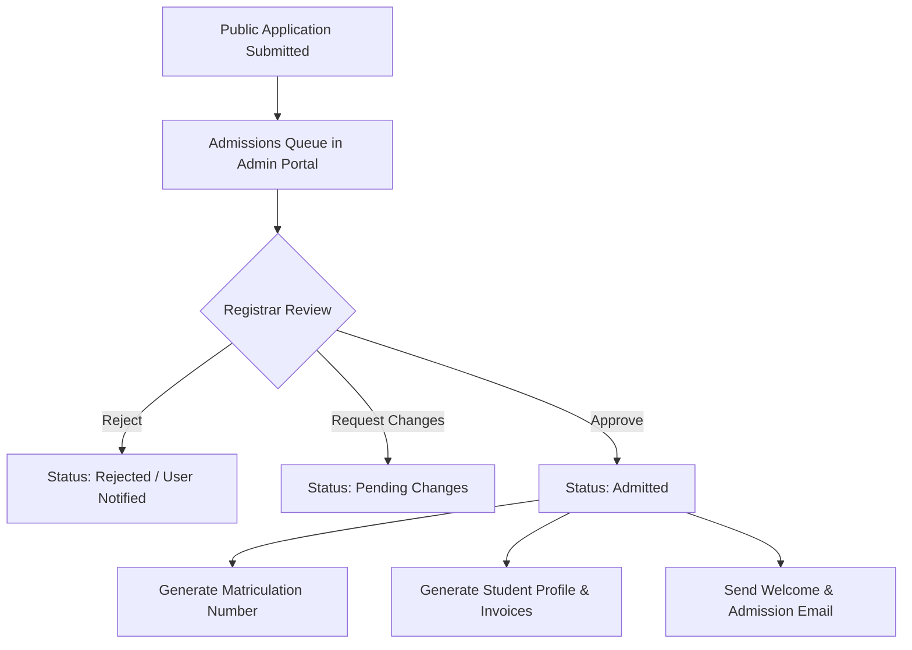

# JBI University Management System — Technical System Documentation

**Document Reference:** `docs/SYSTEM_DOCUMENTATION.md`  
**Version:** 2.0  
**Date:** October 13, 2026  
**Target Audience:** System Architects, Software Engineers, DevOps Engineers, and System Administrators  
**Framework:** Laravel 11.x | PHP 8.2+ | MySQL 8.x | Bootstrap 5  

---

## 1. System Overview & Technology Stack

The **JBI University Management System** is an enterprise-grade academic administration, learning management, and student governance platform designed for tertiary educational institutions. The platform handles the complete academic lifecycle from prospective student admission through enrollment, coursework, examinations, fee payments, and campus life governance.

### Technology Stack
- **Backend Framework:** [Laravel 11.x](https://laravel.com)
- **Programming Language:** PHP 8.2+
- **Database Engine:** MySQL 8.x / MariaDB 10.x with InnoDB storage engine
- **Frontend & UI:** Blade Templating Engine, Bootstrap 5.3, Bootstrap Icons, Vanilla JavaScript, Inter Google Font
- **Session & Cache Drivers:** Database / File / Redis
- **Mail Driver:** SMTP with queue support
- **Queue Driver:** Database / Redis / Sync

### High-Level Directory Layout
```
e:/Projects/JBI/
├── app/
│   ├── Http/
│   │   ├── Controllers/
│   │   │   ├── Admin/            # Central administration (Registrar, Academic Setup, Finance, HR)
│   │   │   ├── Faculty/          # Lecturer, Dean, and HOD management controllers
│   │   │   ├── Student/          # Student portal (Academics, Grades, E-Voting, Timetables)
│   │   │   └── Parent/           # Parent/guardian tracking controllers
│   │   ├── Middleware/           # Role verification, admission check, permission gates
│   │   └── Requests/             # Form request validation classes
│   ├── Models/                   # 70+ Eloquent models representing domain entities
│   ├── Policies/                 # Authorization policies (Announcement, Course, Exam, etc.)
│   └── Providers/
│       ├── AppServiceProvider.php   # Global view sharing (Currency, Timezone, Admissions)
│       └── AuthServiceProvider.php  # Gates, Policies, and SuperAdmin authorization bypass
├── bootstrap/
│   ├── app.php                   # Laravel 11 application pipeline & middleware configuration
│   └── providers.php             # Explicit service provider registration
├── config/                       # Application configuration files
├── database/
│   ├── factories/                # Data generation factories for models
│   ├── migrations/               # Database schema definitions
│   └── seeders/                  # Production and demo seeders
├── docs/                         # System analysis, review reports, and documentation
├── resources/
│   └── views/                    # Role-partitioned Blade templates
└── routes/
    ├── web.php                   # Application web routes (638 registered routes)
    ├── api.php                   # REST API endpoints
    └── console.php               # Artisan console commands
```

---

## 2. Authentication & Authorization Architecture (RBAC)

The system employs a dual-layer access control model: **Primary User Roles** combined with granular **Functional Area Permissions** and **Dynamic Administrative Role Appointments**.

### 2.1. Primary User Roles
The `users.role` field defines the core identity of an account:
1. `admin` / `super_admin`: Full administrative control across the institution.
2. `faculty`: Academic teaching staff (Lecturers, Senior Lecturers, Professors).
3. `student`: Enrolled university students with active student profiles.
4. `parent`: Guardians or sponsors linked to one or more enrolled students.
5. `bursar`: Financial officers managing fee structures, invoicing, and reconciliation.
6. `registrar`: Officers managing academic registry, transcripts, and admissions.
7. `hr`: Human resources staff managing staff profiles, contracts, and job postings.

### 2.2. Dynamic Academic Administrative Appointments
Academic leadership is dynamically assigned without altering the user's primary base role:
- **Deans:** Faculty members assigned to lead an academic division via `faculties.dean_id`.
  - Automatically acquire the `isDean()` identity.
  - Dynamically granted Dean administration permissions: `dean_administration`, `academic_quality`, `faculty_budget`, `student_support`, and `external_relations`.
- **Heads of Department (HOD):** Faculty members assigned to head a department via `departments.head_of_department_id`.
  - Automatically acquire the `isHeadOfDepartment()` identity.
  - Dynamically granted department management rights over department courses, programs, and assigned lecturers.

### 2.3. Permission Gates & SuperAdmin Bypass
Registered in [app/Providers/AuthServiceProvider.php](file:///e:/Projects/JBI/app/Providers/AuthServiceProvider.php):
```php
Gate::before(function ($user, $ability) {
    if ($user->isSuperAdmin() || ($user->isAdmin() && $user->role === 'super_admin')) {
        return true; // Super Administrator bypass
    }
});
```

---

## 3. Core Subsystems & Workflows

### 3.1. Admissions & Onboarding Workflow

1. **Public Application:** Prospective applicants submit their bio-data, selected program, and supporting documents via `/apply`.
2. **Review & Verification:** The Registrar verifies academic qualifications via `/admin/applications`.
3. **Matriculation:** Upon approval, the system assigns a unique matriculation number (e.g. `JBI/2026/FCS/001`), creates a linked `StudentProfile`, and initializes tuition fee obligations.

### 3.2. Academic Structure & Course Enrollment
- **Hierarchy:** `Faculty` &rarr; `Department` &rarr; `Program` (Degree/Diploma) &rarr; `Academic Year` &rarr; `Semester` &rarr; `Course`.
- **Course Assignment:** Courses are assigned to faculty lecturers (`courses.instructor_id`).
- **Enrollment:** Students register for active semester courses via the student portal. The system enforces prerequisite validation, maximum credit unit limits, and fee clearance checks.

### 3.3. Learning Management System (LMS) & Attendance
- **Course Materials:** Lecturers upload syllabus documents, lecture slides, and reading lists (`CourseMaterial` model).
- **Assignments:** Lecturers create assignments with strict submission deadlines, attachment allowances, and maximum marks. Students submit work online; lecturers grade submissions with feedback comments.
- **Quizzes:** Interactive online quizzes supporting multiple question types, time limits, auto-grading, and randomized questions.
- **Attendance Tracking:**
  - **Daily QR Check-in:** Faculty generate unique daily QR check-in codes via `/faculty/attendance/qr-code`. Students scan the code to log their presence.
  - **Manual Marking:** Lecturers can manually mark students as Present, Absent, Late, or Excused via `/faculty/attendance/create`.

### 3.4. Grading, Examinations & GPA Computation
- **Continuous Assessment (CA):** Assignments and Quizzes contribute to coursework totals (typically 30%–40%).
- **Final Examinations:** Examination scores are combined with CA to calculate final percentage grades.
- **Automated Grading Scale:**
  - 80% – 100%: **A** (4.00 Grade Points)
  - 70% – 79%: **B** (3.00 Grade Points)
  - 60% – 69%: **C** (2.00 Grade Points)
  - 50% – 59%: **D** (1.00 Grade Points)
  - 0% – 49%: **F** (0.00 Grade Points — Fail / Retake Required)
- **GPA / CGPA Calculation:** Grade points are weighted by course credit units to compute Semester GPA and Cumulative GPA. Failed courses trigger an automated `retake` flag.

### 3.5. Student E-Voting & Leadership Governance Subsystem
The E-Voting subsystem provides secure, automated democratic elections for the student body:
1. **Voting Sessions:** The Electoral Commission schedules election seasons (`VotingSession`) specifying target academic years and vetting windows.
2. **Positions:** Positions can be University-Wide (e.g. Student Union President) or Faculty-Specific (e.g. Technology Faculty Representative).
3. **Automated Academic Vetting Engine:**
   - Any student who submits a candidacy application is evaluated by `EVotingController::checkStudentHasRetake($userId)`.
   - If an active course retake, failed grade ('F'), or retake fee invoice is detected on the applicant's record, the application is **automatically disqualified** to preserve academic standards.
4. **Electoral Commission Review:** Eligible applications are vetted and approved by commission members.
5. **Secret Ballot & Tallying:** Admitted students cast their votes via `/student/evoting/sessions/{session}/ballot`. The system prevents duplicate voting using unique database constraints (`user_id` + `voting_position_id`). Results are tallies in real-time and published by the Commission.

### 3.6. Support Ticket & Help Desk Subsystem
- **Persistence:** Inquiries submitted via `/support` are persisted in the `support_tickets` table with a unique tracking code: `TIC-YYYYMMDD-XXXXX`.
- **Classification:** Category (`general`, `technical`, `academic`, `finance`, `admissions`) and Priority (`low`, `medium`, `high`, `urgent`).
- **Staff Dispatch Queue:** Administrators view, filter, and manage tickets via `/support`. Updating a ticket status (`in_progress`, `resolved`, `closed`) logs the administrative notes and triggers an instant notification to the submitter.

### 3.7. Announcements & Institutional Communications
- **Targeted Broadcasting:** Announcements support granular role targeting stored as JSON in `target_roles` (e.g. `['student', 'faculty']`).
- **Creator Relationship:** Managed through `created_by` foreign key referencing the authoring staff user.
- **Permissions:** Admin and Faculty can broadcast announcements according to [AnnouncementPolicy.php](file:///e:/Projects/JBI/app/Policies/AnnouncementPolicy.php).

---

## 4. Key Database Models & Schema Reference

### Core Domain Entities
| Model Name | Table | Description | Primary Key / Key Relations |
| :--- | :--- | :--- | :--- |
| `User` | `users` | Central identity entity for all accounts. | `id`, `role`, `supportTickets()`, `deanFaculties()` |
| `StudentProfile` | `student_profiles` | Academic record, matriculation number, year of study. | `user_id`, `department_id`, `program_id` |
| `Faculty` | `faculties` | Academic division (e.g. Faculty of Technology). | `id`, `dean_id` &rarr; `users.id`, `departments()` |
| `Department` | `departments` | Academic department (e.g. Computer Science). | `id`, `faculty_id`, `head_of_department_id` |
| `Course` | `courses` | Taught subject/module with credit units. | `id`, `department_id`, `instructor_id` &rarr; `users.id` |
| `CourseEnrollment`| `course_enrollments`| Enrolled students per course. | `user_id`, `course_id`, `semester_id`, `status` |
| `Grade` | `grades` | Official continuous assessment and exam grades. | `user_id`, `course_id`, `percentage`, `letter_grade` |
| `VotingSession` | `voting_sessions` | Electoral election period. | `id`, `academic_year_id`, `is_active`, `positions()` |
| `VotingCandidate`| `voting_candidates`| Vetted candidate running for a position. | `voting_position_id`, `user_id`, `status` |
| `Vote` | `votes` | Encrypted/anonymized student vote record. | `voting_session_id`, `voting_position_id`, `user_id` |
| `SupportTicket` | `support_tickets` | User help desk tickets. | `ticket_number`, `user_id`, `status`, `assigned_to` |
| `Announcement` | `announcements` | Institutional broadcast notices. | `id`, `created_by` &rarr; `users.id`, `target_roles` |

---

## 5. Security & Error Handling Architecture

### 5.1. CSRF & Form Validation
All web requests modifying state require valid `@csrf` tokens. Form inputs are validated through specialized `FormRequest` classes or inline controller validation.

### 5.2. Access Control Enforcement
- Administrative endpoints (`/admin/*`) require `auth` and `role:admin,super_admin`.
- Sensitive operations require explicit permission checks (e.g., `middleware('permission:finance,view')`).
- Appointed deans access `/faculty/dean/*` validated dynamically through `isDean()` checks.

### 5.3. Custom Error Pages
- **HTTP 403 Forbidden:** Managed via [resources/views/errors/403.blade.php](file:///e:/Projects/JBI/resources/views/errors/403.blade.php). Features role detection, direct dashboard routing, in-page sign-out, and technical support links.
- **HTTP 404 Not Found:** Handled gracefully with portal search fallbacks.
- **HTTP 500 Server Error:** Handled with secure, unexposed stack traces in production.

---

## 6. Operational Maintenance & Deployment Guide

### 6.1. Environment Configuration (`.env`)
Ensure the following variables are configured in production:
```ini
APP_NAME="JBI University"
APP_ENV=production
APP_KEY=base64:...
APP_DEBUG=false
APP_URL=https://portal.jbiuniversity.com

DB_CONNECTION=mysql
DB_HOST=127.0.0.1
DB_PORT=3306
DB_DATABASE=jbi_production
DB_USERNAME=jbi_db_user
DB_PASSWORD=SecurePasswordHere

QUEUE_CONNECTION=database
CACHE_STORE=file
SESSION_DRIVER=database

MAIL_MAILER=smtp
MAIL_HOST=smtp.hostinger.com
MAIL_PORT=465
MAIL_USERNAME=info@jbiuniversity.com
MAIL_PASSWORD=MailPasswordHere
MAIL_ENCRYPTION=ssl
MAIL_FROM_ADDRESS="info@jbiuniversity.com"
MAIL_FROM_NAME="JBI University"
```

### 6.2. Deployment Procedure
```bash
# 1. Pull latest code
git pull origin main

# 2. Install production dependencies
composer install --no-dev --optimize-autoloader

# 3. Run database migrations
php artisan migrate --force

# 4. Clear and warm up caches
php artisan optimize:clear
php artisan config:cache
php artisan route:cache
php artisan view:cache

# 5. Ensure storage symlink exists
php artisan storage:link
```

### 6.3. Background Daemon (Queue Worker)
To ensure prompt delivery of admissions notifications and support updates, configure a `supervisord` worker:
```ini
[program:jbi-worker]
process_name=%(program_name)s_%(process_num)02d
command=php /var/www/jbi/artisan queue:work database --sleep=3 --tries=3 --max-time=3600
autostart=true
autorestart=true
user=www-data
numprocs=2
redirect_stderr=true
stdout_logfile=/var/www/jbi/storage/logs/worker.log
```

---

*This document is maintained by the JBI University Engineering Team. Direct inquiries or updates to info@jbiuniversity.com.*
